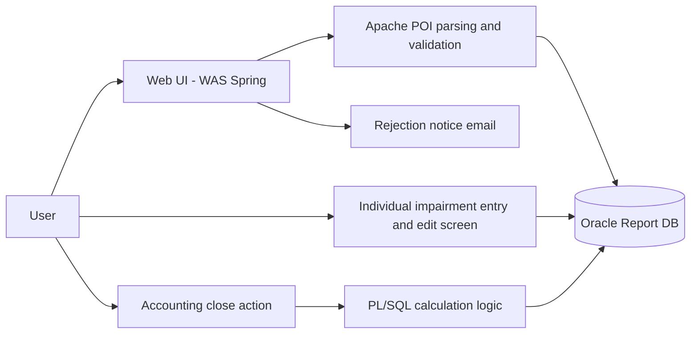
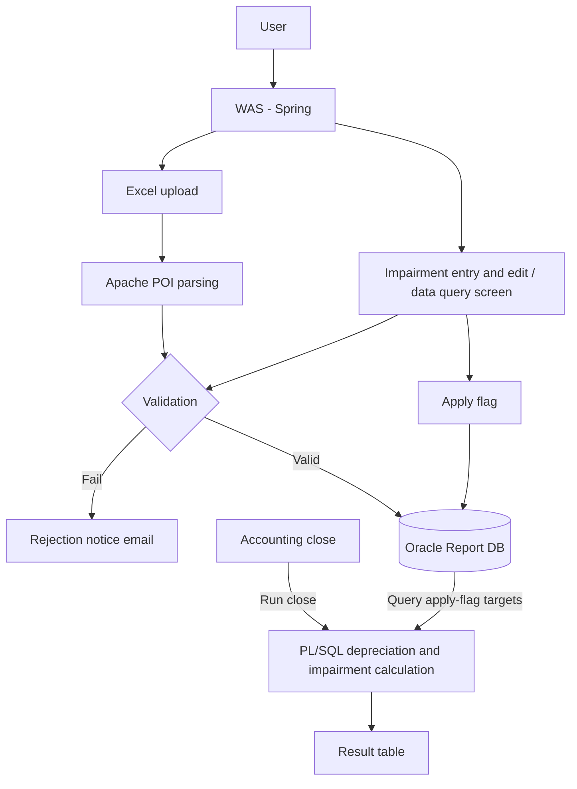
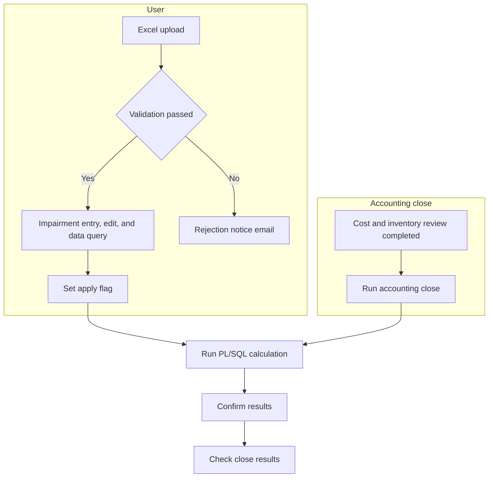
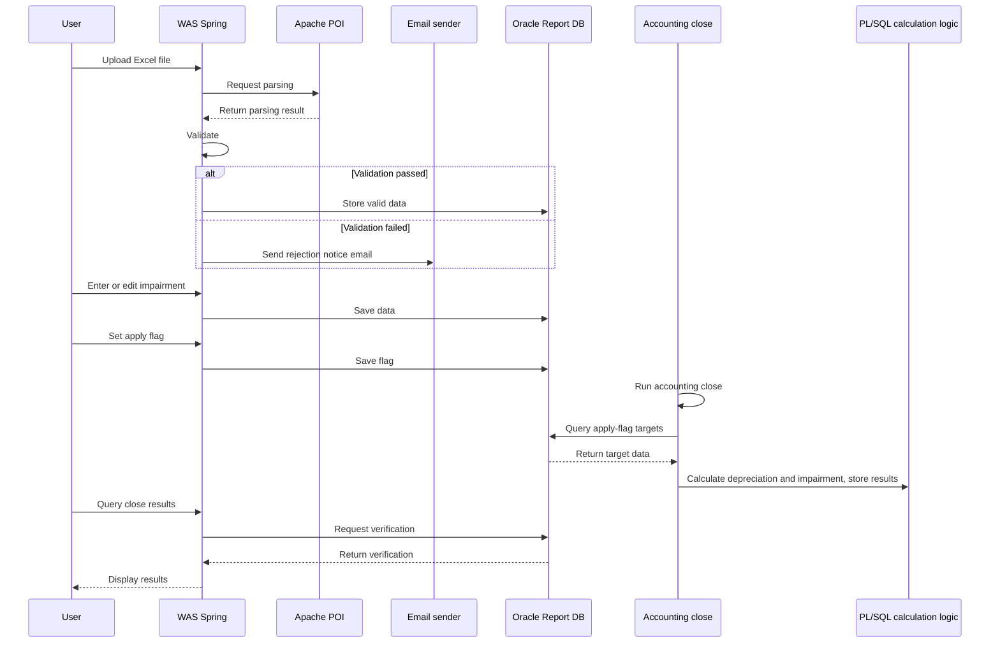

# Asset Impairment Loss System

A project that receives impairment losses on company-owned equipment through Excel upload, validates them, and automatically recalculates depreciation at the monthly closing.

## Background

All of the company's equipment is subject to depreciation. A depreciation system already existed that handled depreciation for each asset automatically at the monthly closing. The query screens of that system were provided in xPlatform, and they only displayed depreciation data.

The problem was impairment loss. When the value of an asset falls below its carrying amount for a specific reason, that difference is recognized as impairment, and depreciation for the remaining period must be recalculated. The system had no feature to support this, so the accounting team calculated it by hand in Excel and built the report every closing. The scope covered all equipment, the amounts were large, and the work repeated every month, so the burden was heavy, and a calculation mistake could turn directly into a closing error.

### How impairment loss affects depreciation (simplified example)

| Item | Amount | Description |
|---|---|---|
| Existing depreciation | 10 per month | Depreciation has been recorded up to 60 so far |
| Remaining carrying amount | 40 | Amount still to be depreciated over 4 more periods |
| Impairment loss | 15 | Additional amount to recognize because the asset value dropped |
| Carrying amount after impairment | 25 | 40 − 15 |
| Changed monthly depreciation | About 6 | 25 divided over the remaining 4 periods (from 10 to about 6) |

In other words, once impairment is recorded, the monthly depreciation of that asset changes, so the existing depreciation logic cannot be used as is, and the period after the impairment has to be calculated separately. (This is a simplified example to explain the concept. The actual calculation is more complex, depending on accounting standards and conditions of each asset.)

## Problems to Solve

- For an asset with impairment, monthly depreciation changes, but the existing depreciation logic could not reflect this, so it had to be recalculated by hand at every closing
- The scope covered all equipment, so the volume was high, and the manual calculation caused human error and closing delays
- Data was neither standardized nor centralized, making audit response and history tracking difficult
- The system had to keep the Excel format the accounting team already used while filtering out input errors

## Goals

- Audit response: produce depreciation data with impairment loss applied correctly under accounting standards, so it can be submitted without problems during the closing and the accounting audit
- Reliable automation: let practitioners create and validate impairment data with a standardized Excel upload and simple operations, without repeating complex calculations
- Higher efficiency: build a stable system that minimizes the human error possible in manual calculation and validation and speeds up reporting and closing work

## Architecture

Based on the company's existing standard architecture (WAS + DB), the roles were split: input, validation, and application run in the newly developed Spring WAS, and bulk calculation runs in PL/SQL on the DB. The existing xPlatform screens were left as they were for querying depreciation data, and impairment input and validation are handled on a new web screen.

Both the Excel upload and screen entry go through validation and are stored in the Report DB. At the accounting close, PL/SQL selects only the targets whose apply flag is on and calculates them.

**Why this structure**

- The calculation logic was kept in PL/SQL on the DB for consistency with the existing depreciation logic and for bulk calculation performance.
- xPlatform is a screen for displaying depreciation data and has no Excel upload or validation feature, so the part that receives and processes the accounting team's Excel was newly developed on a Spring-based WAS.
- Separating the validation, application, and closing logic raised both closing reliability and work efficiency.

**Tech stack mapping**

- Backend: Java, Spring Framework, Apache POI (upload, parsing, validation), JavaMailSender/SMTP (upload error and processing result notifications)
- Frontend: Kendo UI (Grid). The existing depreciation query screens stay in xPlatform
- Database: Oracle Report DB, PL/SQL (impairment loss calculation logic)
- Operations/Architecture: Based on the company's existing standard architecture (WAS + DB). Input, validation, and application run in the WAS, and bulk calculation runs on the DB

## Business Flow

The user path (Excel upload, validation, apply flag) and the accounting close path run separately and meet in the PL/SQL calculation at closing time.

In time order, the upload and entry stage and the closing stage are separate. At closing, the target data is queried, then calculated and stored.

## Responsibilities

- Requirements analysis and design: gathered requirements for impairment entries and the closing process with the accounting team and reviewed how they connect to the existing depreciation logic. Designed the staging table structure with the apply, validation, and closing flow in mind
- Excel upload and parsing: parsed the Excel files the accounting team prepares with Apache POI and implemented per-field validation. When validation fails, a rejection notice email with the reasons is sent
- Impairment entry and edit screen: developed a Kendo Grid screen and REST API for entering the impairment of an individual asset directly and adjusting it with +/− corrections
- Closing integration: analyzed and adjusted the integration points with the existing closing flow so that, at the accounting close, the DB calculation logic reads only the targets whose apply flag is on
- Testing: verified calculation results with test data and reflected feedback and errors found in practitioner testing

## Why These Technologies

- **Apache POI**: Chosen for reliable Excel parsing and data validation.
- **Kendo UI/Grid**: Chosen for a user-friendly UI and because it is the company's standard component.
- **JavaMailSender/SMTP**: Reused the standard email sending process as it was.
- **Oracle PL/SQL**: Chosen for bulk calculation performance and to reuse the existing DB environment.

## Troubleshooting

We ran into the usual range of problems during development and testing. The main ones were as follows.

- **Excel parsing errors**: When reading the Excel files prepared by the accounting team, parsing did not always work as intended. We made validation run right after parsing, so problem data was filtered out before it was stored in the DB and reported through a notification email.
- **Calculation result mismatches**: After applying impairment and running the close, there were several cases where the results did not match expectations. We checked the formulas and the data flow together and repeated testing until the results were correct.
- **Delays in getting test data**: Receiving the verification data from the accounting team took about a week on average. In the meantime we ran unit tests with sample data we created ourselves, and added verification once the real data arrived, which limited schedule disruption.
- **Integration with the existing closing logic**: Impairment loss had to fit into the trigger flow of the existing accounting close process, so it took time to understand when the close runs and how flags are handled. We analyzed the closing process and adjusted the integration points so the apply flag is reflected correctly.

## Technologies

- Java, Spring Framework
- Oracle, PL/SQL
- Apache POI
- Kendo UI (Grid), xPlatform

## Results

I handed over the work and left the company when development and practitioner testing were finished, so I could not confirm performance indicators from actual operation. Structurally, the system provides the following.

- Automatic validation on Excel upload filters out wrong input before it enters the DB, and impairment for individual assets can be entered and edited (+/− corrections) on screen.
- The flow from uploaded source, to validated data, to apply flag, to closing result table remains in the DB, which makes it easier to check and reconcile the basis and results of calculations.
- Separating "user input, validation, and application" from "running the accounting close" made permissions and responsibilities clear.
