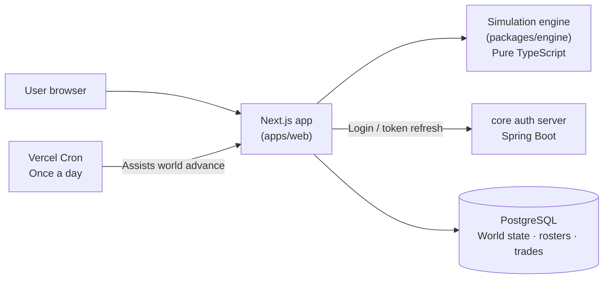
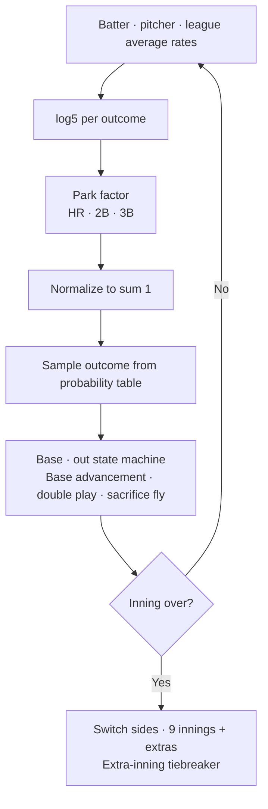
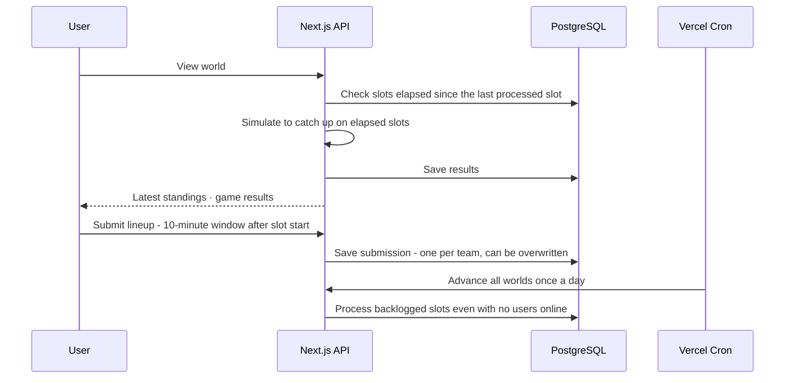
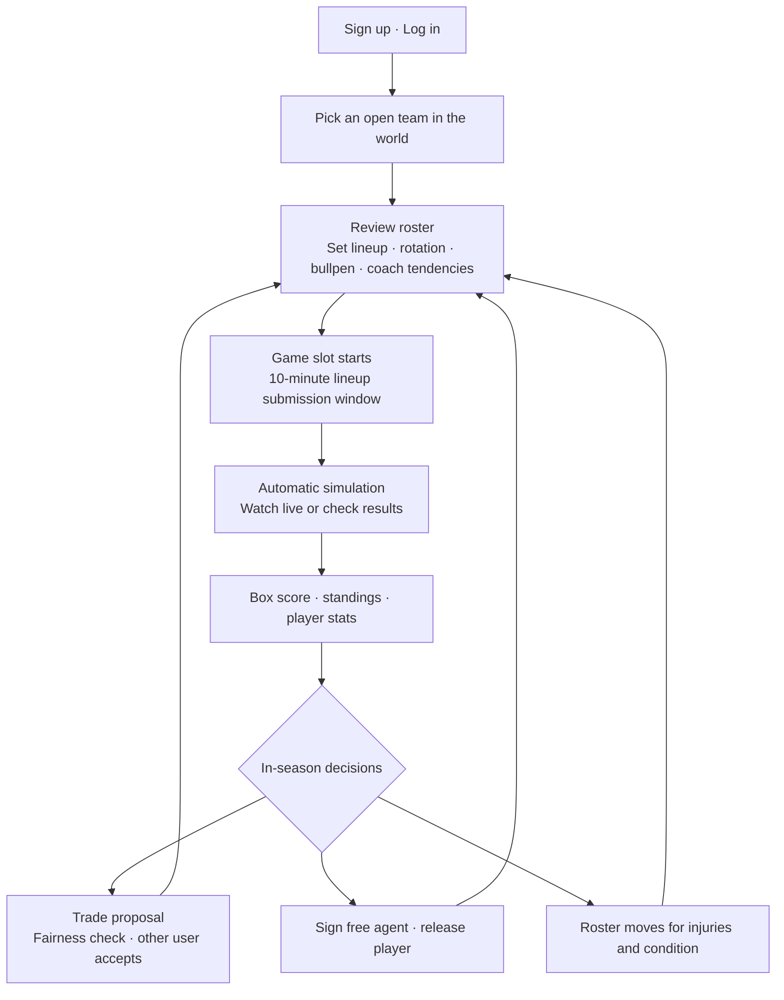

# Baseball Management Game

A web-based baseball management game. You build a team from the stats of real KBO and MLB players, decide lineups, pitching usage, trades, and free agency yourself, and the server carries the season forward. The game does not have a name yet.

## Background

It started from a sense of disappointment: soccer has Football Manager, but there are few games like it for baseball. OOTP Baseball is the original of the genre, but there is no version you can play lightly on the web. I decided to build one myself, where you can run a club in the browser and compete with friends in the same league.

The goal is numbers and decisions, not flashy graphics. Images such as player faces and emblems were left out from the start, and the screens center on box scores and text play-by-play.

## Problems to Solve

- Take real player stats as input and build a game simulation whose result distributions do not stray far from real baseball
- Instead of running a game to the end automatically, be able to stop at every point where a person may step in, such as pitching changes and tactical plays
- When several users share one league, the season must keep advancing while they are offline, and two users must not claim the same team or end up with a tangled trade
- Run all of this within a serverless environment and cost limits (free plans)
- KBO has no official public API, so the way to obtain data had to be decided first

## Goals

- Compute the result of one plate appearance with the log5 probability model, and extend it into inning, game, and season simulation
- Let people step into games through a manager mode (pitching changes, bunts, steals, and so on) and a coach system
- Build a world where several users each take a team, and the server advances games automatically at set times
- Complete a structure in which the season continues through trades, free agency, and the offseason

## Architecture

It is an npm workspaces monorepo, and the simulation engine is a pure TypeScript package completely separated from the UI. This lets the web app and a future mobile app share the same engine.



- **Engine (packages/engine)**: Handles log5 plate appearance calculation, the inning state machine, game, season, and world schedules, injuries, condition, and stamina, and trade evaluation. It does not depend on any framework and is verified with unit tests.
- **Web (apps/web)**: A Next.js app shell, the game screens, and API routes that act as the server. Internationalization (next-intl) and dark/light themes have been in place since the first commit.
- **Authentication**: Not built from scratch. The app only calls the REST API of a separate auth server (core) that is already in production. Login and token refresh are left to core, and this side verifies the issued JWT to identify the user.
- **DB**: PostgreSQL. World state is stored as a single JSONB row, while team claims, trade proposals, and lineup submissions are split into separate tables.

## Simulation Engine

The result of a plate appearance is simplified to one of eight outcomes: walk, hit by pitch, strikeout, single, double, triple, home run, or out. The batter's and pitcher's outcome rates are each compared with the league average and combined. It uses Bill James's log5 formula.

```
odds(x) = x / (1 - x)
oddsMatchup = odds(batter) × odds(pitcher) ÷ odds(league average)
P(outcome) = oddsMatchup / (1 + oddsMatchup)
```

The formula is applied to each of the eight outcomes and then normalized so the probabilities sum to 1. The park factor is applied only to home runs, doubles, and triples. An outcome is drawn from the resulting probability table and applied to the base and out state to advance the inning.



**What was deliberately simplified**: Left/right splits, batted-ball direction and speed, and defensive ability are not modeled. Applying log5 independently to eight outcomes is also an approximation that does not perfectly preserve the correlations between outcomes. In exchange, it cuts development effort substantially and keeps full-season simulation fast. Validation works by running a large number of plate appearances with sample players and comparing the outcome distributions, and by simulating seasons repeatedly at the team level to check that league-average figures do not stray far from real ones.

### Where a Person Steps In

Instead of running a game to the end in one go, the engine is designed as a step structure that can stop at every half-inning. This is a decision that is hard to change later, so it was built in from the start. Manager decisions go through the same interface in two ways.

- The user decides directly: pitching changes, bunts, steals, and so on
- When the user is away: decided automatically from a manager tendency profile (slider values such as steal aggressiveness, bunt tendency, and the threshold for pulling a pitcher)

A coach system sits on top of this. The pitching coach makes changes based on stamina and condition, the hitting coach calls for pinch hitters, the baserunning coach handles pinch runners and steal success rates, and the defensive coach swaps weak defenders for bench players. Tactical plays include failure cases as in real baseball (a missed bunt, the lead runner thrown out, and so on), so botched plays can happen.

## World Mode (Multiplayer)

Several users share the same league and each takes one team. The season has to move forward even when users are not connected, so the way it advances differs from single-player.



- **Pace**: One real 30-minute step is one in-game day. Ten steps open each day between 18:00 and 23:00 KST, and a rest day is inserted after every 7 games to approximate the rhythm of a real season.
- **Catch-up approach**: Instead of an always-on server running the games, each request that views a world simulates, all at once, the slots that have actually elapsed since the last one processed. If there is no slot to process, nothing happens, so it is safe to call any number of times (idempotent). Cron is only a backup for days when nobody logs in.
- **Lineup submission window**: A lineup can be submitted for 10 minutes after a game slot starts. If none is submitted, the game proceeds with an automatic lineup at the deadline. The remaining time is for watching the game.
- **League setup**: MLB and KBO are combined into one world. Trades are allowed only within the same league, and moves across leagues go through a shared free agent pool. Roster rules are also split: 26 players for MLB and 28 for KBO.
- **Season lifecycle**: The regular season, the MLB and KBO postseason brackets, and the offseason (free agency and the period after the trade deadline) advance automatically in line with the real calendar.

## Business Flow



## What I Worked On

I handled everything alone, from planning through implementation, deployment, and operations.

- Wrote the game design documents: roadmap (engine → one club → season → league → world → mobile), how player ratings are represented, and the data source policy
- Implemented and tested the simulation engine (over 300 tests): log5, the inning state machine, the injury probability model, condition and stamina, manager and coach decisions
- Season mode: schedule generation, standings, postseason, saving
- World mode: team claims, slot schedule, catch-up advancement, lineup submission, trade proposals and acceptance, roster rules
- Viewing screens: pitch-by-pitch play-by-play text, batted-ball direction and type presentation, a live diamond view, box scores
- Auth integration, internationalization (Korean and English) and themes, and an admin tool for entering roster data by hand
- Deployment and operations: Vercel deployment, connecting a self-hosted PostgreSQL, Cron

## Why These Technologies

- **TypeScript monorepo**: With the engine in pure TypeScript, the web app and mobile (Expo) can share the same simulation code. Switching the backend language to Java would have meant rewriting the engine already built, so everything was unified on TypeScript.
- **Next.js API routes**: At this scale, keeping the API inside the same app, without a separate server, made deployment and operations simpler.
- **PostgreSQL + JSONB**: Large structures that are read and written whole, such as world state, go in JSONB, while claims and trade proposals, where concurrency matters, are split into separate tables.
- **Outcome-based simulation**: Simulating down to pitch type and location for every pitch would be far more realistic, but it takes much more development. I started by drawing the plate appearance result directly from the probability table, and added the pitch and batted-ball descriptions in the play-by-play as presentation that does not affect the result.
- **Reusing core auth**: The app calls only the login API of the auth server already in production, so account management is not implemented twice.

## Troubleshooting

**1. The trade "throw-in" bug**

Trade fairness was checked by summing player values and accepting the trade if neither side lost more than a set ratio. But the value of a below-average player comes out negative, and adding a weak player to one side's package removed that negative from the total, so the package looked like it was "giving less". In practice, a trade that brought in a star player for one backup catcher, with the weakest reliever thrown in, went through.

- **Cause**: Individual player values were summed with their signs, so the more bad players were added, the easier the deal became.
- **Fix**: When summing a package, each player's value is now prevented from going below 0. The totals shown on screen use the same function, so the verdict and the display cannot disagree.
- **Also fixed**: A simple ratio comparison flips the inequality when values are negative, which made it pass trades even more generously. This was caught by a test and changed to compare the difference against a tolerance proportional to the size of the deal.

**2. Cron that never succeeded**

The Cron that assists world advancement was calling an endpoint that only accepted POST. Vercel Cron calls with GET, so it kept returning 405, and I did not notice because the response was not being checked. I switched the endpoint to GET and generalized it to loop over all worlds instead of one hardcoded world. If one world fails, the rest keep being processed. The free plan limits Cron frequency, so it runs once a day. The main advancement is handled by catch-up on view, so this was not a big problem.

**3. File edits disappearing on serverless**

The admin tool for entering KBO rosters by hand saved to a JSON file, but on a serverless deployment the filesystem is reset on every request and deployment, so edits did not take effect in production. I moved the roster source of truth into a PostgreSQL table, and the static JSON is now only the initial seed, used when the table is empty.

**4. Player ID collisions after mid-season trades**

Player IDs collided in the per-team structure for players traded during the season. I fixed it by prefixing player IDs with a team namespace.

**5. DB migration**

After exceeding the quota of a free managed DB, I moved the production DB to a self-hosted PostgreSQL. Because it uses a self-signed certificate, I added an environment variable that keeps the connection encrypted but turns off certificate verification. If we return to a managed DB with a public certificate, the variable only needs to be turned off. When the DB cannot be reached, the app does not crash and returns a safe JSON error that leaves out the connection string and password.

**6. Real-name data and how it is collected**

MLB offers public JSON, but KBO's official records have no public API, and the main stats sites block automated collection. Instead of scraping, I filled the rosters using an admin tool for manual entry. At the current non-commercial personal project level this is fine, but if the service grows I left open the options of formally reviewing data licensing and, if that does not work out, switching to a fictional league.

## Tech

- TypeScript, npm workspaces
- Next.js (App Router), next-intl, next-themes
- PostgreSQL (pg), JSONB
- Vitest (over 300 engine tests)
- Vercel (deployment, Cron), self-hosted PostgreSQL
- JWT verification, integration with an external auth server (Spring Boot)

## Current Status

The engine, season mode, and world mode (team claims, automatic advancement, trades, free agency, postseason, offseason notifications) all work. It is in a beta stage used with friends, and the plans going forward are:

- A review screen for looking back over games that were auto-played during the season and adjusting manager and coach tendencies
- Notifications for events that need a decision, such as injuries and trade requests
- A posting system between leagues
- An Expo-based mobile app
