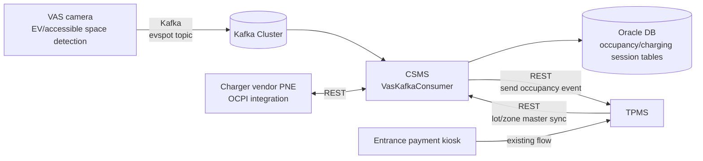
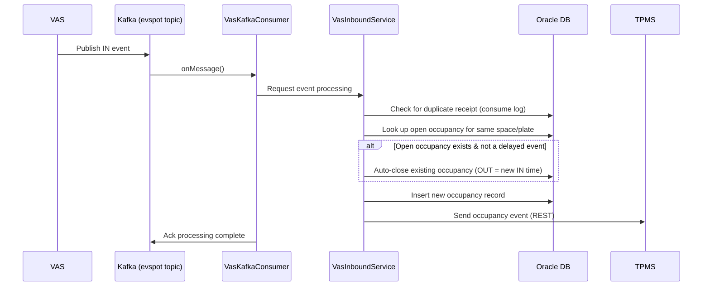

# Bucheon CSMS — EV Charging Management System

Took over an EV charging management system (CSMS) build from a developer who had left the company, and carried it alone through the remaining development, integration expansion, and audit review response.

## Background

The Bucheon site already runs a TPMS (Total Parking Management System). When a vehicle enters, the entrance payment kiosk reads the plate number and passes it to TPMS (discount eligibility is checked beforehand, for example through the Ministry of the Interior and Safety's low-emission vehicle lookup), and TPMS manages the parking data. A new VAS was then built: a camera-based video analytics system that watches EV and accessible parking spaces. When a vehicle parks in an EV-only space, VAS reads the plate and publishes an event to Kafka. CSMS was built to receive those events and decide and manage whether a given vehicle is currently charging.

The developer in charge left the company and the project was handed over. From understanding the structure through remaining development, new requirements, and audit review response, the work was effectively done alone.

## Problems to Solve

- At handover, the deliverables (such as the standard database design document) did not match the schema of the DB actually in production
- Some items marked "development complete" in the documents were not actually implemented
- VAS occasionally missed a vehicle's OUT event when it left an EV space, so the occupancy record for that space never closed and kept accumulating, producing bad data (occupancy times totaled in the thousands of hours)
- A new requirement: EV occupancy history had to be queryable from TPMS through an API
- Audit review response (secure coding, web vulnerabilities, web accessibility) was needed before the project ended

## Goals

- Understand the structure and unfinished items of the inherited project and complete the remaining development
- Fix at the root the occupancy data errors caused by lost VAS events
- Expand the TPMS integration so EV occupancy history can also be queried from TPMS
- Respond to audit review findings (secure coding, web vulnerabilities, web accessibility) and write an operations manual, leaving the project in a state that can be handed over

## Architecture

CSMS is a traditional MVC structure on Java 8 + Spring Framework (eGovFrame, the Korean e-Government Standard Framework), the same family of legacy stack as TPMS. It reaches the Oracle DB through MyBatis, receives real-time occupancy events from VAS over Kafka, and talks to TPMS over REST. There is also a separate OCPI-family integration with the charger vendor (PNE).

**Tech stack**

- Backend: Java 8, Spring Framework (eGovFrame), MyBatis
- Database: Oracle (RAC configuration), HikariCP connection pool
- Messaging: Kafka (spring-kafka), manual commit (manual ack) + a consume log table to prevent duplicate processing
- Other: Spring Batch/Quartz (periodic sync batches), Spring Security, Redis, log4j2

## Business Flow

IN/OUT events published by VAS are received over Kafka, the occupancy state is updated, and the result is passed back to TPMS.

The sequence in which the Kafka consumer receives and processes an event looks like this.

## Responsibilities

- Handover from the departed developer: went through each mismatch between the deliverables and the actual DB schema, and each item marked "complete" in the documents but not implemented, to understand the whole project structure
- Finished the unfinished features and fixed data mapping and aggregation errors (dashboard occupancy status, handling of data with missing exits, and so on)
- **Fixed the VAS occupancy loss bug**: the "thousands of hours parked" data error came from VAS occasionally failing to send an OUT event. Added logic so that when a new IN event arrives while an open occupancy record already exists for the same space (or the same plate number), the existing record is closed automatically. Also implemented an event time comparison guard so delayed or duplicate events are not closed by mistake
- **Expanded the TPMS integration**: developed a new API that delivers EV space occupancy events to TPMS over REST, so EV occupancy history can also be queried on the TPMS side
- Audit review response: organized deliverables such as the standard database design document, fixed secure coding findings, responded to the web vulnerability scan, and improved web accessibility
- Wrote the operations manual and developed the final requirements before deployment

## Troubleshooting

The biggest problem was the loss of VAS OUT events. When VAS failed to recognize a vehicle leaving a given space, that space's occupancy record stayed "in progress" forever, and the occupancy time shown on screen was abnormally totaled in the thousands of hours.

- **Cause**: since the OUT event was never published at all, nothing else in the system signaled when the occupancy ended.
- **Fix**: even without an OUT event, when a new IN event arrives for the same space (or the same plate number), the earlier occupancy is treated as already over and closed automatically. The end time is recorded as the time of the new IN event, not the processing time, to stay as close as possible to the real occupancy time.
- **Additional handling**: conversely, so that an IN event that arrives late does not wrongly close a newer, valid occupancy, a guard treats the event as delayed and ignores it when the open occupancy's start time is later than the new event. OUT events with no matching open occupancy (for example, when it was already closed automatically) are also ignored without raising an error.
- **Result**: the abnormal accumulation of occupancy time stopped, and cases where an automatic close happened are logged so they can serve as evidence for improving VAS recognition rates later.

## Tech

- Java 8, Spring Framework (eGovFrame), MyBatis
- Oracle
- Kafka
- Spring Batch, Quartz, Spring Security, Redis

## Result

Every mismatch between documents and the real system, and every unimplemented item, was identified and sorted out at handover, and the occupancy data errors caused by lost VAS events were resolved from the root cause. The integration was expanded so TPMS can also query EV occupancy history, and the project was closed out after responding to audit review findings (secure coding, web vulnerabilities, web accessibility) and writing the operations manual. Taking on everything from the handover through audit review response effectively alone, the project was brought to a completed state.
