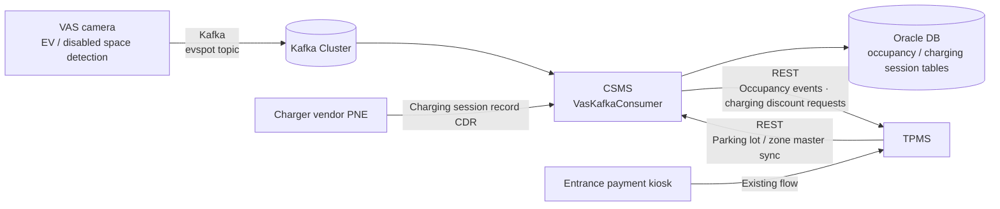
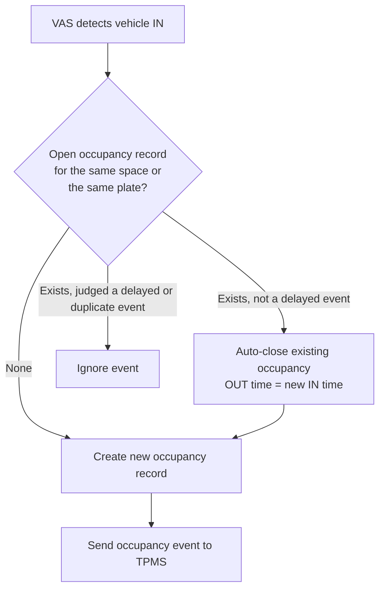
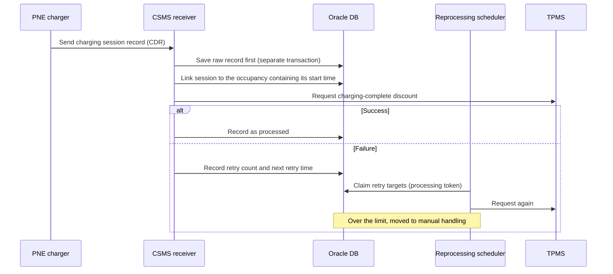

# Bucheon CSMS — EV Charging Management System

A project to build an EV charging management system (CSMS). The developer working on it left the company, and the project was taken over through a handover. As the lead developer, the unfinished features, the data consistency handling, the integration expansion, and the audit review response were all completed.

## Background

The Bucheon site already runs a TPMS (Total Parking Management System). When a vehicle enters, the entrance payment kiosk reads the license plate and passes it to TPMS (discount eligibility is checked beforehand, for example through a low-emission vehicle lookup via the Ministry of the Interior and Safety), and TPMS manages the parking data. This time a new VAS was built (a camera-based video analysis system that watches EV and disabled-parking spaces). When a vehicle parks in an EV-only space, VAS reads the plate and publishes an event to Kafka. CSMS was built to receive that event and decide and manage "is this vehicle charging right now?" The chargers are the vendor's equipment (PNE). When charging ends, a charging session record (CDR) is sent to CSMS, and a charging discount is applied in TPMS based on it.

The previous developer's departure meant taking over the project. It was handed over as finished according to the documents, but once the structure was worked out, some data did not match and some termination handling was not working properly. From April these were checked one by one and fixed, and before the project ended the work extended to audit review response and writing the operations manual.

## Problems to Solve

- At handover, the deliverables (such as the standard database design document) did not match the actual production DB schema
- Some items marked "development complete" in the documents were not actually implemented
- **Records left open** broke consistency. When VAS missed a vehicle leaving, the space occupancy never ended. When a session was not closed properly at the charger, the charging session stayed "charging," so charging time showed up as abnormally long or the data got tangled
- A structure was needed so that data stays consistent even when the integration that applies the discount to TPMS after charging fails or is duplicated
- A new requirement: TPMS also had to be able to query EV occupancy history through an API
- Audit review response (secure coding, web vulnerabilities, web accessibility) was needed before the project ended

## Goals

- Understand the structure and unfinished items of the inherited project and complete the remaining development
- Automatically clean up "records left open," such as occupancy and charging sessions, and keep consistency even with delayed, duplicate, and corrected data
- Extend the TPMS integration so EV occupancy history can also be queried from TPMS
- Respond to the audit review findings and wrap up the project with the operations manual

## Architecture

CSMS has a traditional MVC structure based on Java 8 + Spring Framework (eGovFrame, the Korean e-Government Standard Framework), the same family of legacy stack as TPMS. It accesses the Oracle DB through MyBatis, receives real-time occupancy events from VAS over Kafka, and communicates with TPMS through REST APIs. An integration with the charger vendor (PNE) exchanges charger information and charging session records (CDR).

**Tech stack**

- Backend: Java 8, Spring Framework (eGovFrame), MyBatis
- Database: Oracle (RAC setup), HikariCP connection pool
- Messaging: Kafka (spring-kafka), manual commit (manual ack) + consumption log table to prevent duplicate receipt
- Other: Spring Batch/Quartz (periodic sync batch), reprocessing scheduler, Spring Security, Redis, log4j2

## Business Flow

The flow receives the IN/OUT events published by VAS over Kafka, updates the occupancy state, and passes the result back to TPMS.

The sequence in which the Kafka consumer receives and processes an event is as follows.

When charging ends, the charging session record (CDR) sent by the charger vendor is processed in this order.

## Responsibilities

- **Handover from the departed developer**: Worked out the overall project structure by checking, one by one, the mismatches between the deliverables and the actual DB schema, and the items marked "complete" in the documents but not implemented or unfinished
- **Fixed lost occupancy in VAS**: VAS intermittently failed to send OUT events, so occupancy never ended. Handled this by auto-closing the existing record when a new IN event arrives for the same space (or the same license plate). Also implemented an event-time comparison guard so delayed or duplicate events are not closed by mistake
- **Charging session (CDR) consistency handling**: Implemented a processing structure that cleans up sessions that were never closed and data that had drifted. It includes saving the received raw record first, distinguishing duplicates from corrections, processing status and retries, moving records to manual handling when the retry limit is exceeded, recovering records that stalled mid-processing, occupancy linking rules, and transaction separation
- **TPMS integration**: Stabilized the discount-application call after charging completes, passed EV space occupancy events to TPMS, and developed a new API that lets TPMS query EV occupancy history
- **Dashboard fixes**: Handling of records with no exit data, license plate mapping errors, previous-day and previous-month cumulative aggregate mapping, and improvements to the event detail screen
- **Audit review response**: Code fixes for secure coding findings, item-by-item fixes for the web vulnerability and web accessibility remediation reports, and cleanup of deliverables such as the standard database design document
- **Operations manual**: Written and delivered at the client's request

## Troubleshooting

**1. Occupancy records piling up without ending**

When VAS failed to detect a vehicle leaving a particular space, that space's occupancy record stayed "in progress" forever, and the occupancy time shown on screen was abnormally aggregated in the thousands of hours.

- **Cause**: The OUT event was never published at all, so the system had no other signal to decide when the occupancy ended.
- **Fix**: Even without an OUT event, when a new IN event arrived for the same space (or the same license plate), the earlier occupancy was treated as already finished and closed automatically. The end time was recorded as the time of the incoming IN event rather than the processing time, to keep it as close as possible to the actual occupancy time.
- **Additional handling**: So that a delayed IN event arriving late does not wrongly close a newer, valid occupancy, an event was treated as delayed and ignored when the open occupancy's start time was later than the new event. An OUT event with no matching open occupancy is also ignored without an error.
- **Result**: The abnormal accumulation of occupancy time went away, and cases where auto-close happened are logged so they can serve as evidence for improving VAS recognition rates.

**2. Charging sessions not ending, or data drifting**

At handover this was recorded as complete, but the consistency handling on the charging session side was not sufficient. When a session was not closed properly, a charge that had already ended stayed "charging," so charging time looked abnormally long. A delayed end record could also be linked to the next vehicle's occupancy by mistake, which tangled the data.

- **Save the raw record first**: When a charging session record is received, the raw record is committed in a separate transaction before any session or vehicle lookup or TPMS call. Even if later processing fails, the raw record remains and can be reprocessed.
- **Distinguishing duplicates from corrections**: When the same record arrives again, its content is compared to tell a simple duplicate from a correction, and a log is written.
- **Occupancy linking rule**: The session is linked to the occupancy that contains its start time, not to the vehicle present at the time of receipt. This prevents a delayed end record from attaching to the next vehicle's occupancy. Records whose entry/exit matching is ambiguous are separated into their own status.
- **Status and retries**: Each record keeps a processing status, a retry count, and a next retry time. Retry targets are claimed with a processing token so they are never processed in two places at once. Records that stalled mid-processing are recovered, and records over the retry limit are moved to manual handling.
- **Transaction separation**: Processing for different parking lot paths was separated so that a failure on one side does not roll back charging record processing for another parking lot.
- **Failure propagation**: When the charging-complete discount call fails, the result is passed back to the caller, so the save does not appear to have succeeded.

**3. Dashboard data mismatches**

On the dashboard, records with no exit data stayed shown as "in use," and license plates were linked incorrectly. These had the same root as the first two problems (occupancies and sessions left open), so the consistency handling was fixed first and the dashboard aggregation and mapping were aligned afterward. The logic for records with no exit, the license plate mapping, and the previous-day and previous-month cumulative data mapping were corrected, and infinite scroll was applied to the event detail screen.

## Audit Review Response

Before the project ended, the audit review raised findings on secure coding, web vulnerabilities, and web accessibility.

- **Secure coding**: There were many findings, so from late April to early May the code was fixed item by item. Several types of findings, including exception handling, were addressed, and some of the files were split up and handled with help from a teammate.
- **Web vulnerabilities and web accessibility**: Each item in the inspection reports received was checked and fixed. This included tightening query conditions.
- **Regression checks**: Work continued to restore features that stopped working after the fixes.

## Technologies

- Java 8, Spring Framework (eGovFrame), MyBatis
- Oracle
- Kafka
- Spring Batch, Quartz, Spring Security, Redis

## Outcome

The mismatches between documents and actual system, and the unimplemented and unfinished items, from the handover were checked and cleaned up. Data errors caused by records left open, such as occupancy and charging sessions, were handled from the root cause. Charging session processing that saves the raw record first and includes retries and a manual handling stage keeps data consistent through temporary failures and delayed data. The integration was extended so TPMS can also query EV occupancy history. The project was wrapped up by responding to the audit review findings and providing the operations manual to the client.
