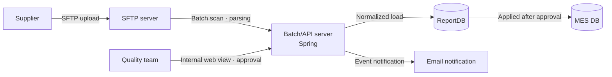
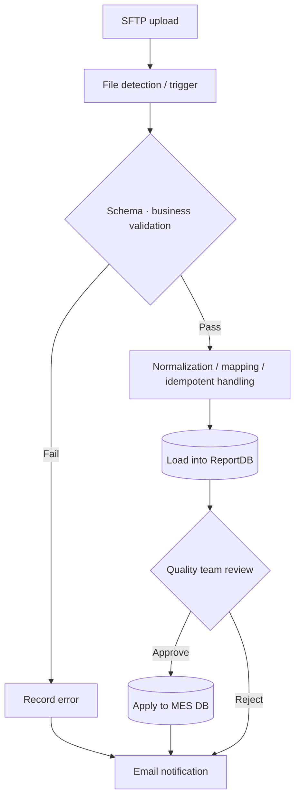
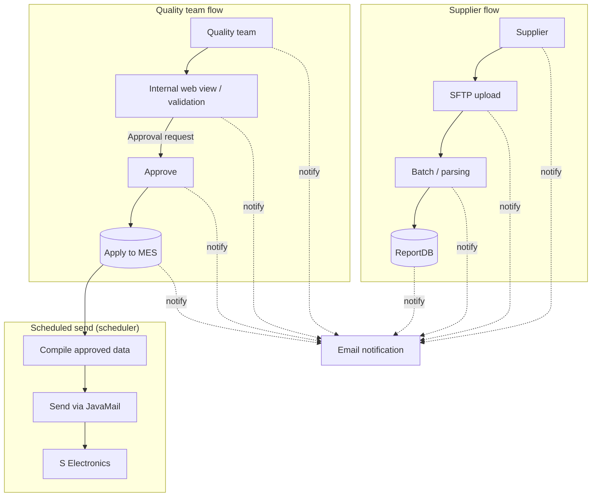
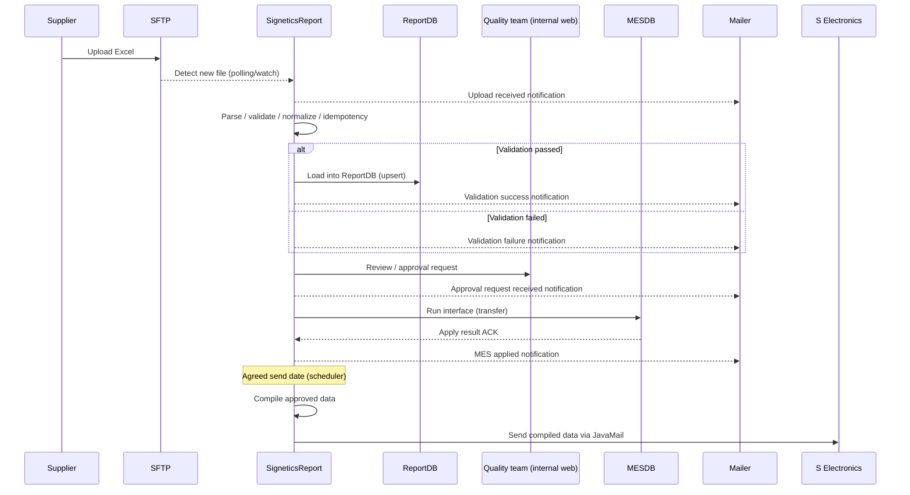

# CoA Data Collection & Validation System

Designed and built a system that automatically collects, validates, and approves supplier CoA data over SFTP. It reduced security risk and greatly improved the quality team's efficiency and data reliability.

## Background

A Certificate of Analysis (CoA) is quality data for the materials (consumables and parts) used in semiconductor packaging processes. Originally, material suppliers sent this data, and the quality team compiled it and submitted it to the client, S Electronics.

The problem was that the data passed through human hands once along the way. From S Electronics' point of view, it could not rule out the possibility that the quality team might alter data while compiling it, so it required a structure where supplier data is delivered as is, without quality team involvement. The initial requirement was for suppliers to connect to the internal web system directly from outside and enter data, but opening an external access path into the internal network was too large a security risk. So I proposed an alternative: issue an SFTP account to each supplier, have a scheduler periodically check the upload directory, and parse any Excel files found and load them into the DB.

## Problem

- Lower data accuracy and traceability caused by the manual, Excel-based process
- The possibility of data manipulation or distortion because the quality team was involved in compiling the data. This was S Electronics' biggest concern.
- A conflict with security policy caused by the initial requirement that external suppliers connect directly to the internal web system
- Lower efficiency and rework caused by quality team staff repeatedly validating and sending data

## Goals

- Design a structure that can collect and store supplier data safely
- Standardize and automate data entry through SFTP uploads and automatic parsing on the server
- Set up a system where the quality team can view and validate data in real time through a web system
- Minimize security risk and ensure data reliability

## Architecture

The system consists of an SFTP server, a batch/API server (the same server), ReportDB, and the MES DB. The batch and API features were developed by adding them to the existing Spring Framework-based internal web server, without setting up a separate new server.

The data flow branches step by step, from upload through validation and approval to MES. At the validation step, the system detects values outside defined thresholds and blank required fields, treats them as failures, and sends an email notification at every step.

**Why this structure**

- **Security and network separation**: Instead of letting external suppliers connect to the internal web directly, SFTP uploads provided a one-way collection path. This minimized the attack surface and made audits easier.
- **Standardization and automation**: The batch normalizes and validates the SFTP files and loads them into ReportDB, which automated the compiling and validation work that people used to do.
- **Quality gate**: ReportDB serves as the first loading and validation layer, and only approved data is interfaced to MES, which stops bad data from propagating downstream.
- **Audit traceability**: Original files, parsing logs, and validation results are stored separately, which made history tracking, reprocessing, and root cause analysis easier.

**Tech stack mapping**

- SFTP server: user and key management, separate upload directories per supplier
- Batch/API server (Spring): the batch handles scheduling, file parsing (Apache POI), validation/normalization, and idempotency keys. The API handles quality team lookups and approvals, interface triggers, and monitoring/error reports.
- ReportDB: first-stage loading schema (original / normalized / validation status tables)
- MES DB: final storage for approved data only (interface tables/procedures)

## Business Flow

There are two flows, one for suppliers and one for the quality team, each running on its own and joining at email notifications for major events. Separately from being applied to MES, approved data is compiled and sent by email on the dates agreed with S Electronics. The quality team is not involved in this final sending step and cannot edit values. A fixed scheduler compiles and sends the data mechanically.

The sequence below shows approval, rejection, and error points in time order.

## What I Did

- Analyzed requirements and designed the business flow, system architecture, and ERD myself
- Replaced the initial "allow external access" requirement with a counterproposal of an SFTP upload-based structure, removing the security risk
- Designed a normalized schema covering original data storage, validation status management, and event/notification logs, and wrote the PL/SQL procedures
- Developed the scheduler that automatically compiles approved data and sends it by JavaMail on the dates agreed with S Electronics, implemented so that it runs mechanically without quality team involvement
- Developed on my own the quality team's user screens, from design through the frontend (Kendo UI/JavaScript) and the Spring MVC-based backend APIs
- Implemented the Apache POI-based Excel parser and turned the validation rules into a rule engine
- Built automatic email notifications for all events, including upload, validation, approval, and loading
- Built the batch scheduler and the error reporting/monitoring log system
- Worked with the infrastructure team to open the SFTP port and set the directory policy

## Why These Technologies

- **Reusing existing infrastructure**: Since new servers or additional resources were not available, the features were added to the existing Spring Framework project.
- **Oracle-based optimization**: The existing DB was Oracle and policy did not allow introducing a new DB, so some logic was implemented in PL/SQL and MyBatis was used to keep changes to the existing integration minimal.
- **Choosing SFTP**: Internal network policy did not allow external access, so the design used SFTP uploads with automatic parsing instead of direct web entry.
- **Simplicity and extensibility together**: With few options available, the system was kept as simple as possible using existing resources, while log and event management kept it maintainable.

## Troubleshooting

In the early period, uploads failed often because of user input errors: typos in Excel headers, mismatched sheet names or column order, missing required values, merged cells, and so on. The spec had not been communicated well enough, and the validation failure messages did not make it easy to see right away which cell failed and why.

- Distributed a common Excel template for all suppliers, with required columns and sample data spelled out
- Used specific error messages with row/column position, field name, and expected vs. actual value so that users could fix problems themselves
- Added a pre-validation step that checks sheet names, headers, and column count as soon as a file is uploaded
- Reworked the parsing/validation logic to skip error rows and keep loading the valid data
- Prevented recurrence through template version management and monthly sharing of failure cases

## Technologies

- Java, Spring Framework, MyBatis
- Oracle, PL/SQL
- Apache POI
- Kendo UI, JavaScript
- Spring Scheduler, JavaMailSender/SMTP
- SFTP

## Results

The repetitive manual compiling and validation process was fully replaced by a single SFTP upload-based process. After the early file format errors were resolved and the system stabilized, it has run without major incidents. With approval steps and error reports automated, the quality team's workload decreased, and the reliability and delivery speed of the reports improved as well. Above all, the structure removed the point S Electronics worried about most, which was the possibility that the quality team could alter values while compiling data. Approved data is compiled and sent by the scheduler as is, without passing through human hands. This delivered a system that keeps to internal security policy while still being able to prove the reliability of the data, and it received a positive evaluation in an internal security audit.
