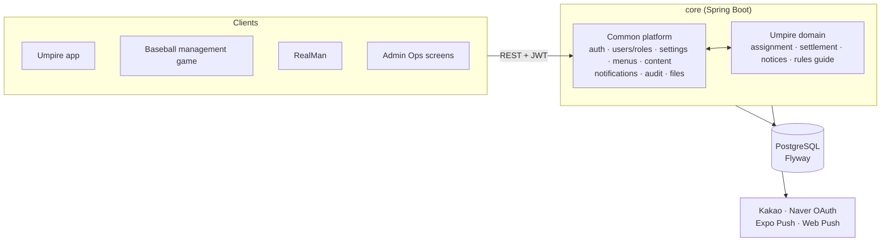
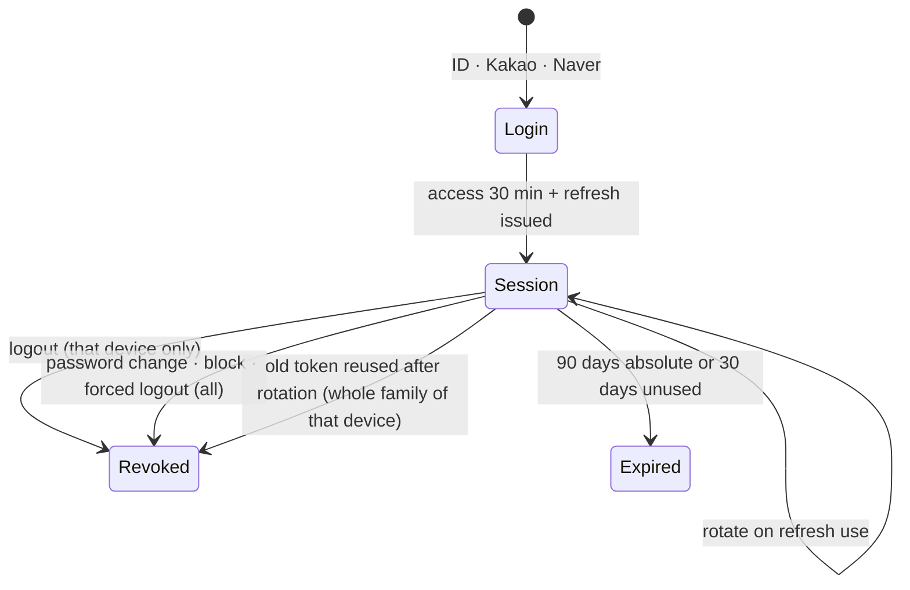
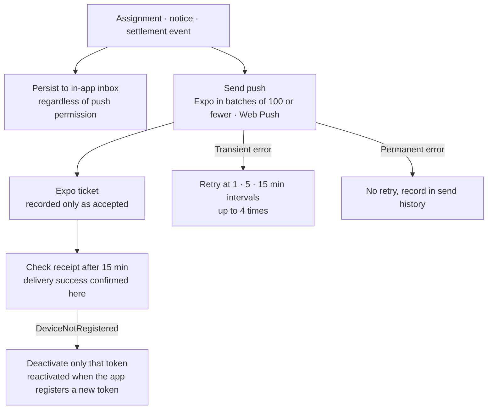

# Empire Core Platform — Shared Auth & Notification Backend

A shared platform that gathers the accounts, login, permissions, notifications, and auditing that multiple services need over and over into a single backend. The umpire assignment and settlement domain ([Umpire platform](/en/projects/umpire-platform)) runs on top of it in the same codebase, and other personal projects use this authentication over REST. This document covers **the platform side, not the domain**: authentication and sessions, push delivery, auditing, and the structure for adding services.

## Background

If every new service rebuilds sign-up, login, social login, token refresh, roles, and notification delivery from scratch, security policy ends up different in each service and operating standards get scattered. Splitting these into separate services from the start, on the other hand, costs more in deployment and contract management than it saves at a scale run by one person. So the common features are kept in one platform, and each service's own logic is separated into packages on top of it.

## Problems to Solve

- If each service has its own authentication, session, and permission policy, there are more places for a security incident to occur
- A mobile app needs long-lived sessions, but stolen tokens, or a logged-out device that keeps access, must be prevented
- "Sent" and "delivered" are different things for push, and a way to trace the cause of failures is needed
- Administrator actions and important changes must be traceable afterward
- Adding a new service should not require rebuilding the user and role model

## Goals

- Provide authentication, roles, notifications, and auditing consistently in one place
- Separate users, menus, and settings per service by service type while sharing the authentication code
- State the token policy in a document and pin it with code and tests
- Keep service domain code depending on the common platform, so it can be split out later

## Structure

- **Common platform** (`com.empire.core`): authentication, users and roles, per-service-type settings, menus, and content, file metadata, notifications, audit logs, schedulers, and common responses and exception handling
- **Service domains** (`com.empire.service.*`): currently just Umpire. It runs in the same JAR and the same DB, but with a package boundary, and the principle is that services call core
- **Service types**: UMPIRE, REALMAN, FRONTOFFICE. A user belongs to one service, and menus, settings, and role scope are divided per service
- **Schema management**: PostgreSQL + Flyway. Hibernate only runs `validate`, and every change is made through migration files (more than 60)

### Why a Single JAR to Start, and Its Limits

The services could have been split into separate processes, but at a scale run by one person, the cost of separate service contracts, deployment, and monitoring was judged to outweigh the benefit. Instead, the dependency direction is kept so that a path to splitting stays open. For now, some places remain where core's schedulers and admin screens call the Umpire service directly, so before splitting, the ownership of user and role data, the event contract between services, and the transaction boundaries of settlement, assignment, and notifications must be decided first. These prerequisites are written up in a document.

## Authentication and Token Policy

The token policy is stated in a separate document, and the code and tests follow it.

- **Access token**: 30 minutes. It is never left in logs or URLs.
- **Refresh token**: split into per-device and per-browser sessions, and rotated into a new token on every refresh. The DB stores only the SHA-256 hash instead of the raw token, along with the session family and the expiry, revocation, and last-used times. It lasts at most 90 days and expires after 30 days unused.
- **Reuse detection**: a duplicate request right after rotation may be a network retry, so a 10-second grace period is allowed. If the previous token is used again after that, it is treated as theft and that device's session family is revoked.
- **Immediate logout**: access tokens are also validated against the session family, so the remaining access tokens of a device that logged out or was force-revoked are rejected right away.
- **Revocation scope**: logout revokes only the current device. A password change, an account block, or an administrator's forced logout revokes all sessions.
- **Admin web**: uses an HttpOnly refresh cookie and refreshes automatically on a 20-minute cycle, when the screen is revisited, and on a 401 response.
- **Social login**: Kakao and Naver. Separate apps were created for development to keep them apart from the production app settings.

### Integration with Other Services

External services call only core's authentication API (login, sign-up, token refresh, social login) over REST. The baseball management game is one example: it leaves accounts and login to core and verifies the issued JWT on its own server to identify the user. Users are not created separately for each service, and a new service is accepted by adding a service type.

## Push Notification Delivery

Push delivery is not considered done at "the API was called". It is tracked through to actual delivery.

- **The source of the event is server data**: push is a supplementary way to signal changes. Every common send event is also stored in each user's in-app inbox, regardless of push permission or whether a token exists.
- **Acceptance and delivery are separate**: an Expo ticket is recorded only as accepted, and delivery success is confirmed only after checking the receipt 15 minutes later.
- **Multiple devices per user** are allowed, and a push token is not a means of authentication.
- **Coverage check**: every day, the system checks for active, opted-in users who have neither an Expo token nor a web push subscription. This list must be 0 before going to production.
- **Incident criteria**: it counts as an incident when receipt waiting runs 30 minutes or more behind schedule, or when retry waiting runs 10 minutes or more behind.

## Audit Logs and Operational Tracing

- Administrator actions and important changes are written to the audit log explicitly in service code. The state before and after the change and the target are recorded, so the cause can be traced.
- Audit logs are kept daily as JSONL files and then cleaned out of the DB.
- An audit workflow checks production push status every night, and verifies whether any active user cannot receive push.

## Responsibilities

Planning, design, development, deployment, and operations were all handled alone.

- Designed the package responsibility boundary between the common platform and service domains
- Sign-up, login, social login, session rotation and reuse detection, logout, and forced revocation
- Permissions based on service type and role, and management of menus, settings, and content
- Push delivery pipeline (acceptance, receipt check, retry, token deactivation) and the in-app inbox
- Audit logs, the retention scheduler, and the operational check workflow
- Flyway migrations and integration tests based on Testcontainers
- Token policy document, production cutover checklist, and deployment and rollback workflows

## Troubleshooting

**1. Authentication 500 for a user who re-registered after withdrawing**

The authentication lookup that runs on every request did not filter out deleted users. Once the ID was scoped per service type, an "old withdrawn account" and a "new account re-registered with the same ID" could coexist, so the lookup returned two rows and every authenticated request from that user returned 500. The lookup was fixed to query only users that are not deleted, the risky query was removed, and this scenario was pinned with an integration test.

**2. OAuth callback URL behind a reverse proxy**

The callback URL for admin social login was built incorrectly as `http://host:80/...`. Behind the proxy that terminates TLS, the app used the request's scheme and port as they were. It was changed to build the absolute URL from the proxy headers, and a security configuration gap that was blocking the callback path before authentication was fixed along with it.

**3. Production audit workflow failing every day**

The production push audit workflow compared against a hardcoded Flyway schema version, so it failed every night without exception each time a migration was added. The latest version is now computed at run time from the migration folder. An unused test account flagged in the same audit was confirmed and cleaned up.

## Why These Technologies

- **Spring Boot 3 + Spring Security + JWT**: because the API is stateless, mobile apps, the web, and other services all authenticate the same way. Only refresh tokens are managed in the DB for sessions, so the server can control rotation and revocation.
- **PostgreSQL + Flyway**: the schema is managed as code, and Hibernate only validates so the production DB and the code do not drift apart.
- **Testcontainers**: parts where DB behavior matters, such as concurrency in session rotation or the withdraw and re-register scenario, are verified against a real PostgreSQL.
- **Expo Push + Web Push**: covers both mobile and web at no extra cost. Paid channels such as Kakao AlarmTalk were put on hold because the benefit was low for the cost.

## Tech

- Java 17 / Spring Boot 3.5
- Spring Security / JWT
- Spring Data JPA / Flyway / PostgreSQL
- Thymeleaf (admin screens)
- Testcontainers / JUnit 5 / Mockito
- Kakao · Naver OAuth, Expo Push, Web Push (VAPID)
- Docker / GitHub Actions (deployment, rollback, production audit)

## Current Status

The Umpire service is in real operation on this platform, and the baseball management game uses its authentication over REST. The scheduler has no distributed lock, so duplicate runs must be prevented first before adding instances. That point, and the prerequisites to settle before splitting out the domains, are tracked in documents.
