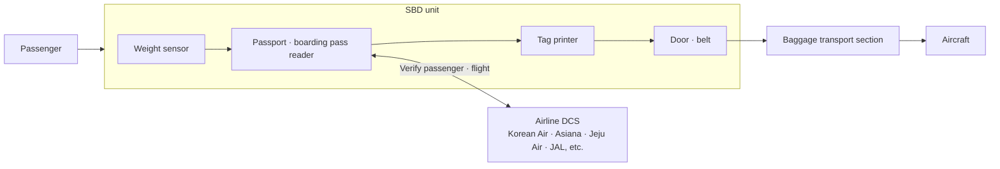
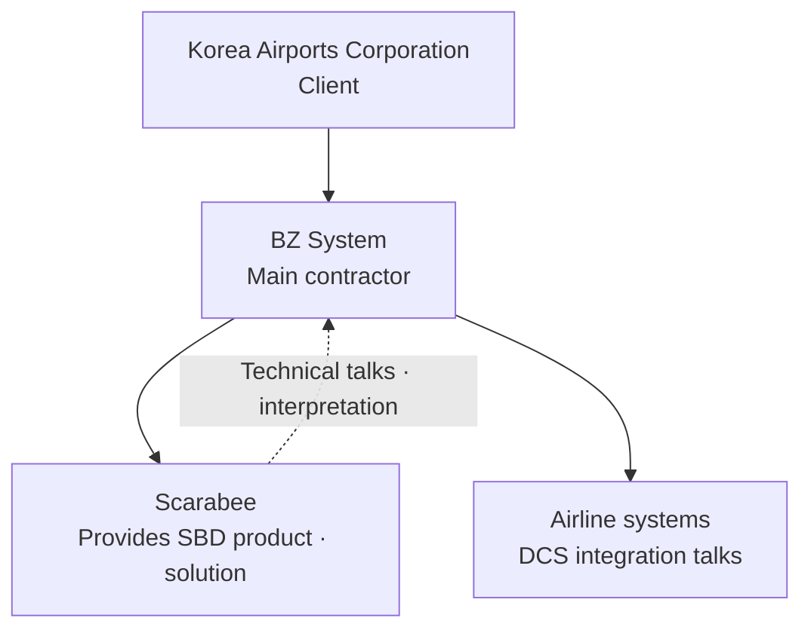
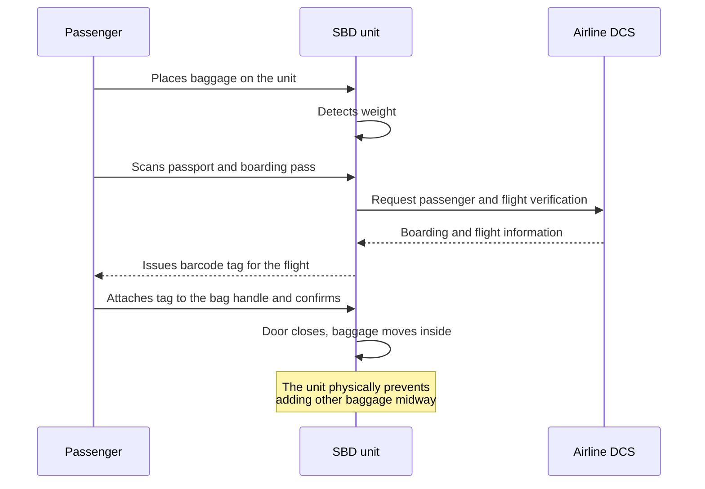

# Gimpo Airport International Terminal SBD Implementation

This project installed Self Bag Drop (SBD) equipment, where passengers check in their own baggage, at the international terminal of Gimpo Airport. I worked on it at BZ System, handling project delivery and management. By coordinating integration with airline systems, communicating technically with the overseas manufacturer, and handling operations after deployment, I saw up close how an airport system fits together across several parties.

## Background

SBD lets passengers check in baggage themselves at a machine, instead of a staff member doing it at the check-in counter. Korea Airports Corporation commissioned a project to introduce it at the international terminal of Gimpo Airport, and BZ System took part as the main contractor. The equipment and solution were products of Scarabee of the Netherlands.

SBD is not finished once the equipment is installed. The passenger's passport and boarding pass information has to be checked against the airline's Departure Control System (DCS), and a baggage tag for that flight has to be issued. That makes it an integration project involving the equipment manufacturer, the airport corporation, and each airline's system owners.

## Problems to Solve

- The SBD equipment had to be integrated with existing systems and with DCSs that differ by airline
- The domestic delivery team and the client had to understand and negotiate over the overseas manufacturer's equipment and software structure
- Because passengers operate the equipment themselves, malfunctions and user errors had to be prevented at the equipment level
- Equipment issues arising on site had to be handled continuously even after opening

## Goals

- Install SBD at the Gimpo Airport international terminal, integrate it with the major airlines' DCSs, and run it normally
- Keep technical communication and schedule coordination running smoothly among the manufacturer, the contractor, the client, and the airlines
- Operate and maintain the equipment reliably after opening

## System Configuration

Several SBD units were installed at the Gimpo Airport international terminal. By my recollection, there were more than a dozen. Each unit consists of a reader for the passenger's passport and boarding pass, a baggage weight sensor, a tag printer, and a belt and door that move the baggage inside.

## Business Flow

This is the process of a passenger checking in baggage at an SBD unit.

- Once the baggage weight is detected, the passenger scans the passport and boarding pass, and the DCS is used to check the boarding status and flight from this information.
- If confirmed, a barcode tag that lets the bag be traced to that flight is issued. The passenger attaches it to the handle and presses confirm.
- After confirmation, the door closes and the baggage is moved inside and sent on toward the aircraft.
- During transport, the unit blocks any attempt to add or swap baggage.

## What I Worked On

- **Project delivery**: Delivered the project by managing schedule and issues under the project manager (a senior colleague)
- **DCS integration coordination by airline**: Discussed what each integration required with the airlines to be integrated, including Korean Air, Asiana Airlines, Jeju Air, and JAL, and coordinated schedules
- **Technical interpretation**: Interpreted discussions with Scarabee's local engineers, and also interpreted when their CTO explained the system structure, the program flow, and code-level characteristics, so that the domestic team could understand the system
- **Operations and maintenance**: Took part in operating the installed equipment and responding to on-site issues after deployment

## Troubleshooting

After opening, there were equipment problems in on-site operation.

- **Baggage not getting onto the belt**: Baggage is supposed to ride the unit's belt inward, but on some units it did not get onto the belt. A mechanical defect was suspected as the cause.
- **Sensor problem between units**: When the front unit sends baggage, the units connected behind it have to sense through optical sensors that bags are coming, so it is not a good time to pass anything on, and wait. When this sensor did not work properly, baggage sometimes jammed inside.

Neither problem was the kind that software alone could solve. They had to be handled jointly by the on-site equipment and the manufacturer.

## Tech

- Self Bag Drop (SBD) equipment and solution: Scarabee
- Airline Departure Control System (DCS) integration
- Equipment components such as passport and boarding pass reading, weight sensors, optical sensors, and tag printers

## What I Learned

The experience from this project carried over into my later development work.

- I came to understand how a single service works together with equipment, manufacturers, the client, and several external systems (airline DCSs).
- Because each system that needs integration has different requirements and methods, I learned that it is important to make specs and schedules clear and not to miss issues.
- Handling communication between overseas technical staff and the domestic team, I experienced that moving technical content across accurately requires understanding the system.
- I saw on site that failures can come from equipment sensors and mechanisms rather than from software.
