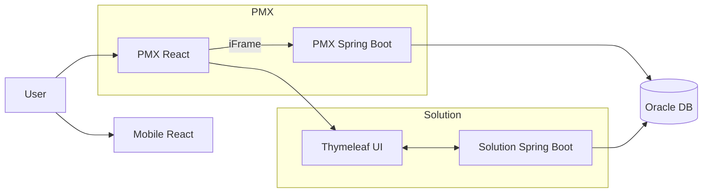
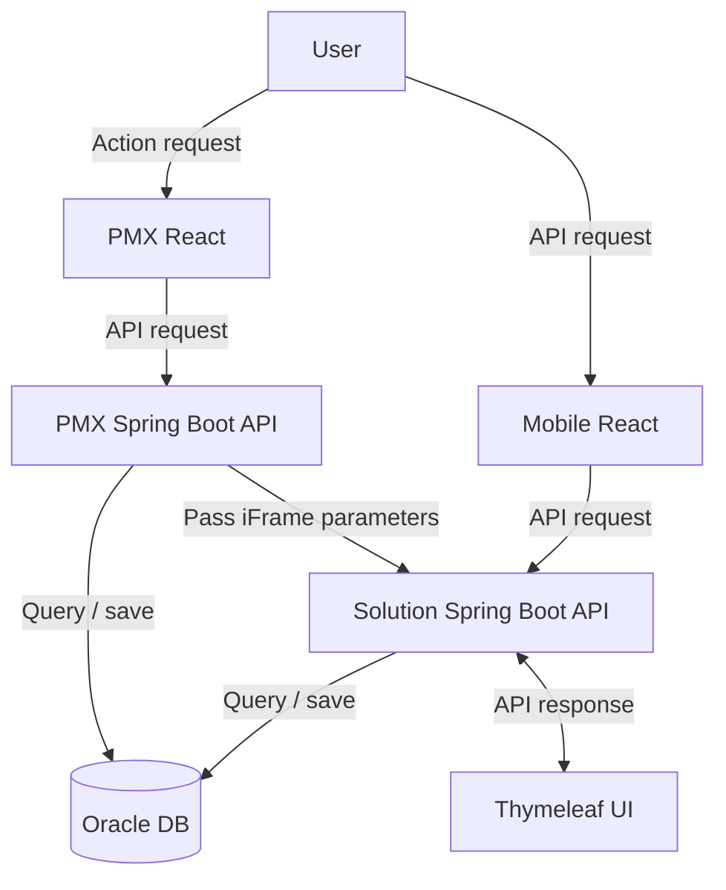
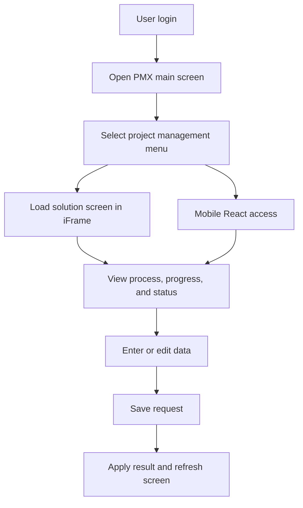
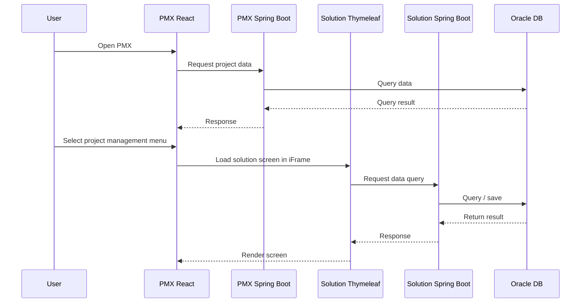

# GS E&C Project Management System Build

A project that moved a procedure-driven, MSSQL-based progress and issue management solution to GS E&C's standard Oracle environment and integrated it into the newly built PMX through an iFrame.

## Background

PMX, the new project management system GS E&C commissioned, was to include several business solutions. One of them was a PM solution that manages construction site progress, issues, and more. The solution was a product of Chaeum Solution and was used by everyone involved in a construction project, including site staff, suppliers, and head office managers. The work was done as a combination of delivering the solution and dispatching staff to the client site.

The problem was that the solution was MSSQL-based. GS E&C's standard DB was Oracle, and it had already been decided that the solution must be embedded in PMX through an iFrame. On top of that, most of the solution, from calculations to data queries, was implemented as DB procedures. So this was not a port that could be done by just changing connection settings. The core logic of the solution had to be moved to Oracle PL/SQL.

## Problems to Solve

- Most of the solution's logic lived in MSSQL procedures, so changing the Java code would not solve it
- Many functions and types existed only in MSSQL or behaved differently, so they could not be used in Oracle as they were
- The solution running inside an iFrame had to take over authentication from PMX, and session handling did not work correctly in this process
- It was a new build, so requirements kept being added and changed

## Goals

- Convert the solution's procedures and queries to Oracle PL/SQL and port it to run in GS E&C's standard DB environment
- Implement screen and session integration that takes over PMX authentication and works reliably inside the iFrame
- Customize features to reflect the client's requirements
- Reach a level of stability fit for operation at the early stage of the new build

## Architecture

The system consists of GS E&C's PMX system, the iFrame-based solution screens, a Spring Boot WAS, and an Oracle DB. The solution was designed not to run standalone but inside the iFrame structure of the newly built GS E&C PMX system.

**Tech stack mapping**

- Backend: Java, Spring Boot, MyBatis
- DB: Oracle DB, PL/SQL / MSSQL (analysis and conversion of the existing solution structure)
- Frontend: Thymeleaf, JavaScript, React (mobile), iFrame-based system integration
- Session: Redis session (PMX authentication integration)

## Business Flow

A user logs in to PMX and selects a project management menu, the solution screen loads in an iFrame (mobile connects separately through a React app), and the user views and enters or edits process, progress, and status data, which is then saved.

From opening PMX to rendering the solution screen, the sequence in time order is as follows.

## Responsibilities

- Backend development of the PM solution that goes into GS E&C's PMX (delivery and on-site dispatch together)
- **MSSQL to Oracle conversion**: because the solution was procedure-centric, converted the procedures and queries that handled calculations and data queries to PL/SQL one by one. Rewrote MSSQL-only functions, types, and syntax differences to fit Oracle
- **iFrame integration**: aligned the flow that takes over authentication from PMX and adjusted session handling problems after iFrame authentication in the Redis session environment
- Customized features according to the client's requirements
- Fixed existing feature errors and inconsistencies found while applying the solution
- Worked with business users to reflect requirement changes and handle early stabilization

## Troubleshooting

In the early build phase there were so many problems that every day was effectively error handling. They fell into two main groups.

**1. Porting a procedure-centric structure to another DB**

- **Situation**: The solution handled most calculations and queries in the system through DB procedures. If the logic had run in Java, it could have connected to any DB, but because the logic was inside the DB, it effectively had to be converted from start to finish.
- **Problem**: Many functions used in MSSQL did not exist in Oracle or behaved differently, and the data type differences were large. Errors kept coming during conversion and in later testing.
- **Action**: Converted the procedures to PL/SQL one by one, and ran the system as we went to check that screens and features worked correctly, fixing problems as they appeared.

**2. Session authentication in an iFrame environment**

- **Situation**: The solution had to take over authentication from PMX, and sessions used Redis.
- **Problem**: After session authentication through the iFrame, access to the solution side was blocked by session authentication.
- **Action**: Adjusted how authentication is handed over and the session is kept, so that it works correctly inside the iFrame as well.

## Lessons Learned

For a solution with logic deep inside DB procedures, switching the DB product effectively means rewriting almost everything. Having experienced that cost first-hand in this project, I came to think that keeping business logic in application code where possible, and lowering dependence on the DB, is better for portability and maintainability.

## Technologies

- Java, Spring Boot, MyBatis
- Oracle DB, PL/SQL, MSSQL
- Redis (session)
- Thymeleaf, JavaScript, React
- iFrame-based system integration

## Results

The MSSQL-based solution was converted to the Oracle environment, completing the port so that it runs in GS E&C's standard environment. It was integrated to take over PMX authentication in the iFrame-based structure, and by resolving the integration issues that came up early in the new build, it contributed to stabilization. After finishing all the development in my scope, the project was closed.
