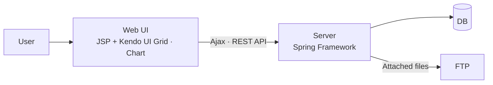
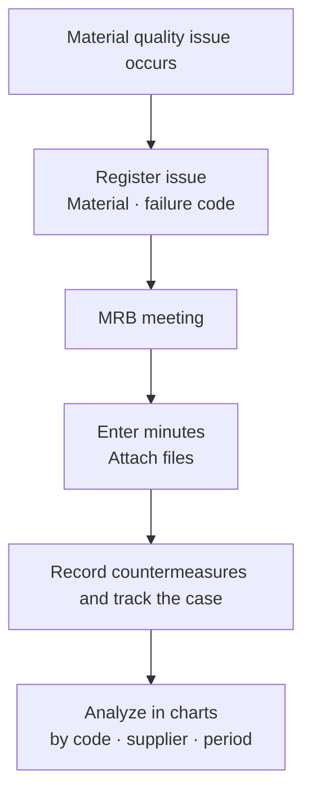
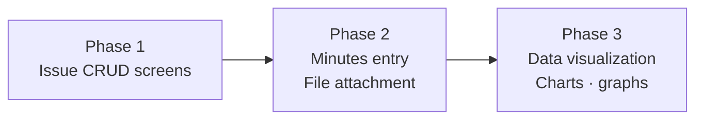

# MRB (Material Review Board) Issue Management System

A system that records and tracks, per case, the issues, countermeasures, and meeting minutes of the Material Review Board (MRB) meetings held when a semiconductor material has a problem. It also charts how often problems occur by material and by failure code. I built it alone in three phases, working with the quality team from requirements analysis through screens and server development.

## Background

MRB stands for Material Review Board. When a material has a problem, the people involved meet to discuss the cause and the countermeasures. Each meeting leaves minutes and countermeasures. When the same material or the same type of problem comes up again, finding out how it was handled before requires those records to be gathered per case.

These records had been managed by hand, scattered across Excel files and email. Tracking a single issue meant searching in several places. It was also hard to see at a glance which problems kept recurring, by material or by supplier.

## Problems to solve

- MRB meeting content and countermeasures were scattered across Excel and email, which made cases hard to track
- Files attached to meeting minutes were managed separately, so they were hard to find in connection with the issue
- There was no way to check with data which materials and failures recurred often, or whether suppliers differed

## Goals

- Bring everything from issue registration to minutes, countermeasures, and attached files into one case that can be tracked
- Organize materials and failures as codes so they can be analyzed by code, by supplier, and by period
- Replace manual record keeping with screens that the business users fill in and search themselves

## Architecture

I kept the structure simple. Users enter and search data on web screens, and the server stores the data and provides the data for the charts. Attached files are managed through FTP.

## Workflow

- Materials and failures are organized as codes, so issues with the same code can be viewed together.
- After a meeting, the minutes and countermeasures are entered and the necessary files are attached.
- The accumulated data can be viewed in charts and graphs by code and by supplier, and by day, week, or month.

## Development process

I handled this system alone from start to finish, in three phases.

1. **Issue CRUD screens**: the basic screens for registering, viewing, editing, and deleting issues
2. **Minutes entry and file attachment**: screens for entering MRB meeting content and countermeasures and attaching files
3. **Data visualization**: charts and graphs of trends by material and failure code and by supplier, on a daily, weekly, and monthly basis

## What I did

- Gathered requirements with the quality team and turned them into screens
- Developed the screens and server for issue registration, viewing, editing, and deletion, minutes entry, and file attachment
- Designed the data structure that holds material and failure codes
- Implemented visualization by code, supplier, and period with Kendo UI Grid and Chart
- Connected the screens and the server through an Ajax-based REST API

## Technology

- Backend: Java, JSP, Spring Framework
- Frontend: JavaScript, Kendo UI (Grid, Chart)
- Data: Ajax, RESTful API, FTP (attached file management)

## Result

MRB issues that used to be managed by hand can now be handled in one system, from entry and attachment to tracking and analysis. Issues are gathered per case, so earlier cases can be looked up. Trends by material, failure code, supplier, and period can be checked in charts.
