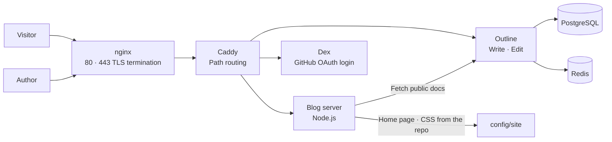
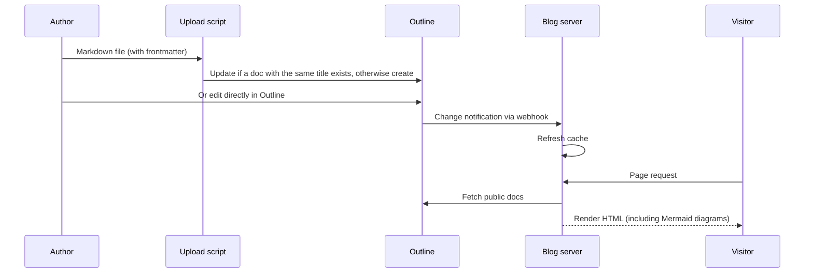
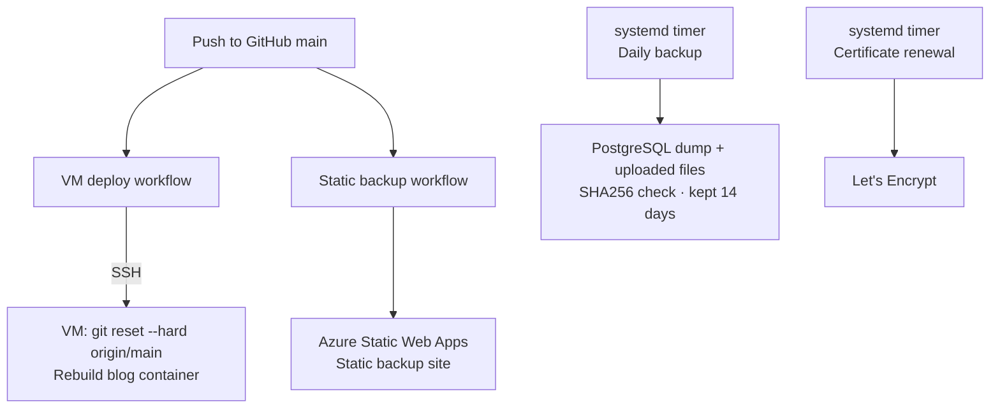

# Neverland — A Portfolio-Style Personal Blog

This is the site you are looking at now. A personal archive where writing happens in a tool that is easy to use, while the public side is presented as a separate portfolio.

## Background

If a portfolio that only lists finished work and a blog that flows in chronological order are run separately, neither lasts long. I needed one place where the problems I actually solved and the reasons behind my decisions connect to the project descriptions. The writing environment should be light and comfortable, and the public pages should look tidy to the reader.

## Problems to Solve

- Writing should be easy, but the public side should feel like a personal site
- Work logs and project descriptions should not be separated from each other
- As posts accumulate, they should stay findable by tag, year, and search
- I should be able to edit posts from outside, such as from the office or another PC
- It should run on infrastructure I already have, with no new server or paid domain
- The posts should survive even if the server goes away

## Goals

- Separate where documents are written (Outline) from where they are shown (the blog), while edits are reflected immediately
- Allow diagrams (Mermaid) and tables in project descriptions
- Deploy automatically to the server when the site code is pushed
- Zero additional cost, with backup and recovery procedures in place

## Architecture

- **Outline**: An open-source wiki, used as the private writing and editing screen. Posts and projects live in a single collection (Portfolio) and are distinguished by the frontmatter at the top of each document (title, type, slug, summary, tags, period, and so on).
- **Blog server**: A single Node.js server. It fetches the documents marked for publication through the Outline API and renders them as lists, detail pages, search, RSS, and a sitemap. The Markdown converter, Mermaid rendering, and the project list API are also in here.
- **Dex**: Connects Outline login to GitHub OAuth. Visitors see only the public pages without logging in, and the author enters through the `Write` link.
- **Caddy**: Routes paths under a single address to the blog, Outline, and Dex.
- **nginx**: Another service on the same server already uses ports 80/443, so that nginx terminates TLS and passes the Neverland paths on to Caddy. This is how Neverland was brought into the existing setup.
- **Home page**: Static HTML and CSS are kept in the repository (`config/site`), and the project cards and recent posts are filled in by calling the blog's public API.

## Content Flow

Posts are either uploaded as Markdown files with the upload script or edited directly in Outline. Both paths work on the same document, using the document title as the key: update if it exists, create if it does not. When a document is edited, a webhook refreshes the blog cache right away and the change appears on the public pages.

## Deployment and Operations

- **Automatic deployment**: When site code (home page, CSS, blog server) is pushed to main, GitHub Actions connects to the server over SSH, pulls the latest code, and rebuilds the blog container. Posts need no deployment, since uploading them to Outline is enough.
- **Static backup**: The same push also builds the repository's Markdown into a static site and uploads it to the Azure Static Web Apps free plan. The posts stay readable even if the main server goes down.
- **Backup**: Every day, the PostgreSQL dump and the Outline uploaded files are bundled, verified for integrity with a hash, and kept for 14 days. The recovery procedure is also written down.
- **Cost**: It reuses the Azure VM I was already running, with the free `sslip.io` domain and Let's Encrypt certificates, so there is no additional cost.

## Design

It went through three rounds of refinement.

1. **Initial**: An editorial-style home page. The site name "Neverland" comes from Peter Pan (my English name was Peter), and the palette was changed to forest green and gold.
2. **Copy cleanup**: Removed decorative wording. The hero is a single line, "WORK · NOTES · EXPERIMENTS", with the subtitle and the manifesto removed.
3. **Overhaul**: Replaced the hardcoded project cards and activity list on the home page with the API. Settled the fonts on Instrument Serif, Noto Serif KR, and Pretendard, and built a new card grid, hover effects, and mobile navigation.

## My Role

I handled planning, design, build, and operations on my own.

- Content structure design: frontmatter rules, project, writing, and page types, sorting by period
- Docker Compose setup tying together Outline, Dex, Caddy, PostgreSQL, and Redis
- Blog server: Outline integration, list, detail, search, RSS, and sitemap, public API, Markdown renderer
- Upload script: creating and updating documents, assigning the collection
- Integration into the shared server's nginx, and automatic certificate renewal
- GitHub Actions: automatic VM deployment, static backup deployment
- Backup, verification, and recovery procedures
- Home page design and front end

## Why These Technologies

- **Outline**: Rather than building my own CMS, using an already polished document editor (Markdown, images, collaboration) lets me focus on writing. It has an API, so it can also be driven by scripts.
- **A separate Node blog server**: I separated it so that Outline's own screens are not exposed as they are, and only the documents I choose are shown in the design I want. It is a small server with almost no dependencies, so it is light to maintain.
- **Caddy**: Path routing is simple to configure.
- **Mermaid**: Keeping the design diagrams in project documents as text rather than image files makes them easy to edit and version.
- **Static backup plus VM, a dual setup**: Normally the dynamic server serves the site, and a low-cost safety net keeps the posts viewable even when the server has problems.
- **Reusing the existing VM**: No new resources are created, so the cost is zero and there is nothing more to manage.

## Troubleshooting

**1. Ports 80/443 already taken**

On the server I was deploying to, another service's nginx was already using ports 80 and 443. Instead of changing ports or setting up a separate server, I included one config file so that the existing nginx reads the Neverland paths and forwards them to the internal Caddy. This made it possible to add only the domain and certificate without touching the existing service.

**2. Markdown tables rendering broken**

The blog's own Markdown renderer did not support tables, so tables in project documents were printed as raw `|` characters. I added table support to the renderer and adjusted the styles so that long tables scroll horizontally.

**3. Projects sorted only by publish date**

The project list showed the date a document was uploaded, which did not match when the work actually happened. The sorting was already based on the document's period, but the screen was displaying the publish date. I changed the list to show the project period.

**4. Hardcoding on the home page**

With the project cards written directly in HTML, the home page had to be edited separately every time I added a project, and it drifted from the actual documents. I made the home page call the public API the blog server already provided, so that projects marked `featured` appear automatically in order of period.

## Tech

- Node.js (blog server, build and upload scripts)
- Outline, PostgreSQL, Redis, Dex
- Docker Compose, Caddy, nginx
- GitHub Actions, Azure Static Web Apps (static backup)
- Markdown, Mermaid
- systemd timers (backup, certificate renewal)

## Current Status

More than 10 company and personal project documents are on this site, and the site code deploys automatically when pushed to main. Next up are a shorter personal domain, better social sharing images, and a writing template.
