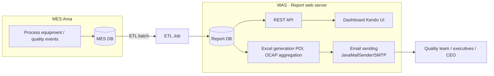
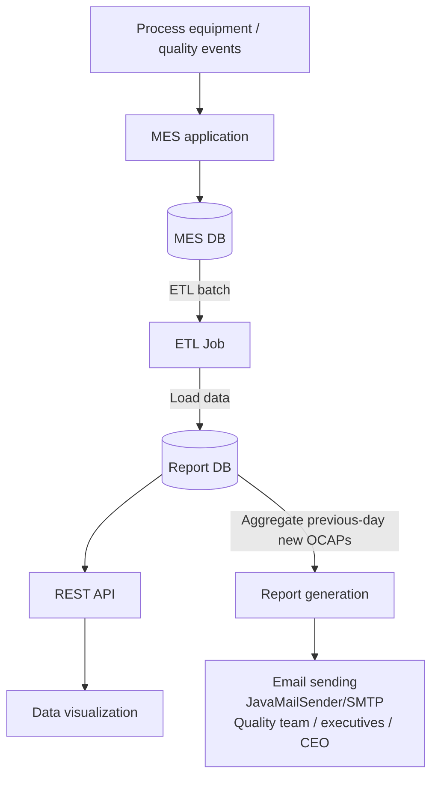
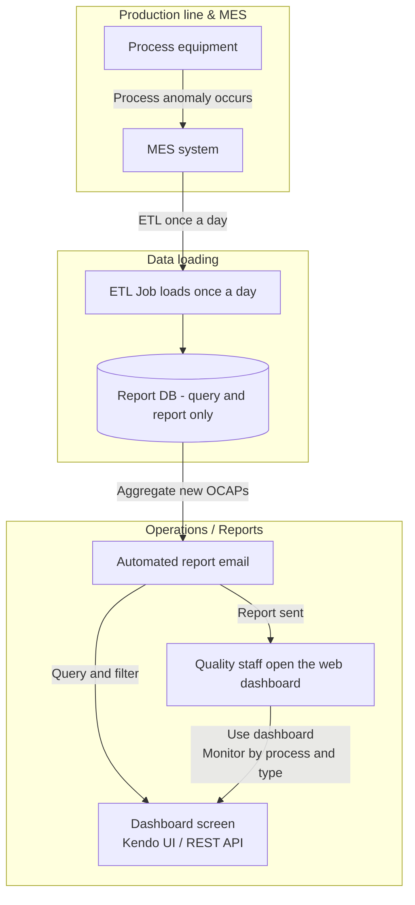
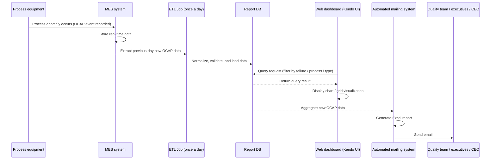

# OCAP Quality Anomaly Response System

A project that made quality anomalies visible on a real-time dashboard and emailed periodic reports automatically, reducing missed responses and shortening action lead time.

## Background

OCAP (Out of Control Action Plan) is an event raised when data goes outside the normal range ("spikes") while a process is running. These events kept accumulating in the MES DB. Daily production volume itself was very large, but the number of OCAP events varied widely, from about 30 a day at most to about 1 at the least. Because these anomaly signals appear so rarely and so irregularly, they were easy for people to miss.

Previously, a person in charge collected this anomaly data by hand and included it in the weekly and monthly reports. When this process ran late or items were dropped, a quick response was difficult. Reports were also written in a different format by each department, so issue tracking and improvement activities were not properly connected.

## Problems to Solve

- No real-time monitoring, so the timing for an early response was lost
- Report writing and delivery were mostly manual, causing delays and omissions
- Rare and irregular anomaly signals were easy to miss with manual collection

## Goals

- Provide a real-time dashboard of process and quality indicators (daily and monthly trends, root cause analysis based on Pareto charts)
- Standardize reporting and prevent omissions with automated email reports
- Strengthen traceability by making OCAP occurrence history visible (the actual corrective actions are taken outside the system, so the system focuses on showing "what occurred" without gaps)

## Architecture

The system consists of the MES DB, ETL, Report DB, WAS, and Kendo UI. Instead of accessing the production history DB (MES DB) directly, data is synchronized daily through ETL. This minimizes load on the production DB and security risk, and a scheduler-based batch reporting scheme standardizes report quality and response speed.

In the overall data flow, anomaly events from the MES are loaded by ETL once a day and used by both the REST API and the automated reports.

**Why this structure**

- Previously, on-site staff collected and reported anomaly data for each process by hand, so delayed and missed responses kept recurring.
- There was a need to make real-time anomaly detection and response indicators visible, and to automate reports to shorten action lead time.
- Querying the MES (production DB) directly would put load and security risk on real-time production data, so the data was separated into a report-only DB through ETL.
- This structure was chosen to build a report-only environment and an automated emailing process, minimizing repetitive work and improving the quality of reporting and response.

**Tech stack mapping**

- Backend: Java, Spring Framework, MyBatis
- Frontend: JavaScript, Kendo UI (Grid, Chart)
- Database: Report DB, MES DB (Oracle)
- ETL & Scheduler: ETL, Spring Scheduler (daily batch, automated reports)
- Reporting: Apache POI (Excel generation), JavaMailSender/SMTP (email sending)

## Business Flow

Process anomalies from the production line are loaded by ETL once a day, and quality staff check them on the dashboard or through the automatically sent report emails.

In time order, the ETL batch aggregates the previous day's data, which then flows to both dashboard queries and automated email sending.

## Responsibilities

- Built the ETL-based data loading and usage framework: synchronized process anomaly data loaded in the MES into the Report DB daily through ETL, creating an environment where reports and the dashboard can use it
- Developed the backend API: built RESTful APIs backed by the Report DB and integrated with the Kendo UI dashboard, served daily, weekly, and monthly indicators and per-process and per-type statistics, and provided the data sets for Pareto chart analysis
- Implemented the frontend visualization dashboard: developed screens with Kendo Grid and Chart so key indicators can be viewed intuitively, implemented date and process filters and visualizations such as the Pareto chart, and simplified the dashboard UI to make it easier to check report data and track action status
- Built the automated email reporting system: every day at 8 a.m. a scheduler aggregates new occurrences and items with incomplete actions, generates an Excel report, and emails it automatically to the quality team, executives, and the CEO. Standardized the report format with Apache POI and implemented reliable email delivery with JavaMailSender
- Improved operations and maintenance efficiency: logged errors in the batch and mailing logic, strengthened exception handling and monitoring, and improved the UI/UX and filter features based on feedback from business users

## Why These Technologies

- **Spring Scheduler**: Automated report generation and email sending on a fixed cycle to minimize operator intervention.
- **Kendo UI (Grid, Chart)**: Provided an intuitive dashboard and filtering and visualization features that business users could use immediately.
- **Apache POI**: Standardized and automatically generated the report Excel documents so business users could use them directly without a separate tool.
- **JavaMailSender / SMTP**: Implemented reliable email sending and error handling.
- **Oracle Report DB + ETL**: Blocked load on the production DB and separated the report data environment, securing performance, security, and maintainability.
- **Spring Framework + MyBatis**: A combination proven for stability and productivity, well suited to REST API development and SQL optimization.

## Troubleshooting

After release, the system ran stably with no outages or critical issues. During testing, however, we found that binding failed when mapping variable (date-based) columns to the Kendo Grid if a column name started with a digit.

- **Cause & fix**: Converted the column keys to use a letter prefix (for example `D_2024_10_03`) and made the Grid schema/columns mapping consistent, which fixed the binding.
- **Prevention**: Established a naming rule for variable columns and added unit tests and data validity checks to strengthen early detection.
- **Result**: Stronger pre-release testing kept operations uninterrupted after launch, and later improvements were limited to the visualization (chart composition) level.

## Technologies

- Java, Spring Framework, MyBatis
- Oracle
- Kendo UI (Grid, Chart)
- Apache POI
- Spring Scheduler, JavaMailSender/SMTP

## Results

After development was completed, the system ran stably with no reported outages, and additional requests were limited to extensions such as some chart configurations. The dashboard earned enough trust to be used as a reference for quality indicators in executive meetings chaired by the CEO. The team lead recognized the result, and it stayed stable with no further improvement requests until I left the company. The automated emailing and the standardized dashboard simplified the quality response and reporting process and reduced the workload.
