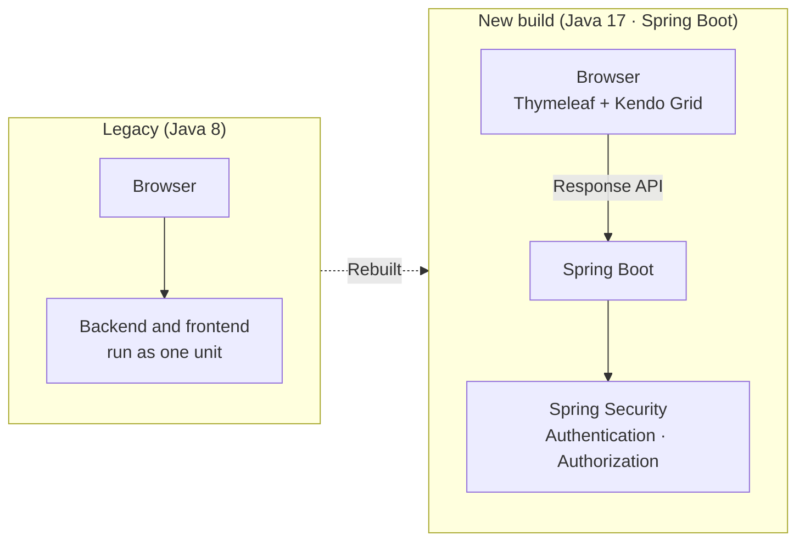
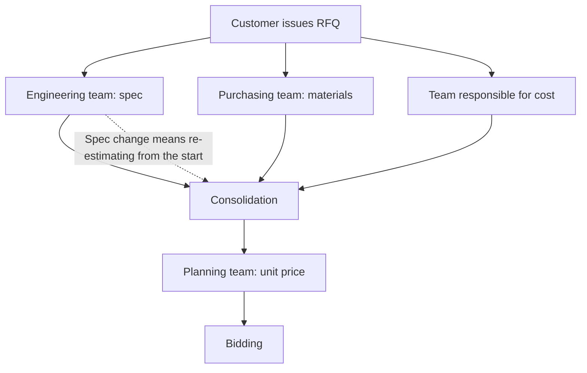

# RFQ Digitization — Rebuilding the Foundation on Java 17 and Spring Boot

I was responsible for the initial build of a project to move cost estimation for Requests for Quotation (RFQ) from Excel into a system. Rather than continue with the existing legacy code, I built a new foundation on Java 17 and Spring Boot. Because I had decided to change jobs, the work went as far as the initial framework stage. My team lead was the PM. The two of us worked on it together, and I wrote the code myself.

## Background

An RFQ (Request for Quotation) is a quotation request issued by a customer. When one arrives, the company has to check costs and place a bid at an appropriate price. This whole process was managed only in Excel.

Several teams take part in cost estimation. The engineering team estimates the spec, the purchasing team estimates materials, and the responsible team estimates costs. The planning team collects all of this and proposes a unit price. The problem is that when any one team changes a value midway, everything has to be recalculated in a chain. For example, if the engineering team changed the spec, the work had to start over from the beginning. The company needed a system to manage these changes and recalculations.

## Problems to Solve

**Business side**

- Spec, materials, and cost data were scattered across each team's own Excel files, so collecting them was tedious and error-prone
- A change by one team was not reflected in other teams' estimates, or reflecting it meant starting over from the beginning

**Technical side (the existing legacy system)**

- It was built on Java 8, with the backend and frontend running together as one unit, so it could not work through an API alone. This was an inefficient structure
- The project structure was inconsistent, which made maintenance very inefficient
- The deployment process was inefficient

## Goals

- Do not continue with the legacy code. Build a new foundation on Java 17 and Spring Boot that RFQ digitization can run on
- Clean up the response API so that the screens and the server run separately and communicate through the API
- Put a security structure (authentication and authorization) in place from the start
- Keep the Kendo Grid, for which the company had already bought a license, usable in the new structure

## Architecture

- **New Spring Boot project**: Built from scratch with a consistent structure, without carrying over the legacy structure.
- **Response API design**: The company already used an in-house framework called SigneticsReport that defined things such as the response format. I applied it to the new structure.
- **Spring Security**: Built the authentication and authorization structure.
- **Kendo Grid + Thymeleaf**: The company already held a Kendo Grid license, so we decided to keep using it in the new structure. The component was originally designed to run in a JSP environment, and at first it did not work properly with Thymeleaf. I adjusted the configuration until it worked.

## Business Flow (What Was to Be Digitized)

The purpose of the system was to manage re-estimation when a value changes midway in this flow, such as a spec change.

## My Responsibilities

- Built a new foundation on Java 17 and Spring Boot instead of continuing with the legacy code
- Designed the project structure and the response API, and applied the in-house response framework (SigneticsReport)
- Built the authentication and authorization structure with Spring Security
- Developed data entry and lookup screens with Thymeleaf, Kendo UI (Grid, Form), and jQuery
- Because deployment was inefficient, planned to build CI/CD, and proposed that the company adopt GitLab for it
- Discussed schedule and requirements with the PM (my team lead), and wrote the code myself

## Tech Stack

- Java 17, Spring Boot, Spring Security
- Thymeleaf, jQuery, Kendo UI (Grid, Form)
- GitLab (adoption proposed)

## Scope Delivered

The work went as far as the initial framework stage.

- Set up the Spring Boot project environment (including the security structure and API design)
- Built data entry and lookup features on Kendo UI
- Work to strengthen authentication, sessions, and authorization was still in progress
- CI/CD was still at the planning stage

Because I decided to change jobs, I could not continue to the later stages. I handed the project over with the initial build complete.

## What I Learned

I learned firsthand that getting the foundation right before adding features (API separation, authentication, response format, deployment) largely determines later maintenance cost. I also learned that fitting a new structure within existing constraints, such as a license already purchased and an established in-house framework, is part of the design.
