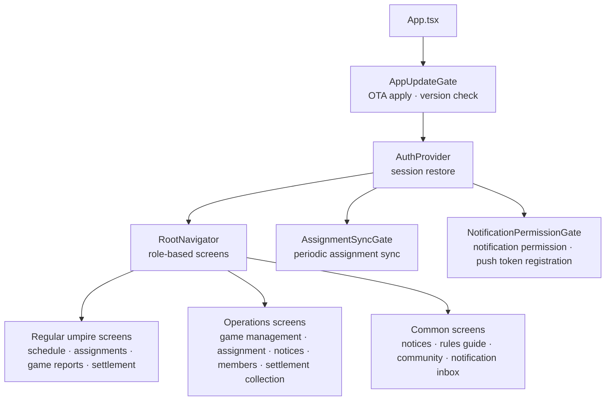
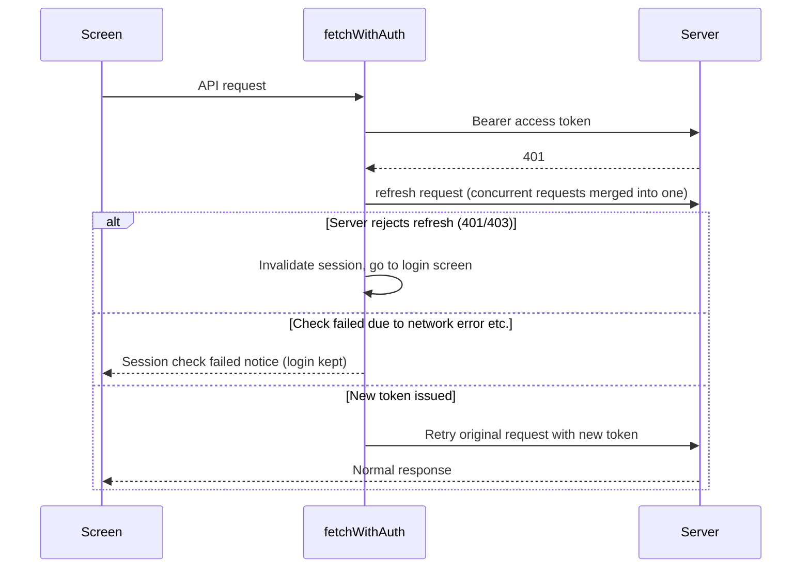
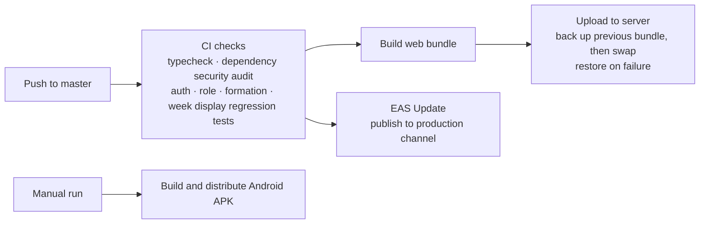

# Umpire Mobile — Android and Web Client

This is the client app of the [Umpire assignment and settlement platform](/en/projects/umpire-platform). The overall business flow and the backend are covered in that document. This one focuses on **how the app was designed and deployed**.

## Background

The users are the umpires who work games every weekend, and the Director, Deputy Director, and Treasurer who run the operation. Most of them check things on their phones while at work or at the ballpark, so mobile has to be the default channel, and the same person has to use both the regular umpire screens and the operations screens with a single account. It was also operationally important to get fixes to users quickly without waiting for app store review.

## Problems to Solve

- Each role needs different menus and can perform different actions: regular umpire, trainee, on leave, Director, Deputy Director, Treasurer, and system admin
- Mobile networks are unstable, and if token expiry cannot be told apart from a network error, a perfectly valid user gets logged out
- Some users do not receive push notifications, and there is no way to tell where it is blocked
- Distributing every app update as an APK leaves old versions in use for a long time, because users never install them
- There was no capacity to build the Android app and the web separately

## Goals

- Serve both Android and web from one codebase
- Vary menus and screens by role, following the same rules as the server's permissions
- Keep the login session alive as long as possible, and log out only when it has really expired
- Make every step of push registration diagnosable
- Ship JavaScript changes immediately, and distribute an APK only when a native change is required

## App Structure

- **Stack**: Expo 54, React Native 0.81, React 19, TypeScript, React Navigation. The same code builds the Android app and the web.
- **Screens**: more than 30, including login and sign-up (with Kakao sign-up), home, availability entry, my assignments, game reports, monthly settlement view and history, notices (list, detail, write), Director screens for games, assignments, candidate selection, and member management, the rules guide (KBO rule search and detail), a free board, baseball discussion, emergency contacts, a notification inbox, and bug reports.
- **Baseball domain screens**: baseball discussion uses a situation board component where users tap to enter runner positions and balls, strikes, and outs. The rule detail in the rules guide includes an SVG animation player (react-native-svg) that replays formation positions and ball movement step by step.

### Role-Based Screens

Roles are decided in the app through helper functions. Allowed roles differ by feature, such as whether someone is on the operations staff, can create rental games, or can edit confirmed assignments, and regression tests pin these to the same rules as the server's permission checks. When the same account logs in, the bottom tabs and side menu change to match the role. Regular umpires mainly see their own assignments and settlement, while operations roles go straight to assignment candidate selection, notices, and member management.

### Assignment Sync

The server data is the source of truth for assignments, and push is only a supplementary way to signal changes. So that an open app shows the latest state even when a push is missed, it fetches this week's and next week's assignments every 30 seconds (an interval chosen to avoid excessive calls) and syncs immediately when the app returns to the foreground.

## Authentication and Session

- **Telling expiry apart from network errors**: when the server rejects the refresh, the session has truly expired and the user is logged out. When the request itself fails, the app only reports that the check failed because of a network problem and keeps the session. The goal is to avoid logging users out for no reason on an unstable connection.
- **Merging concurrent requests**: even if several screens receive a 401 at the same time, the refresh runs only once and its result is shared. The server rotates refresh tokens, so sending several at once could trigger reuse detection.
- **Secure storage**: tokens are stored in the device's secure storage (SecureStore). The web has no SecureStore, so it uses browser storage.

## Push Notification Registration

When push notifications do not arrive, the cause could be anywhere: notification permission, the Android channel, the project ID, token issuance, or saving on the server. No single log can tell which.

- Registration is attempted on login, on session restore, whenever the app returns to the foreground, and whenever the token changes
- The result of each step is recorded as diagnostic information both locally and on the server, so a permission denial, a token issuance failure, and a server save failure can be told apart. Tokens and project IDs are masked when recorded
- Failures in saving diagnostic records or the local cache do not block the actual registration flow, because they are kept separate from the main flow
- The web registers the same way using Web Push (VAPID)

## Deployment

- **JavaScript and asset changes**: publishing to the EAS Update production channel makes the app fetch the update on its next launch. No app store review or reinstall is needed.
- **Native changes** (permissions, SDK, manifest): a new APK is built and distributed. At app start, the update gate first applies the OTA update, then asks the server for the version and, if a mandatory update is needed, guides the user to the APK download. It checks again when the app returns to the foreground.
- **Web bundle**: the built bundle is uploaded to the server, the previous bundle is backed up, and then it is swapped in. If the swap fails, the backup is restored. The APK download file is preserved during the swap.
- **CI**: typecheck, a dependency security audit, and regression tests for authentication, roles, the formation parser, and week display must pass before the deployment stage.

## Responsibilities

Planning, design, development, and deployment were all handled alone.

- Role-based navigation structure and screen design, and implementation of more than 30 screens
- Auth client: token refresh, merging concurrent requests, separating expiry from network errors, and secure storage
- Push registration and diagnostics flow, and assignment sync
- Domain components such as the baseball situation board and the formation animation player
- Web and Android build, EAS Update, and APK distribution pipeline
- Full walkthrough on an Android emulator with an account for each role, and fixes for the problems found

## Troubleshooting

**1. Only saving the schedule was treated as an expired login session**

On Android, tapping to save the schedule sent the user back to the login screen. In the same session, saving the push token succeeded, and given the server's exception mapping, a closed schedule window or a wrong service type could not produce a 401. Judging it to be a problem at the request stage, schedule saving was changed from PUT to POST (with a POST route added on the server that calls the same logic), and the auth header merging was changed to a plain-object approach that is stable on React Native Android. The logs, reasoning, and verification results were written up in a document.

**2. Push registration race condition**

Right after login, several components requested the same token registration at once, and successes and 401 responses were mixed. Duplicate calls inside the auth API were removed, registration requests were merged into one per access token, and retries now happen only when the first registration fails. After the fix, the result settled into "one registration start, one server save with 200, one success".

**3. User-facing wording and build problems found in the walkthrough**

The login expiry notice showed a raw ISO timestamp, and an inaccurate "demo state" message remained on the operations screens. The wording was cleaned up. Also, depending on how the app was installed, Expo's default entry point could fail to find `App.tsx`, so `index.js` was specified explicitly. With the fixed APK, the permission allow and deny scenarios and the server save were checked again.

## Tech

- React Native / Expo 54 / TypeScript
- React Navigation, react-native-svg
- Expo Notifications / Expo SecureStore / EAS Update
- GitHub Actions (CI, web bundle deployment, APK build)
- Spring Boot API integration

## Current Status

Login, availability, assignments, notices, game reports, settlement, push, the rules guide, and the role-based operations screens are all connected, and the app is in operation for real users at app version 5.0.x.
