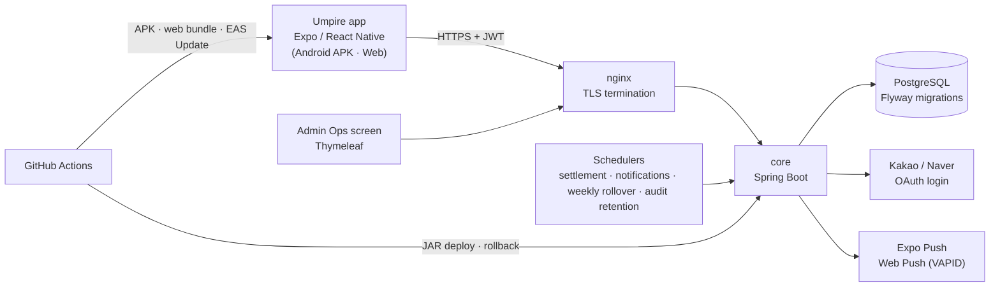
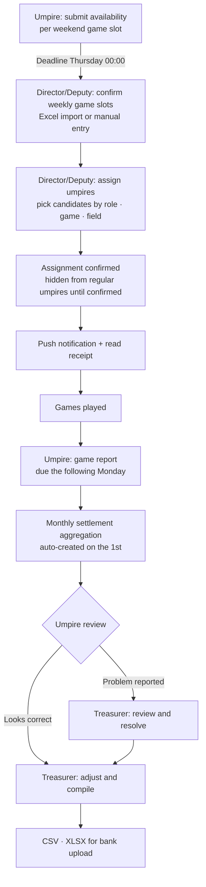
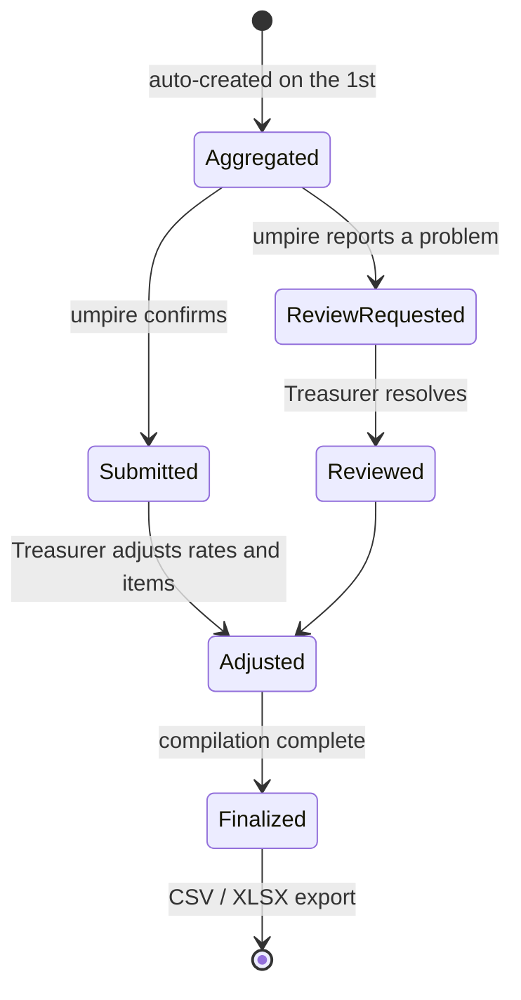
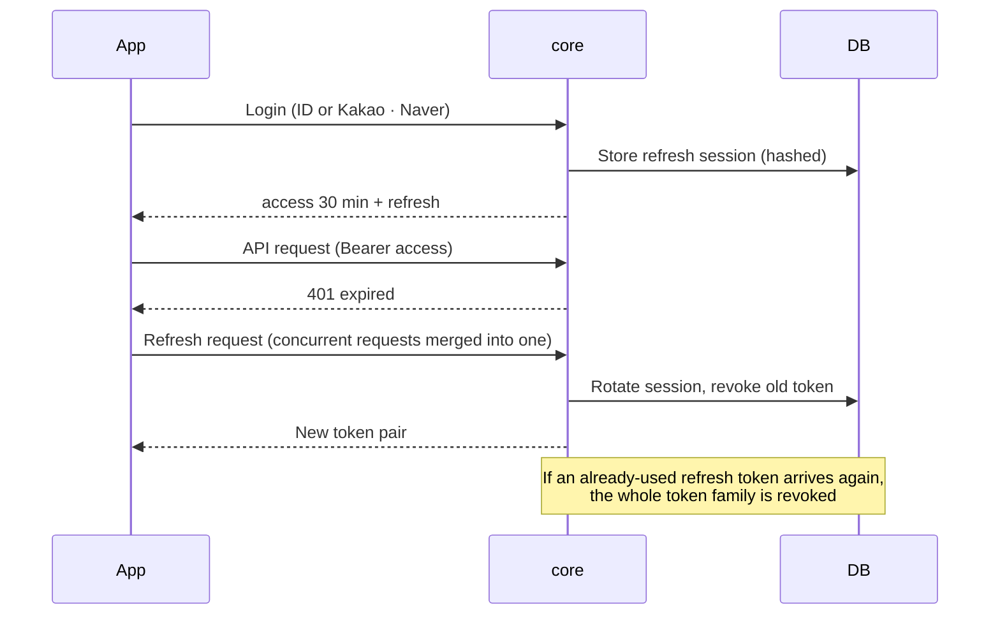

# Umpire — Game Assignment & Settlement Platform

A service that connects the work of baseball umpires assigned to weekend games into one flow. Umpires submit their availability, check assignments, and file game reports in the app. The Director, Deputy Director, and Treasurer handle assignments, announcements, members, and settlement in the same app and an admin screen. I built both the Spring Boot backend (core) and the React Native app (umpire-mobile), and the service is in production use by a real organization today.

## Background

Umpire assignment runs through several steps every week. Umpires send the dates they can work. Umpires are assigned to match the game schedule. The assignment is announced and read receipts are checked. After the games, reports are collected. After a month, the umpire fee is calculated from the number of games and the role, and each umpire confirms it. When all of this is scattered across messengers and spreadsheets, the operators have to check by hand who submitted availability, who has read an assignment, and which games are missing a report. Monthly settlement has layered calculation rules, so mistakes come easily, and disputes are hard to trace.

## Problems to Solve

- Availability, assignments, and announcements were scattered across several channels, so there was no way to see progress at a glance
- Someone had to check by hand who had read an assignment notice and who had not filed a game report
- Monthly settlement stacks role-based rates, night-game allowances, mutual-aid fees, and deductions for missing reports and availability, which made manual calculation and dispute handling difficult
- The Director, Deputy Director, Treasurer, regular umpires, trainees, and umpires on leave each see different screens and can do different things
- There was no way to confirm that notifications actually reached the people they were meant for
- A small group of users needed a service that had to be deployed and operated directly, at no cost

## Goals

- Connect availability → assignment → announcement and read receipt → game report → monthly settlement in the flow of a single mobile app
- Show each role only the features it needs, with the same permissions enforced on the server
- Deliver assignment changes and announcements by push notification, with tracking and retry when delivery fails
- For settlement, keep the basis of each calculation and build the process into the system: umpires confirm or report a problem, and the Treasurer adjusts and compiles
- Separate authentication, users, roles, and notifications into a common platform (core) so that other services can reuse them

## Architecture

- **core (backend)**: Spring Boot 3, Spring Security (JWT), JPA, Flyway, PostgreSQL. The common platform (`com.empire.core`: authentication, users and roles, settings, notifications, audit) and the umpire domain (`com.empire.service.umpire`: announcements, availability, game slots, assignments, game reports, members, community, rules guide, settlement) live in the same project, separated by packages.
- **App**: Expo / React Native / TypeScript. Regular umpires, the Director, and the Treasurer use the same app and see role-specific menus. Web and Android are built from the same code.
- **Admin screen**: Tasks that are easier on a PC, such as writing announcements, compiling settlements, and viewing logs, are provided as server-rendered Thymeleaf screens.
- **Authentication split into a common platform**: core handles login, token refresh, social login linking, and user roles. Other personal projects (the baseball game Pennant Race and RealMan) use the same authentication, distinguished by service type.

### Why a Single JAR

The common platform and the umpire domain could have been split into separate services from the start. For a service run by one person, I judged that managing the contracts and deployments between services would cost more than it would save. Instead, I kept the package boundary (`core` ↔ `service.umpire`) and the dependency direction from service to core, so the split stays possible when it becomes necessary. I also documented that some two-way references still remain in the current implementation, so a split would first require decisions on data ownership, event contracts, and transaction boundaries.

## Business Flow

The week's work follows the Thursday deadline.

Cancellation and restoration are handled even after assignments are confirmed. Cancelling a game also cancels its linked assignments and sends notifications. Restoring the game brings back the assignments that were cancelled with it. A game that has already started, or one with a submitted game report, cannot be cancelled.

## Settlement System

Monthly settlement is the part of this service with the most rules. It gathers confirmed assignments, game reports, and availability submission records by month and calculates an amount for each umpire.

- **Role-based rates**: Plate umpire, base umpire, and single-umpire games have different rates. If an umpire takes both plate and base in one game, it counts as one single-umpire game. Rental games are excluded from monthly settlement and settled separately.
- **Additions and deductions**: night-game allowance, mutual-aid fee, deduction for missing game reports, and deduction for missing availability. The administrator can change the two deduction amounts on a settings screen.
- **Exclusions**: Umpires on leave are exempt from the fee and the deductions, and operations staff are exempt from the missing-report deduction.
- **Process**: On the 1st of each month at 09:00, the previous month's settlement is created automatically and notifications go out. When an umpire confirms (looks correct) or reports a problem, the Treasurer adjusts and reviews, then completes the compilation. Umpires who have not confirmed get reminder notifications on set dates.
- **Outputs**: A reference CSV and an XLSX for bank upload (Apache POI). The actual transfer happens outside the system. The system is responsible for the basis of the calculation and the confirmation process, not for the payment itself.

In the code, a service dedicated to calculation builds a monthly context. A per-umpire accumulator collects games, additions, and deductions, and then the results are converted into items. Records that have already been confirmed are cloned and preserved.

## Authentication and Authorization

- **Tokens**: The access token lasts 30 minutes. Refresh sessions are managed per device, with an absolute lifetime of 90 days and an idle limit of 30 days. Refresh tokens are stored in the DB only as hashes, and the previous one is revoked on every rotation. If a token that was already used arrives again, it is treated as theft and the whole family is revoked. When the app receives a 401, it sends a single refresh request and retries the original request.
- **Roles**: Nine roles, including regular user, trainee, on leave, Director, Deputy Director, Treasurer, and system administrator, combine with the service type (UMPIRE, REALMAN, FRONTOFFICE, and others) to determine permissions. Controllers use `@PreAuthorize` together with access checks inside the services. I am aligning the menu visibility in the app with the same criteria as the server-side permissions.
- **Social login**: Kakao and Naver are supported. A separate app for development keeps local testing from affecting the production app settings.
- **Settlement PIN**: The settlement PIN is stored as a BCrypt hash.

## Push Notifications

Assignments, announcements, and settlement reminders all need people to act, so notifications are a core feature of the service.

- Mobile uses Expo Push and web uses VAPID Web Push
- A scheduler checks scheduled pushes (reminders) every minute and sends them
- Delivery history is kept, failures are retried, and the history across channels is viewed in one place
- When push registration fails, the failing step can be diagnosed. Notification permission, Android channel, project ID, token issuance, and server save are each recorded

## Rules Guide and Community

The service also includes supporting features that umpires need for their work.

- **Rules guide**: The full baseball rulebook is indexed and searchable down to sub-clauses. It uses PostgreSQL trigram search, with a separate screen for each league's local rules.
- **Free board and baseball discussion**: Posts, comments, and read tracking. The baseball discussion also stores game-situation values such as runner positions and the ball, strike, and out counts, so a specific call can be discussed in context.

## Deployment and Operations

- **Backend**: GitHub Actions runs the tests and then deploys the JAR to an Azure VM. There is a workflow that rolls back to the previous JAR with one button, and an audit workflow that checks the production push status every morning.
- **App**: Native changes ship as a new APK, and JavaScript and asset changes ship through the EAS Update production channel. An update gate checks the version when the app starts. The web bundle is served statically from the server.
- **DB**: More than 60 Flyway migrations. Hibernate only runs `validate` against the production DB schema, and every schema change goes through a migration.
- **Schedulers**: Settlement creation and reminders (daily 09:00), weekly assignment and availability rollover (Monday 06:00), scheduled push and retry (every minute), and audit log retention (daily 00:10)

## My Role

I handled planning, design, development, deployment, and operations alone.

- Workflow analysis and domain design: the rules connecting availability, game slots, assignments, game reports, and settlement
- Backend: authentication and authorization, the umpire domain API (92 or more endpoints), settlement calculation, push, schedulers, and the admin screen
- Mobile app: role-specific screens, session management and token refresh, push registration, and the update gate
- Infrastructure and CI/CD: backend deployment and rollback, and APK, web, and OTA deployment for the app
- Security review and fixes, and incident response during operations

## Troubleshooting

**1. Settlement recalculation overwrote confirmed amounts**

When a settlement was aggregated again, amounts in records that umpires had already confirmed or that were under review changed silently, and amounts the Treasurer had adjusted by hand disappeared on recalculation. Game cancellation and restoration were not reflected in settlement either.

- **Fix**: I redesigned the recalculation logic. Records already in the submitted or under-review state are cloned and preserved, and the Treasurer's manual adjustment amounts and reasons are saved in separate columns so they survive recalculation. Game cancellation and restoration are reflected in settlement through a partial recalculation of only the affected assignments.
- **Policies settled at the same time**: Rental games are excluded from monthly settlement. Umpires on leave are exempt from fees and deductions. The weeks that count toward the missing-availability deduction are based on the whole roster. I also confirmed that the difference between the availability save deadline (Thursday) and the settlement cutoff for missing submissions (Wednesday) is an intentional two-stage deadline that gives the Treasurer and the Director a day to review, and I documented it.

**2. OAuth callback URL behind a reverse proxy**

In admin social login, the callback URL was built wrongly as `http://host:80/...`. nginx terminates TLS and forwards requests internally over HTTP, and the app was using the request's scheme and port as they were. I fixed it to build absolute URLs from the proxy headers. I also found and fixed a missing security configuration that was blocking the callback path before authentication.

**3. Only the availability save was treated as an expired login session**

On Android, tapping the button to submit availability sent the user back to the login screen. In the same session, other APIs such as saving the push token succeeded. Given the server's exception mapping, an availability deadline error or a service type error could not have produced a 401. I judged it to be a request-level problem and changed the availability save from PUT to POST (adding a POST route on the server that calls the same save logic). I also changed how the auth headers are merged to a plain-object approach that is stable on React Native Android. I documented the symptoms, logs, reasoning, and verification results.

**4. Push registration race condition**

Right after login, several components requested the same push token registration at the same time, and successes and 401 responses were mixed. I removed the duplicate call inside the auth API, merged registration requests into one per access token, and made retries happen only when the first registration failed. After the fix, I confirmed the result was one registration start, one 200 for the server save, and one success.

**5. Authentication failed with a 500 for a user who left and re-registered**

The per-request authentication lookup did not filter out deleted users. This was safe when IDs were globally unique. After the ID scope was split by service type, a "withdrawn old account" and a "new account registered with the same ID" could exist at the same time. In that case the lookup returned two rows and threw an exception, and every authentication request from that user failed with a 500.

- **Fix**: I replaced it with a query that finds only users who are not deleted, and removed the unsafe version that had no filter. I fixed the exact scenario, with a withdrawal record and a re-registration row existing together, in an integration test.

## Why These Technologies

- **Spring Boot + JPA + Flyway**: For a domain like settlement where data integrity matters, schema changes go only through migration files and Hibernate only validates, so the production DB and the code do not drift apart.
- **PostgreSQL**: One DB covers relational data and also the trigram search for the rules guide.
- **React Native + Expo**: For a small number of users, I could not build iOS, Android, and web separately. One codebase and EAS Update let JavaScript changes ship without app store review.
- **Thymeleaf admin screen**: Tasks done on a PC, such as writing announcements, compiling settlements, and viewing logs, were delivered quickly with server rendering, without a separate frontend project.
- **Expo Push + Web Push**: Two channels cover mobile and web for free. Kakao AlarmTalk and Naver push did not fit technically or on cost, so I reviewed them and put them on hold.
- **JWT + refresh rotation**: To keep sessions long on a mobile app and still respond to token theft, I applied refresh token rotation and reuse detection.

## Technology

- Backend: Java 17, Spring Boot 3.5, Spring Security, Spring Data JPA, Flyway, Thymeleaf, Apache POI
- Database: PostgreSQL
- Mobile: React Native (Expo 54), TypeScript, React Navigation, Expo Notifications, EAS Update
- Auth: JWT, Kakao · Naver OAuth
- Push: Expo Push, Web Push (VAPID)
- Test: JUnit 5, Mockito, Testcontainers
- Infra: Docker, nginx, Azure VM, GitHub Actions

## Current Status

Login and member approval, availability, assignments, announcements, game reports, monthly settlement, push, the rules guide, and role-specific operations screens are all connected and running in a real organization. I am sorting the security and settlement-integrity improvements found in operation by priority and closing them one by one. Integration with real bank transfers and tracking of payment results were deliberately left out of scope.
