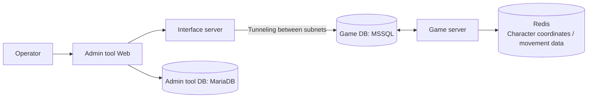
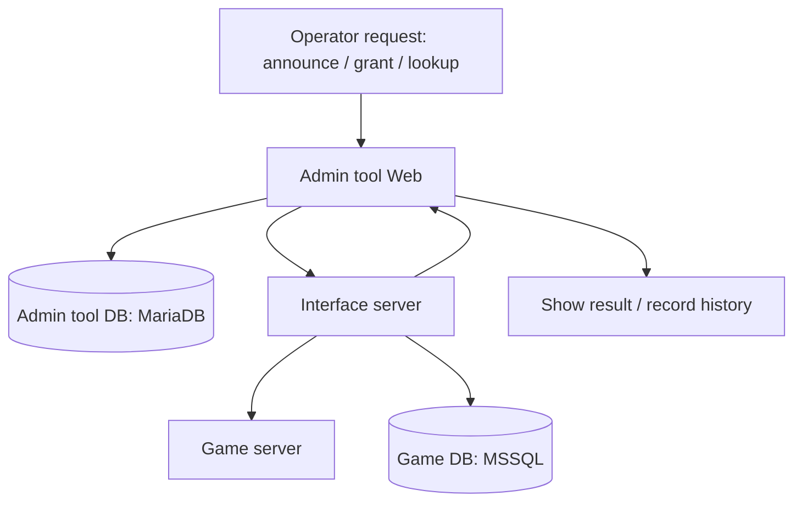
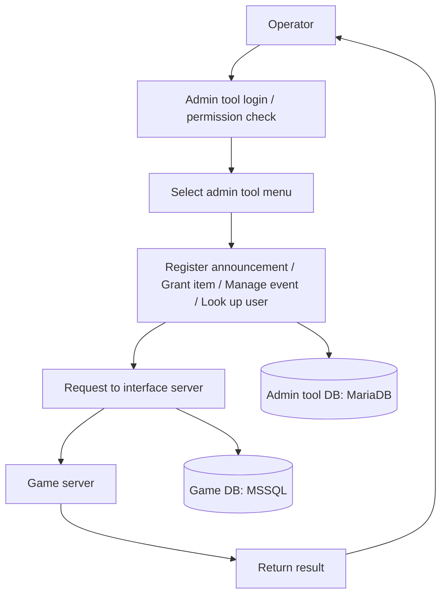
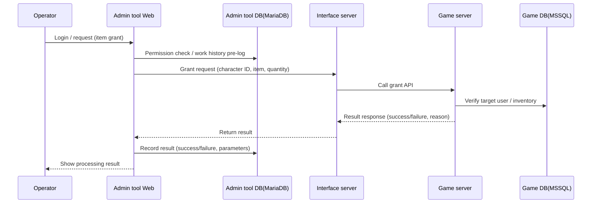
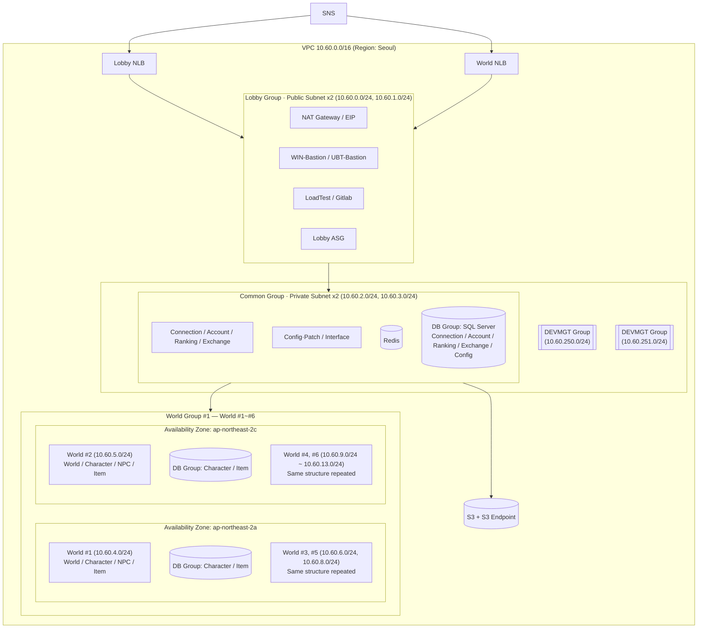

# YKW — Game Operations Admin Tool

My first professional project as a developer. I built data management and operations features to make game operations more efficient, and developed practical skills along the way.

## Background

The YKW admin tool is an internal web system built at a game company so that operators can carry out game operations work. It was built separately on AWS. The game itself ran on an entirely different group of servers: game data was managed in MSSQL, and real-time data flows such as character movement coordinates were handled in Redis. The admin tool itself was built on MariaDB.

The admin tool and the game servers and DB sat in completely separate subnets. An interface server reached the game servers and DB through tunneling between subnets. Through this tool, operators registered in-game announcements, granted items to specific characters, managed events, and looked up user data.

## Problem

- The game had not launched yet and there was no admin tool at all. A basic one had to be built from scratch to prepare for game operations.
- Core features the operations team needed, such as registering announcements, granting items, and looking up user data, had to be in place in advance.
- The tool had to follow a stable 3-tier architecture and security policy, with a defined communication path between the admin tool and the game servers.

## Goals

- Secure the essential operations features before launch: provide the operations team's core functions (announcement registration, item grants, event management, user data lookup) on the web
- Comply with security policy: develop on an AWS 3-tier architecture
- Operational efficiency: let operators handle most operations work without connecting to servers directly
- Extensibility: design the menu structure and interfaces flexibly to allow for new events and system expansion

## Architecture

The system consists of the admin tool web, an interface server, game servers, the admin tool DB (MariaDB), and the game DB (MSSQL). The game servers are not exposed externally and sit in a subnet completely separate from the admin tool, so admin tool requests are passed along only when the interface server reaches them through tunneling between subnets.

**Why this structure**

The overall structure, including security separation and the use of an interface server, was based on the company's standard architecture design. On top of this architecture, my part was developing the admin tool web server features and implementing the screens. I implemented the admin tool's menus and features so that operators could handle core tasks without server access, which contributed to operational efficiency.

**Tech stack mapping**

- Admin tool Web Backend: Java, Spring Framework (eGovFrame), MyBatis
- Admin tool Web Frontend/UI: JSP, JS components
- Main features: announcement registration, item grants, event management, user search/lookup
- Permission management/logging: work history records, access control by permission level
- DB: MariaDB (admin tool menu configuration and work history), MSSQL (game-linked lookups and the data targeted by item grants)
- Game server side: Redis (managing real-time data flows such as character movement coordinates). The admin tool does not handle it directly, but it is needed context for understanding the real-time nature of the game servers behind the interface server.

## Business Flow

An operator logs in, has their permissions checked, and selects a menu. The request goes through the interface server to the game server and DB, and the result is returned.

The sequence below uses an item grant as an example.

## What I Did

- Built the admin tool's base administration features: operator account management, access IP management, menu management, and program management, which together make up the tool's own basic management system
- Developed menus for collecting and querying game data logs
- Built features that work directly with game data: reached the game DB, which sat in a subnet completely separate from the admin tool, through tunneling, and developed features that handle game data directly, such as granting items to specific characters
- Developed the screens and backend APIs for the remaining operations features, including announcement registration, event management, and user search, and implemented menu access control by operator permission and work history recording
- Frontend/UI work: developed and maintained UI components with JSP, JavaScript, and jQuery that operators could use easily
- Bug fixes and maintenance: analyzed and fixed screen errors, data lookup errors, and similar issues that occurred frequently while preparing for game launch
- Operations team support: worked with the operations team to reflect feature requests and helped document operating procedures
- Deployment collaboration: used GitLab for source control and took part in build/deployment testing and verification following the company's standard deployment process

## Why These Technologies

- **Based on the company's standard architecture**: Following the policy that game servers are not externally accessible, the AWS 3-tier structure was used. The communication path was unified through the interface server, and communication security was strengthened with AWS S3 and RSA encryption.
- **eGovFrame**: The company's development standard was eGovFrame, which allowed fast development and maintenance.
- **MyBatis**: Complex SQL queries and a multi-DB environment (MariaDB, MSSQL) called for efficient Mapper management.
- **Separate DBs**: Keeping the admin tool DB and the game DB separate protected the stability of the admin tool and minimized the impact on the game service.
- **UI implementation efficiency**: JSP/JavaScript made it possible to build management features quickly that operators could use right away.

## Troubleshooting

During development, errors occurred in the interface integration and in some screen features. The causes were API call and response handling errors from a poor understanding of the interface integration spec, and insufficient test coverage, which meant exceptions when accessing some menus went unnoticed.

- Re-reviewed the interface server integration documents and reinforced the API call logic
- Wrote per-menu test scenarios and checklists and strengthened the QA process
- Established a way to reproduce and fix errors through code review and log-based debugging

All major errors were resolved before launch, and the system stabilized through launch and the early operations period without major incidents. It was an experience of quickly absorbing and correcting the problems that came from inexperience, and it greatly improved my test-driven development habits and my understanding of integration specs.

## Technologies

- Java, Spring Framework (eGovFrame), MyBatis
- MariaDB, MSSQL
- JSP, JavaScript, jQuery
- AWS
- GitLab (source control)

## Results

Built an environment where operators can perform most management tasks through the admin tool without server access. The announcement, item grant, and user management features required before launch were delivered reliably, which shortened the operations team's preparation time, and the intuitive UI and permission management improved operational efficiency and ease of work. As a first professional project, it let me grow quickly through experience with a real deployment environment, multi-DB integration, and both frontend and backend development.

## Reference: The Company's Standard AWS 3-Tier Architecture

The whole infrastructure the admin tool ran on was an AWS architecture that the company had already designed and built as a standard. I did not design it myself. On top of it, I was responsible for developing the admin tool web features and implementing the integrations. The full diagram I used as a reference for understanding the structure is below.

