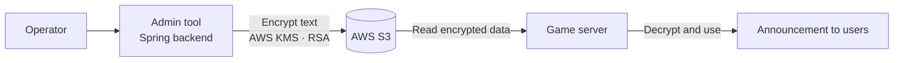

# Sending Text to the Game Server Safely: S3 and Encryption

This is a record of one feature I handled while building the game admin tool ([Yeolhyeol Gangho W — Game Operations Admin Tool](/en/projects/yeolhyeolgangho-admin-tool)). It was a small feature that took about a month, but I learned a lot from it because I had to read the AWS SDK directly and design the encryption myself.

## Background

When an operator enters text such as an in-game announcement in the admin tool, that text has to reach the game server and be shown to every connected user. With around a thousand users online, some of them must never see a wrong announcement or have incorrect text shown to them.

## Problem

The game server is highly sensitive. Apart from the channels the game itself opens, every way of connecting from outside is blocked. So sending data from the admin tool to the game server had to go through a fixed path.

The problem was that if the data is plain text on that path, it can be intercepted (hijacked) in the middle and swapped for different content. If text that every user sees, like an announcement, is tampered with, the impact is large. So we decided to encrypt the data being delivered.

## Architecture

The admin tool encrypts the text and uploads it to S3. The game server reads it, decrypts it, and uses it.

- Encryption used AWS KMS and RSA, and the reading side decrypted with a symmetric key.
- I developed the feature in the admin tool's Spring backend that encrypts the text and then uploads it to S3.
- Since nothing can connect to the game server directly from outside, the data goes through S3 as an intermediate store, but what is stored there is not plain text.

## How it was built

I worked from the SDK documentation and examples that AWS provides. First I sorted out how encryption and upload should be reflected in the code, designed it, and then implemented it.

## What was hard

I had little development experience at the time, so even reading the SDK documentation and applying it to code was not easy. The hardest part was that decrypted data sometimes did not match the original value. Encryption itself succeeded, but the reading side got a different result, so I checked step by step to find where the two sides diverged and brought them into line. There was a lot of trial and error in this process.

## What I learned

- Encryption is not finished when "it encrypts." It is finished when decrypting gives back the original value. The key is making both sides agree on the same settings.
- Sending data over a fixed path does not make plain text safe. For data where tampering has a large impact, protect the data itself instead of trusting the path.
- With an external service's SDK, do not just copy the examples. Understand how it works, so you can find the cause when something goes wrong.
