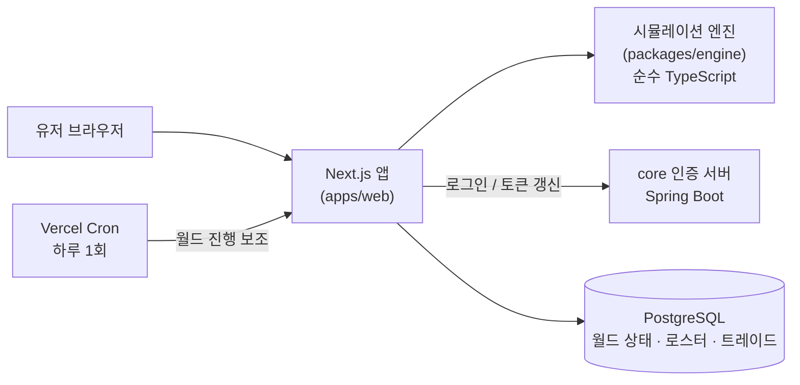
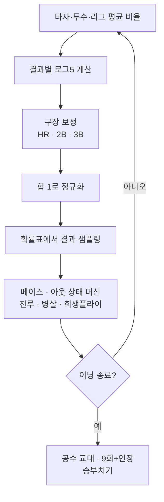
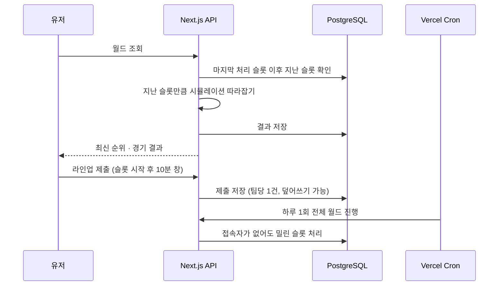
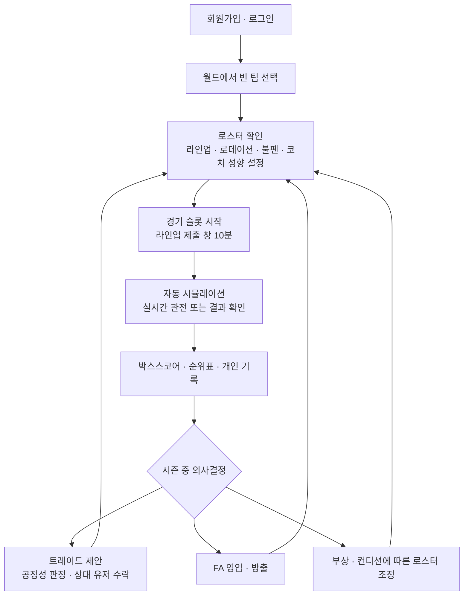

# 페넌트레이스 — 야구 매니지먼트 게임

실제 KBO·MLB 선수의 성적으로 팀을 꾸리고, 라인업과 투수 운용, 트레이드, FA를 직접 결정하면 서버가 시즌을 이어서 진행해 주는 웹 기반 야구 매니지먼트 게임. 이름은 페넌트레이스(Pennant Race)다.

## 배경

축구에는 Football Manager가 있는데 야구에는 이런 게임이 흔하지 않다는 아쉬움에서 시작했다. 원조 격인 OOTP Baseball이 있긴 하지만 웹에서 가볍게 즐길 수 있는 버전은 없다. 브라우저에서 가볍게 구단을 운영하고, 친구들과 같은 리그에서 경쟁할 수 있는 버전을 직접 만들어 보기로 했다.

목표는 화려한 그래픽이 아니라 숫자와 의사결정이다. 선수 얼굴이나 엠블럼 같은 이미지는 처음부터 넣지 않고, 박스스코어와 텍스트 중계 위주의 화면으로 간다.

## 해결하려던 문제

- 실제 선수 성적을 입력으로 받아, 결과 분포가 실제 야구와 크게 어긋나지 않는 경기 시뮬레이션을 만들어야 한다
- 한 경기를 끝까지 자동으로 돌리는 구조가 아니라, 투수 교체나 작전처럼 사람이 개입할 지점마다 멈출 수 있어야 한다
- 여러 유저가 한 리그를 공유할 때, 접속하지 않은 동안에도 시즌이 진행돼야 하고 동시에 같은 팀을 차지하거나 트레이드가 꼬이면 안 된다
- 서버리스 환경과 비용 제약(무료 플랜) 안에서 이 모든 걸 돌려야 한다
- KBO는 공식 공개 API가 없어 데이터 확보 방법부터 정해야 한다

## 목표

- 로그5(log5) 확률 모델로 한 타석의 결과를 계산하고, 이를 이닝·경기·시즌 단위 시뮬레이션으로 확장한다
- 감독 모드(투수 교체, 번트, 도루 등)와 코치 시스템으로 사람이 경기에 개입할 수 있게 한다
- 여러 유저가 팀을 맡는 월드를 만들고, 서버가 정해진 시간에 경기를 자동 진행한다
- 트레이드와 FA, 스토브리그까지 시즌이 이어지는 구조를 완성한다

## 아키텍처

npm workspaces 모노레포로, 시뮬레이션 엔진을 UI와 완전히 분리된 순수 TypeScript 패키지로 두었다. 웹과 나중에 만들 모바일 앱이 같은 엔진을 공유할 수 있게 하기 위한 결정이다.



- **엔진(packages/engine)**: 로그5 타석 계산, 이닝 상태 머신, 경기·시즌·월드 일정, 부상·컨디션·체력, 트레이드 평가를 담당한다. 프레임워크에 의존하지 않아 단위 테스트로 검증한다.
- **웹(apps/web)**: Next.js 앱 셸과 게임 화면, 그리고 서버 역할을 하는 API 라우트. 다국어(next-intl)와 다크/라이트 테마를 첫 커밋부터 적용했다.
- **인증**: 직접 만들지 않고 이미 운영 중인 별도 인증 서버(core)의 REST API만 호출한다. 로그인과 토큰 갱신은 core에 맡기고, 이쪽은 발급된 JWT를 검증해 사용자를 식별한다. 이메일 로그인에 더해 카카오·네이버 소셜 로그인(웹 인가 코드 방식)도 core를 거치도록 구현했고, 세션과 가입 토큰은 httpOnly 쿠키에만 둔다.
- **DB**: PostgreSQL. 월드 상태는 JSONB 한 행으로, 팀 클레임·트레이드 제안·라인업 제출은 별도 테이블로 나눴다.

## 시뮬레이션 엔진

한 타석의 결과를 볼넷, 사구, 삼진, 단타, 2루타, 3루타, 홈런, 아웃 여덟 가지 중 하나로 단순화하고, 타자와 투수 각각의 결과 비율을 리그 평균과 비교해 합성한다. 빌 제임스의 로그5 공식을 쓴다.

```
odds(x) = x / (1 - x)
oddsMatchup = odds(타자) × odds(투수) ÷ odds(리그 평균)
P(결과) = oddsMatchup / (1 + oddsMatchup)
```

여덟 개 결과에 각각 적용한 뒤 합이 1이 되도록 정규화하고, 구장 보정(파크 팩터)은 홈런·2루타·3루타에만 곱한다. 이렇게 얻은 확률표에서 결과를 뽑고, 그 결과를 베이스·아웃 상태에 적용해 이닝을 진행한다.



**의도적으로 단순화한 것**: 좌우 스플릿, 타구 방향·속도, 수비력은 반영하지 않는다. 8개 결과에 로그5를 독립 적용하는 방식도 결과 간 상관관계를 완벽히 보존하지 못하는 근사치다. 대신 개발량을 크게 줄이고 시즌 전체 시뮬레이션 속도를 확보했다. 검증은 표본 선수들로 대량의 타석을 돌려 결과 분포를 비교하고, 팀 단위로 시즌을 반복 시뮬레이션해 리그 평균 지표가 실제와 크게 어긋나지 않는지 확인하는 방식으로 한다.

### 사람이 개입하는 지점

경기를 끝까지 한 번에 돌리지 않고, 하프이닝 단위로 멈출 수 있는 스텝 구조로 설계했다. 이 구조는 나중에 고치기 어려운 결정이라 처음부터 반영했다. 감독 판단은 다음 두 방식이 같은 인터페이스를 쓴다.

- 유저가 직접 판단: 투수 교체, 번트, 도루 등
- 유저가 없을 때: 감독 성향 프로필(도루 적극성, 번트 성향, 강판 기준 등 슬라이더 값)에 따라 자동 판단

여기에 코치 시스템을 얹었다. 투수코치는 체력과 컨디션을 보고 교체하고, 타격코치는 대타를, 주루코치는 대주자와 도루 성공률을, 수비코치는 약한 수비수를 벤치 자원으로 교체한다. 작전에는 실제 야구처럼 실패 케이스(번트 헛스윙, 선행 주자 아웃 등)를 넣어 "작전 미스"가 일어나게 했다.

## 월드 모드 (멀티플레이)

여러 유저가 같은 리그를 공유하고 각자 팀을 하나씩 맡는다. 유저가 접속해 있지 않아도 시즌이 흘러가야 하므로 진행 구조가 단일 플레이와 다르다.



- **진행 속도**: 실제 30분 한 칸이 게임 속 하루다. KST 18시~23시 사이 하루 10칸이 열리고, 7경기마다 휴식 하루를 끼워 실제 시즌의 리듬을 비슷하게 만들었다.
- **따라잡기 방식**: 상시 켜 둔 서버가 경기를 돌리는 대신, 월드를 조회하는 요청마다 "마지막으로 처리한 이후 실제로 지난 슬롯"을 한꺼번에 시뮬레이션한다. 처리할 슬롯이 없으면 아무 일도 하지 않으므로 몇 번을 호출해도 안전하다(멱등). Cron은 아무도 접속하지 않은 날을 위한 보조 수단이다.
- **라인업 제출 창**: 경기 슬롯 시작 후 10분 동안 라인업을 제출할 수 있고, 제출하지 않으면 마감 시점에 자동 라인업으로 진행한다. 이후 남은 시간은 경기 관전용이다.
- **리그 구성**: MLB와 KBO를 하나의 월드로 합쳤다. 트레이드는 같은 리그 안에서만 가능하고, 리그를 넘나드는 이동은 공용 FA 풀을 거친다. 로스터 규정도 MLB는 26인, KBO는 28인으로 나눴다.
- **참가자 표시**: 다른 참가자에게는 이메일 대신 팀을 맡을 때 정한 닉네임만 보인다. 닉네임은 월드 안에서 대소문자 구분 없이 중복될 수 없다.
- **시즌 생애주기**: 정규시즌, MLB·KBO 각각의 포스트시즌 대진, 스토브리그(FA·트레이드 마감 이후)까지 실제 달력에 맞춰 자동으로 넘어간다.

## 비즈니스 플로우



## 담당한 일

기획부터 구현, 배포, 운영까지 혼자 맡았다.

- 게임 기획 문서 작성: 로드맵(엔진 → 한 구단 → 시즌 → 리그 → 월드 → 모바일), 선수 능력치 표현, 데이터 소스 방침
- 시뮬레이션 엔진 구현과 테스트(300개 이상): 로그5, 이닝 상태 머신, 부상 확률 모델, 컨디션과 체력, 감독·코치 판단
- 시즌 모드: 일정 생성, 순위표, 포스트시즌, 저장
- 월드 모드: 팀 클레임, 슬롯 일정, 따라잡기 진행, 라인업 제출, 트레이드 제안·수락, 로스터 규정
- 관전 화면: 투구 단위 중계 문구, 타구 방향·종류 연출, 다이아몬드 라이브 뷰, 박스스코어
- 인증 연동(이메일, 카카오·네이버 로그인), 다국어(한국어·영어)와 테마, 로스터 데이터를 직접 입력하는 관리 도구
- 배포와 운영: Vercel 배포, 자체 호스팅 PostgreSQL 연결, Cron

## 기술 선택 이유

- **TypeScript 모노레포**: 엔진을 순수 TypeScript로 만들어 두면 웹과 모바일(Expo)이 같은 시뮬레이션 코드를 공유할 수 있다. 백엔드 언어를 Java로 바꾸면 이미 쌓인 엔진을 다시 짜야 해서 TypeScript로 통일했다.
- **Next.js API 라우트**: 이 규모에서는 별도 서버 없이 같은 앱 안에서 API를 두는 편이 배포와 운영이 단순했다.
- **PostgreSQL + JSONB**: 월드 상태처럼 통째로 읽고 쓰는 큰 구조는 JSONB로, 동시성이 중요한 클레임·트레이드 제안은 별도 테이블로 나눴다.
- **이벤트 기반 시뮬레이션**: 투구 단위로 구종과 코스까지 시뮬레이션하면 훨씬 사실적이지만 개발량이 커진다. 타석 결과를 확률표에서 바로 뽑는 방식으로 시작하고, 중계의 투구·타구 묘사는 결과에 영향을 주지 않는 연출로 얹었다.
- **core 인증 재사용**: 이미 운영 중인 인증 서버의 로그인 API만 호출해 계정 관리를 중복 구현하지 않았다.

## 트러블슈팅

**1. 트레이드 "끼워팔기" 버그**

트레이드 공정성은 선수 가치를 합산해 한쪽이 일정 비율 이상 손해 보지 않으면 수락하는 방식이었다. 그런데 평균 이하 선수의 가치는 음수로 나오고, 한쪽 묶음에 약한 선수를 끼워 넣으면 그 음수가 합계에서 빠지면서 그 묶음이 "덜 주는 것"처럼 계산됐다. 실제로 최약체 불펜투수를 얹어 주는 조건으로 스타 선수를 백업 포수 한 명에 데려오는 트레이드가 통과됐다.

- **원인**: 선수 개별 가치를 부호 그대로 합산해, 나쁜 선수를 얹을수록 거래가 쉬워졌다.
- **조치**: 한 묶음을 합산할 때 선수 개개인 가치가 0 밑으로 내려가지 않게 막았다. 화면에 보이는 합계도 같은 함수를 쓰도록 맞춰 판정과 표시가 어긋나지 않게 했다.
- **함께 고친 것**: 단순 비율 비교는 값이 음수일 때 부등식이 뒤집혀 오히려 더 후하게 통과시켰다. 이는 테스트로 잡아 거래 규모에 비례한 허용폭과 차이를 비교하는 방식으로 바꿨다.

**2. Cron이 한 번도 성공하지 못했던 문제**

월드 진행을 보조하는 Cron이 POST만 받는 엔드포인트를 호출하고 있었다. Vercel Cron은 GET으로 호출하므로 405가 계속 났는데, 응답을 따로 확인하지 않아 알아채지 못했다. GET으로 맞추고, 월드 하나를 하드코딩하던 것도 전체 월드를 순회하도록 일반화했다. 한 월드가 실패해도 나머지는 계속 처리한다. 무료 플랜은 Cron 주기에 제한이 있어 하루 1회로 두었고, 주 진행은 조회 시 따라잡기가 맡는 구조라 크게 문제되지 않았다.

**3. 서버리스에서 파일 수정이 사라지는 문제**

KBO 로스터를 직접 입력하는 관리 도구가 JSON 파일에 저장했는데, 서버리스 배포는 파일시스템이 요청과 배포마다 초기화돼 운영에서는 수정이 반영되지 않았다. 로스터 원본을 PostgreSQL 테이블로 옮기고, 정적 JSON은 테이블이 비어 있을 때만 쓰는 최초 시드로 바꿨다.

**4. 중간 트레이드 후 선수 ID 충돌**

시즌 중 트레이드된 선수의 ID가 팀 단위 구조에서 충돌하는 문제가 있었다. 선수 ID에 팀 네임스페이스를 붙여 해결했다.

**5. DB 이전**

무료 관리형 DB의 쿼터를 넘기면서 운영 DB를 자체 호스팅 PostgreSQL로 옮겼다. 자체 서명 인증서를 쓰기 때문에 전송 구간은 암호화하되 인증서 검증만 끄는 환경 변수로 분기했다. 공인 인증서를 쓰는 관리형 DB로 돌아가면 변수를 끄기만 하면 된다. DB에 연결하지 못할 때 앱이 죽지 않고 연결 문자열이나 비밀번호는 빼고 안전한 JSON 오류만 내리도록 했다.

**6. 실명 데이터와 수집 방식**

MLB는 공개 JSON을 쓸 수 있지만 KBO 공식 기록은 공개 API가 없고, 주요 기록 사이트는 자동 수집을 막고 있다. 스크래핑하지 않고 직접 입력하는 관리 도구로 로스터를 채웠다. 지금은 비상업 개인 프로젝트 수준이지만, 서비스 규모가 커지면 데이터 라이선스를 정식으로 검토하고 안 되면 가상 리그로 전환하는 선택지를 열어 두었다.

## 기술

- TypeScript, npm workspaces
- Next.js (App Router), next-intl, next-themes
- PostgreSQL (pg), JSONB
- Vitest (엔진 테스트 300개 이상)
- Vercel (배포, Cron), 자체 호스팅 PostgreSQL
- JWT 검증, 외부 인증 서버(Spring Boot) 연동

## 현재 상태

엔진, 시즌 모드, 월드 모드(팀 클레임, 자동 진행, 트레이드, FA, 포스트시즌, 스토브리그 알림)까지 동작한다. 친구들과 베타로 쓰는 단계이고, 2026-10-14에 이름을 페넌트레이스로 정했다. 이후 계획은 다음과 같다.

- 시즌 중 자동 진행된 경기를 사후에 훑어보며 감독·코치 성향을 조정하는 리뷰 화면
- 부상·트레이드 요청 같은 결정이 필요한 이벤트 알림
- 리그 간 포스팅 제도
- Expo 기반 모바일 앱
