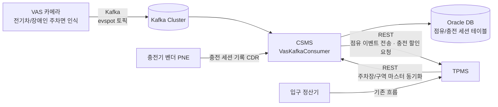
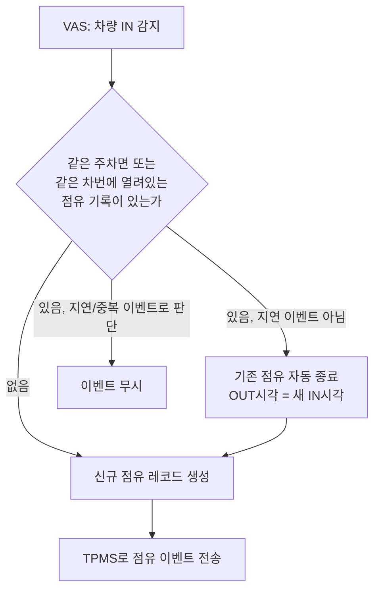
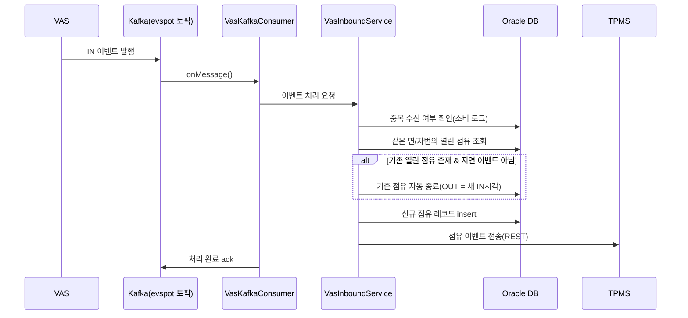
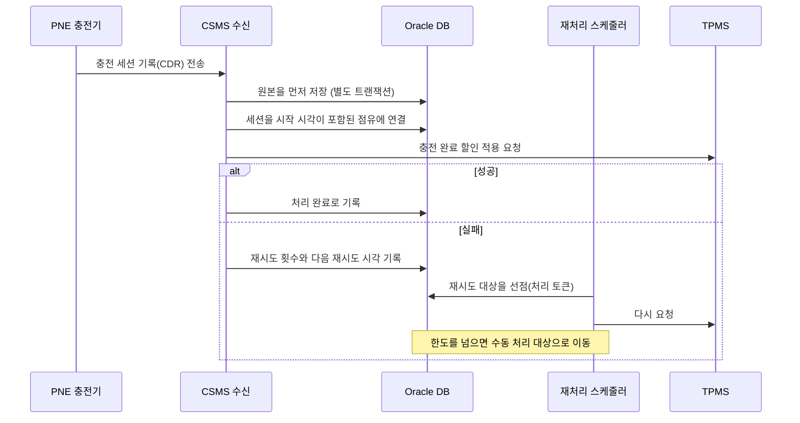

# 부천 CSMS 전기차 충전 관리 시스템

전기차 충전 관리 시스템(CSMS) 구축 프로젝트를 진행하던 개발자의 퇴사로 인수인계를 받아, 미완성 기능 보완과 데이터 정합성 처리, 연계 확장, 감리 대응까지 핵심 담당자로 마무리한 프로젝트.

## 배경

부천 사이트에는 이미 TPMS(Total Parking Management System, 통합주차관리 시스템)가 운영되고 있다. 차량이 입차하면 입구 정산기가 차량 번호를 인식해 TPMS로 전달하고(사전에 행안부 저공해차 조회 등으로 할인 여부 확인), TPMS가 주차 데이터를 관리한다. 이번에 새로 VAS(전기차·장애인 주차면을 보는 카메라 기반 영상분석 시스템)가 구축되면서, 특정 차량이 전기차 전용면에 주차하면 VAS가 번호판을 인식해 Kafka로 이벤트를 발행하고, 그 이벤트를 받아 "이 차량이 지금 충전 중인가"를 판단·관리하는 시스템으로 CSMS가 구축됐다. 충전기는 벤더(PNE)의 장비로, 충전이 끝나면 충전 세션 기록(CDR)이 CSMS로 전달되고 이를 바탕으로 TPMS에 충전 할인이 적용된다.

개발자가 퇴사하면서 프로젝트를 인수인계 받았다. 문서상으로는 개발이 끝난 것으로 넘겨받았지만, 실제로 구조를 파악해 보니 데이터가 맞지 않는 부분과 종료 처리가 제대로 되지 않은 부분이 남아 있었다. 4월부터 이 부분을 하나씩 확인하며 보완했고, 프로젝트 종료 전에는 감리 대응과 운영 매뉴얼 작성까지 이어졌다.

## 해결하려던 문제

- 인수 시점에 산출물(표준데이터베이스 설계서 등)과 실제 운영 DB 스키마가 서로 맞지 않았다
- 문서상 "개발 완료"로 표시된 항목 중 일부가 실제로는 구현돼 있지 않았다
- **열린 채로 남는 기록**이 정합성을 깨뜨렸다. 차량이 나간 것을 VAS가 놓치면 주차면 점유가 끝나지 않았고, 충전기에서 세션이 제대로 종료되지 않으면 충전 세션이 "충전 중"으로 남아 충전 시간이 비정상적으로 길게 표시되거나 데이터가 꼬였다
- 충전 완료 후 TPMS로 할인을 적용하는 연계가 실패하거나 중복되더라도 데이터가 어긋나지 않게 처리할 구조가 필요했다
- 신규 요구사항으로 전기차 점유 이력을 TPMS에서도 API로 조회할 수 있어야 했다
- 프로젝트 종료 전 감리 대응(시큐어코딩, 웹취약점, 웹접근성)이 필요했다

## 목표

- 인수받은 프로젝트의 구조와 미완성 항목을 파악해 잔여 개발을 마무리
- 점유와 충전 세션처럼 "열린 채 남는 기록"을 자동으로 정리하고, 지연·중복·정정 데이터에도 정합성이 유지되게 함
- TPMS와의 연계 범위를 확장해 전기차 점유 이력을 TPMS에서도 조회 가능하게 함
- 감리 지적사항을 대응하고 운영 매뉴얼을 정리해 프로젝트를 마무리

## 아키텍처

CSMS는 Java 8 + Spring Framework(전자정부프레임워크 eGovFrame) 기반의 전통적인 MVC 구조로, TPMS와 같은 계열의 레거시 스택이다. MyBatis로 Oracle DB에 접근하며, VAS로부터는 Kafka로 실시간 점유 이벤트를 수신하고, TPMS와는 REST API로 통신한다. 충전기 벤더(PNE)와는 충전기 정보와 충전 세션 기록(CDR)을 주고받는 연동이 붙어 있다.

**기술 스택**

- Backend: Java 8, Spring Framework(eGovFrame), MyBatis
- Database: Oracle(RAC 구성), HikariCP 커넥션 풀
- Messaging: Kafka(spring-kafka), 수동 커밋(manual ack) + 중복수신 방지용 소비 로그 테이블
- 기타: Spring Batch/Quartz(정기 동기화 배치), 재처리 스케줄러, Spring Security, Redis, log4j2

## 비즈니스 플로우

VAS가 발행한 IN/OUT 이벤트를 Kafka로 수신해 점유 상태를 갱신하고, 처리 결과를 TPMS로 다시 전달하는 흐름이다.

Kafka 컨슈머가 이벤트를 받아 처리하는 과정을 시간 순서로 보면 다음과 같다.

충전이 끝나면 충전기 벤더가 보내는 충전 세션 기록(CDR)은 다음 순서로 처리된다.

## 담당한 일

- **퇴사자 인수인계**: 산출물과 실제 DB 스키마 불일치, 문서상 "완료"로 표기됐지만 미구현·미완성인 항목을 하나씩 확인하며 프로젝트 전체 구조 파악
- **VAS 점유 유실 보완**: VAS가 간헐적으로 OUT 이벤트를 보내지 못해 점유가 끝나지 않던 문제를, 같은 주차면(또는 같은 차량 번호)에 새 IN 이벤트가 들어오면 기존 기록을 자동 종료하도록 처리. 지연·중복 이벤트를 잘못 종료하지 않도록 이벤트 시각 비교 가드도 구현
- **충전 세션(CDR) 정합성 처리**: 종료되지 않은 세션과 어긋난 데이터를 정리하는 처리 구조 구현. 수신한 원본 선저장, 중복·정정 구분, 처리 상태와 재시도, 한도 초과 시 수동 처리 이동, 처리 중 멈춘 건 복구, 점유 연결 규칙, 트랜잭션 분리까지 포함
- **TPMS 연계**: 충전 완료 후 할인 적용 호출의 안정화, 전기차 주차면 점유 이벤트를 TPMS로 전달하고 TPMS에서도 전기차 점유 이력을 조회할 수 있는 신규 API 개발
- **대시보드 보완**: 출차 데이터가 없는 건의 처리, 차량 번호 매핑 오류, 전일·전월 누적 집계 매핑, 이벤트 상세 화면 개선
- **감리 대응**: 시큐어코딩 지적사항의 코드 수정, 웹 취약점과 웹접근성 조치 보고서 항목별 수정, 표준데이터베이스 설계서 등 산출물 정비
- **운영 매뉴얼**: 발주처 요청으로 작성해 제공

## 트러블슈팅

**1. 점유 기록이 끝나지 않고 쌓이는 문제**

VAS가 특정 주차면에서 차량이 빠져나가는 것을 인식하지 못하면 해당 주차면의 점유 기록이 영구히 "진행 중" 상태로 남았고, 화면에 표시되는 점유 시간이 수천 시간 단위로 비정상적으로 집계됐다.

- **원인**: OUT 이벤트가 아예 발행되지 않으니 점유 종료 시점을 판단할 다른 신호가 시스템 안에 없었다.
- **조치**: OUT 이벤트가 없어도, 같은 주차면(또는 동일 차량 번호)에 새로운 IN 이벤트가 들어오면 먼저 있던 점유는 이미 끝난 것으로 간주해 자동 종료했다. 종료 시각은 처리 시점이 아니라 새로 들어온 IN 이벤트의 시각으로 기록해 실제 점유 시간과 최대한 가깝게 맞췄다.
- **부가 처리**: 지연되어 늦게 도착한 IN 이벤트가 더 최신의 정상 점유를 잘못 종료시키지 않도록, 기존 열린 점유의 시작 시각이 새 이벤트보다 늦으면 지연 이벤트로 판단해 무시했다. 매칭되는 열린 점유가 없는 OUT 이벤트도 오류 없이 무시한다.
- **결과**: 점유 시간이 비정상적으로 누적되는 현상이 사라졌고, 자동 종료가 발생한 케이스는 로그로 남겨 VAS 쪽 인식률 개선의 근거 자료로 쓸 수 있게 했다.

**2. 충전 세션이 끝나지 않거나 데이터가 어긋나는 문제**

인수받을 때는 완료된 것으로 되어 있었지만 충전 세션 쪽 정합성 처리가 충분하지 않았다. 세션이 제대로 종료되지 않으면 이미 끝난 충전이 "충전 중"으로 남아 충전 시간이 비정상적으로 길어 보였고, 지연되어 도착한 종료 기록이 다음 차량의 점유에 잘못 연결될 여지도 있어 데이터가 꼬였다.

- **원본을 먼저 저장**: 충전 세션 기록을 받으면 세션·차량 조회나 TPMS 호출에 앞서 원본부터 별도 트랜잭션으로 확정한다. 이후 처리가 실패해도 원본은 남아 재처리할 수 있다.
- **중복과 정정 구분**: 같은 기록이 다시 오면 내용이 같은지 비교해 단순 중복인지 정정인지 구분해 로그를 남긴다.
- **점유 연결 규칙**: 수신 시점의 현재 차량이 아니라 세션 시작 시각을 포함하는 점유에 연결한다. 지연된 종료 기록이 다음 차량의 점유로 붙는 문제를 막기 위해서다. 입출차 매칭이 모호한 건은 별도 상태로 분리한다.
- **상태와 재시도**: 기록마다 처리 상태, 재시도 횟수, 다음 재시도 시각을 관리하고, 재시도 대상은 처리 토큰으로 선점해 동시에 두 곳에서 처리되지 않게 한다. 처리 중에 멈춘 건은 복구하고, 재시도 한도를 넘은 건은 수동 처리 대상으로 옮긴다.
- **트랜잭션 분리**: 서로 다른 주차장 경로의 처리를 분리해, 한쪽 실패가 다른 주차장의 충전 기록 처리까지 롤백하지 않게 했다.
- **실패 전파**: 충전 완료 할인 호출이 실패하면 그 결과를 호출한 쪽에 전달해, 저장이 성공으로 끝난 것처럼 보이지 않게 했다.

**3. 대시보드 데이터 불일치**

대시보드에서 출차 데이터가 없는 건이 계속 "이용 중"으로 표시되거나 차량 번호가 맞지 않게 연결되는 문제가 있었다. 앞의 두 문제(열린 채 남는 점유와 세션)와 같은 뿌리여서, 정합성 처리를 먼저 고친 뒤 대시보드 쪽 집계와 매핑을 맞췄다. 출차가 없는 건을 처리하는 로직, 차량 번호 매핑, 전일·전월 누적 데이터 매핑을 수정하고 이벤트 상세 화면에는 무한 스크롤을 적용했다.

## 감리 대응

프로젝트 종료 전에 시큐어코딩, 웹 취약점, 웹접근성에 대한 감리 지적이 나왔다.

- **시큐어코딩**: 지적사항이 많아 4월 말부터 5월 초까지 지적 항목별로 코드를 수정했다. 예외 처리를 비롯한 여러 유형의 지적을 조치했고, 일부 파일은 팀 동료의 도움을 받아 나눠 작업했다.
- **웹 취약점·웹접근성**: 받은 점검 보고서의 항목을 하나씩 확인해 수정했다. 쿼리 조건을 강화하는 조치도 포함됐다.
- **회귀 확인**: 조치 후 동작하지 않게 된 기능을 정상화하는 작업이 이어졌다.

## 기술

- Java 8, Spring Framework(전자정부프레임워크), MyBatis
- Oracle
- Kafka
- Spring Batch, Quartz, Spring Security, Redis

## 결과

인수 시점의 문서-실물 불일치와 미구현·미완성 항목을 확인해 정리했고, 점유와 충전 세션처럼 열린 채 남는 기록으로 인한 데이터 오류를 근본 원인부터 처리했다. 원본을 먼저 저장하고 재시도와 수동 처리 단계까지 갖춘 충전 세션 처리로 일시적 실패나 지연 데이터에도 정합성이 유지되게 했고, TPMS에서도 전기차 점유 이력을 조회할 수 있도록 연계를 확장했다. 감리 지적사항에 대응하고 운영 매뉴얼을 발주처에 제공해 프로젝트를 마무리했다.
