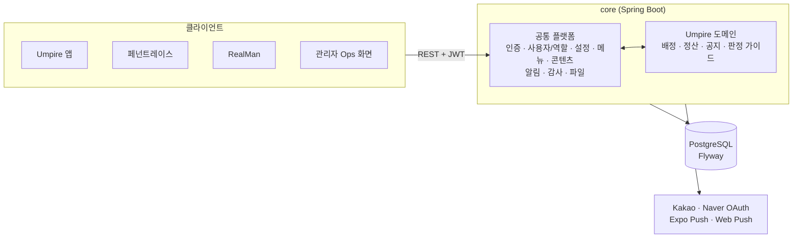
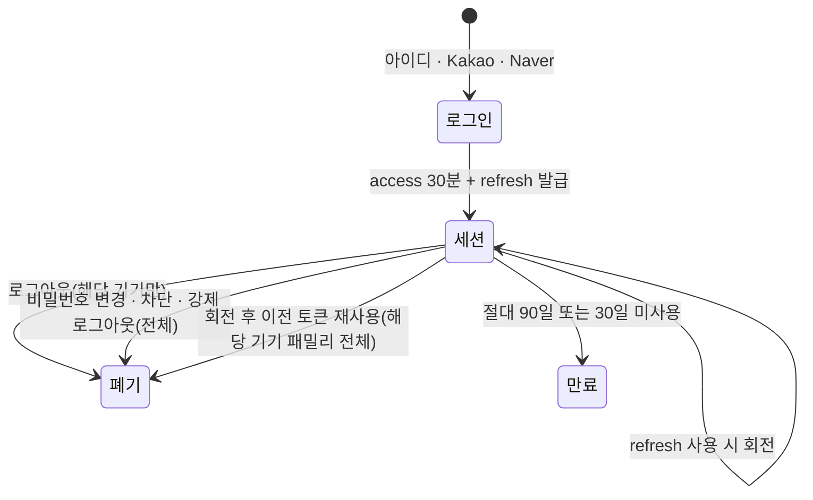
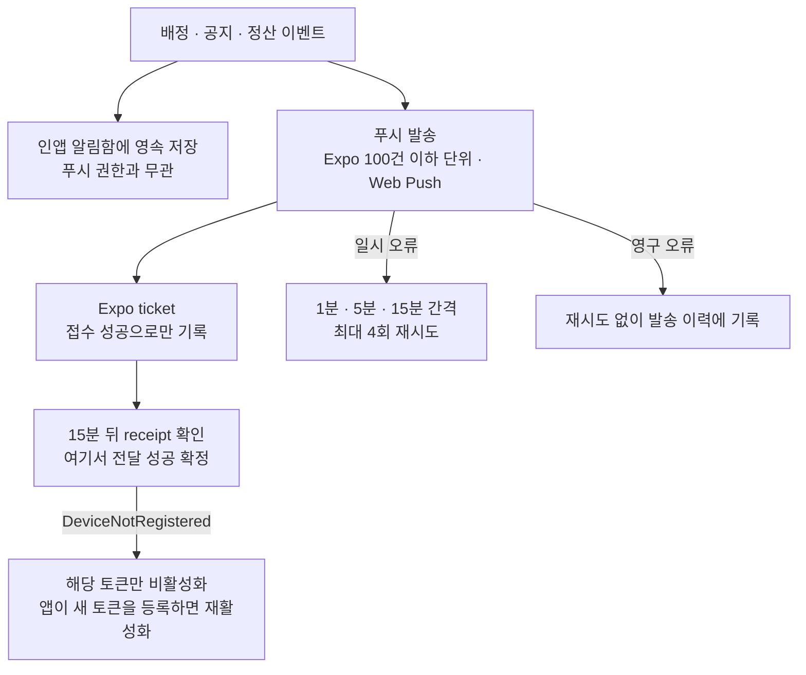

# Empire Core Platform

여러 서비스가 반복해서 필요로 하는 계정, 로그인, 권한, 알림, 감사 기능을 하나의 백엔드로 모은 공통 플랫폼. 같은 코드베이스 안에 심판 배정·정산 도메인([Umpire 플랫폼](/projects/umpire-platform))이 올라가 있고, 다른 개인 프로젝트도 이 인증을 REST로 사용한다. 여기서는 **도메인이 아니라 플랫폼 쪽**, 즉 인증과 세션, 푸시 전달, 감사, 서비스 확장 구조를 다룬다.

## 배경

서비스를 하나 만들 때마다 회원가입, 로그인, 소셜 연동, 토큰 갱신, 역할, 알림 발송을 처음부터 다시 만들면 보안 정책이 서비스마다 달라지고 운영 기준도 흩어진다. 반대로 처음부터 이것들을 별도 서비스로 쪼개면 혼자 운영하는 규모에서는 배포와 계약 관리 비용이 더 크다. 그래서 공통 기능은 하나의 플랫폼으로 두고, 서비스 고유 로직은 그 위의 패키지로 분리하는 구조를 택했다.

## 해결하려던 문제

- 서비스마다 인증, 세션, 권한 정책이 다르면 보안 사고 지점이 늘어남
- 모바일 앱에서 세션을 길게 유지하면서도 토큰이 탈취되거나 로그아웃된 기기가 계속 접근하는 일을 막아야 함
- 푸시는 "보냈다"와 "전달됐다"가 다르고, 실패 원인을 추적할 방법이 필요함
- 관리자 조작과 중요한 변경을 나중에 되짚어 볼 수 있어야 함
- 새 서비스가 추가될 때 사용자와 역할 모델을 다시 만들지 않아도 되어야 함

## 목표

- 인증, 역할, 알림, 감사를 한 곳에서 일관되게 제공한다
- 서비스 타입으로 사용자와 메뉴, 설정을 서비스별로 구분하면서 인증 코드는 공유한다
- 토큰 정책을 문서로 명시하고 코드와 테스트로 고정한다
- 서비스 도메인 코드가 공통 플랫폼에 의존하는 방향을 유지해, 나중에 분리할 수 있게 한다

## 구조

- **공통 플랫폼**(`com.empire.core`): 인증, 사용자와 역할, 서비스 타입별 설정·메뉴·콘텐츠, 파일 메타데이터, 알림, 감사 로그, 스케줄러, 공통 응답과 예외 처리
- **서비스 도메인**(`com.empire.service.*`): 지금은 Umpire 하나. 같은 JAR와 같은 DB에서 돌지만 패키지 경계를 두고, 서비스가 core를 호출하는 방향을 원칙으로 한다
- **서비스 타입**: UMPIRE, REALMAN, FRONTOFFICE. 사용자는 하나의 서비스에 속하고 메뉴·설정·역할 범위를 서비스별로 나눈다
- **스키마 관리**: PostgreSQL + Flyway. Hibernate는 `validate`만 하고 모든 변경은 마이그레이션 파일(60개 이상)로 한다

### 단일 JAR로 시작한 이유와 한계

서비스를 별도 프로세스로 쪼갤 수도 있었지만 혼자 운영하는 규모에서 서비스 간 계약, 배포, 모니터링을 따로 두는 비용이 이득보다 크다고 판단했다. 대신 의존 방향을 지켜 분리할 길을 열어 뒀다. 현재는 core의 스케줄러와 관리자 화면이 Umpire 서비스를 직접 호출하는 부분이 남아 있어 분리하려면 사용자·역할 데이터의 소유권, 서비스 간 이벤트 계약, 정산·배정·알림 트랜잭션 경계를 먼저 정해야 한다. 이 선결 과제는 문서로 정리해 두었다.

## 인증과 토큰 정책

토큰 정책은 별도 문서로 명시하고 코드와 테스트가 그것을 따르게 했다.

- **access 토큰**: 30분. 로그나 URL에 남기지 않는다.
- **refresh 토큰**: 기기·브라우저별 세션으로 분리하고, 갱신할 때마다 새 토큰으로 회전한다. DB에는 원문 대신 SHA-256 해시와 세션 패밀리, 만료·폐기·마지막 사용 시각만 저장한다. 최대 90일, 30일 미사용이면 만료.
- **재사용 탐지**: 회전 직후의 중복 요청은 네트워크 재시도일 수 있어 10초의 유예를 두고, 그 뒤에 이전 토큰이 다시 쓰이면 탈취로 보고 해당 기기의 세션 패밀리를 폐기한다.
- **즉시 로그아웃**: access 토큰도 세션 패밀리에 묶어 검증해서, 로그아웃되거나 강제 폐기된 기기의 남은 access 토큰을 바로 거부한다.
- **폐기 범위**: 로그아웃은 현재 기기만, 비밀번호 변경·계정 차단·관리자 강제 로그아웃은 모든 세션을 폐기한다.
- **관리자 웹**: HttpOnly refresh 쿠키를 쓰고 20분 주기·화면 복귀·401 응답 시 자동 갱신한다.
- **소셜 로그인**: Kakao, Naver. 개발용 앱을 따로 만들어 운영 앱 설정과 분리했다.

### 다른 서비스와의 연동

외부 서비스는 core의 인증 API(로그인, 가입, 토큰 갱신, 소셜 로그인)만 REST로 호출한다. 페넌트레이스(야구 매니지먼트 게임)가 그 사례로, 계정과 로그인은 core에 맡기고 발급된 JWT를 자체 서버에서 검증해 사용자를 식별한다. 서비스마다 사용자를 따로 만들지 않고, 서비스 타입을 추가하는 것으로 새 서비스를 받는다.

## 푸시 알림 전달

푸시 발송을 "API를 호출했다"에서 끝내지 않고 실제 전달까지 추적한다.

- **이벤트 원본은 서버 데이터**: 푸시는 변경을 알리는 보조 수단이다. 모든 공통 발송 이벤트는 푸시 권한이나 토큰 유무와 상관없이 사용자별 인앱 알림함에도 저장한다.
- **접수와 전달을 구분**: Expo ticket은 접수 성공으로만 기록하고, 15분 뒤 receipt를 확인한 뒤에야 전달 성공으로 확정한다.
- **사용자당 여러 기기**를 허용하고, 푸시 토큰은 인증 수단이 아니다.
- **커버리지 점검**: 활성·수신 동의 사용자 중 Expo와 웹 푸시가 모두 없는 사람을 매일 점검한다. 운영 전에 이 목록이 0이어야 한다.
- **장애 기준**: receipt 대기가 예정보다 30분 이상 지연되거나 재시도 대기가 10분 이상 지연되면 장애로 본다.

## 감사 로그와 운영 추적

- 관리자 조작과 중요한 변경은 서비스 코드에서 명시적으로 감사 로그를 남긴다. 변경 전후 상태와 대상을 기록해 원인을 되짚어 볼 수 있다.
- 감사 로그는 매일 JSONL 파일로 보관한 뒤 DB에서 정리한다.
- 운영 푸시 상태를 매일 새벽 점검하는 감사 워크플로가 있고, 활성 사용자 중 푸시를 받을 수 없는 사람이 있는지 확인한다.

## 담당한 일

기획, 설계, 개발, 배포, 운영을 혼자 맡았다.

- 공통 플랫폼과 서비스 도메인의 패키지 책임 경계 설계
- 가입, 로그인, 소셜 로그인, 세션 회전과 재사용 탐지, 로그아웃과 강제 폐기
- 서비스 타입과 역할 기반 권한, 메뉴, 설정, 콘텐츠 관리
- 푸시 발송 파이프라인(접수, receipt 확인, 재시도, 토큰 비활성화)과 인앱 알림함
- 감사 로그와 보관 스케줄러, 운영 점검 워크플로
- Flyway 마이그레이션과 Testcontainers 기반 통합 테스트
- 토큰 정책 문서, 운영 전환 체크리스트, 배포·롤백 워크플로

## 트러블슈팅

**1. 탈퇴 후 재가입한 사용자의 인증 500**

요청마다 도는 인증 조회가 삭제 여부를 거르지 않았다. 아이디가 서비스 타입별로 범위가 나뉜 뒤에는 "탈퇴한 옛 계정"과 "같은 아이디로 재가입한 새 계정"이 공존할 수 있어, 조회가 두 행을 반환하며 해당 사용자의 모든 인증 요청이 500이 됐다. 삭제되지 않은 사용자만 조회하도록 고치고, 위험한 쿼리는 삭제했으며, 이 시나리오를 통합 테스트로 고정했다.

**2. 리버스 프록시 뒤의 OAuth 콜백 주소**

관리자 소셜 로그인의 콜백 주소가 `http://호스트:80/...`로 잘못 만들어졌다. TLS를 종단하는 프록시 뒤에서 앱이 요청의 scheme과 port를 그대로 썼기 때문이다. 프록시 헤더를 반영해 절대 주소를 만들도록 바꾸고, 인증 전 단계에서 막히던 콜백 경로의 보안 설정 누락도 함께 고쳤다.

**3. 운영 감사 워크플로가 매일 실패하던 문제**

운영 푸시 감사 워크플로가 Flyway 스키마 버전을 하드코딩해 비교하고 있어서, 마이그레이션이 하나 늘 때마다 매일 새벽 무조건 실패했다. 최신 버전을 실행 시점에 마이그레이션 폴더에서 계산하도록 바꿨다. 같은 감사에서 걸린 미사용 테스트 계정을 확인 후 정리했다.

## 기술 선택 이유

- **Spring Boot 3 + Spring Security + JWT**: stateless API라 모바일 앱, 웹, 다른 서비스가 같은 방식으로 인증한다. 세션은 서버가 회전·폐기를 제어할 수 있도록 refresh 토큰만 DB로 관리한다.
- **PostgreSQL + Flyway**: 스키마를 코드로 관리하고, 운영 DB와 코드가 어긋나지 않게 Hibernate는 검증만 한다.
- **Testcontainers**: 세션 회전의 동시성이나 탈퇴·재가입 시나리오처럼 DB 동작이 중요한 부분을 실제 PostgreSQL로 검증한다.
- **Expo Push + Web Push**: 별도 비용 없이 모바일과 웹을 모두 커버한다. 카카오 알림톡 같은 유료 채널은 비용 대비 효용이 낮아 보류했다.

## 기술

- Java 17 / Spring Boot 3.5
- Spring Security / JWT
- Spring Data JPA / Flyway / PostgreSQL
- Thymeleaf (관리자 화면)
- Testcontainers / JUnit 5 / Mockito
- Kakao · Naver OAuth, Expo Push, Web Push (VAPID)
- Docker / GitHub Actions (배포, 롤백, 운영 감사)

## 현재 상태

Umpire 서비스가 이 플랫폼 위에서 실제 운영 중이고, 페넌트레이스가 인증을 REST로 연동해 쓰고 있다. 스케줄러에 분산 락이 없어서 인스턴스를 늘리려면 중복 실행을 먼저 막아야 한다는 점과, 도메인 분리 전에 정리할 선결 과제는 문서로 관리하고 있다.
