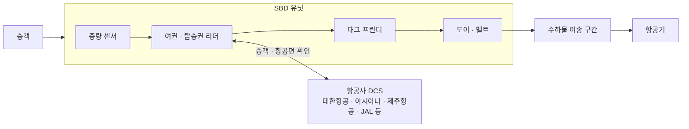
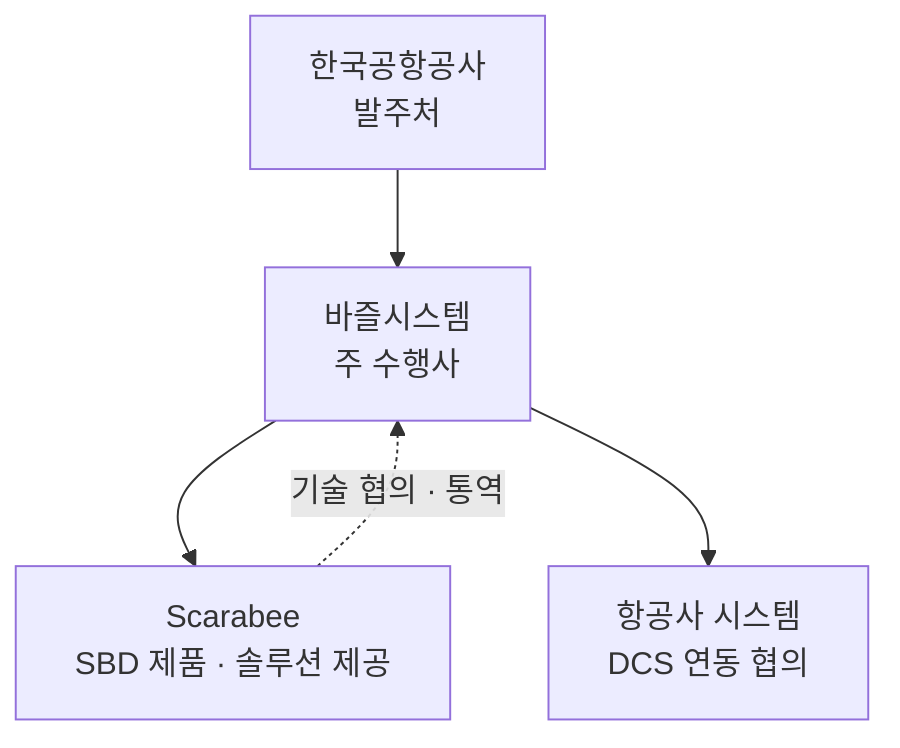
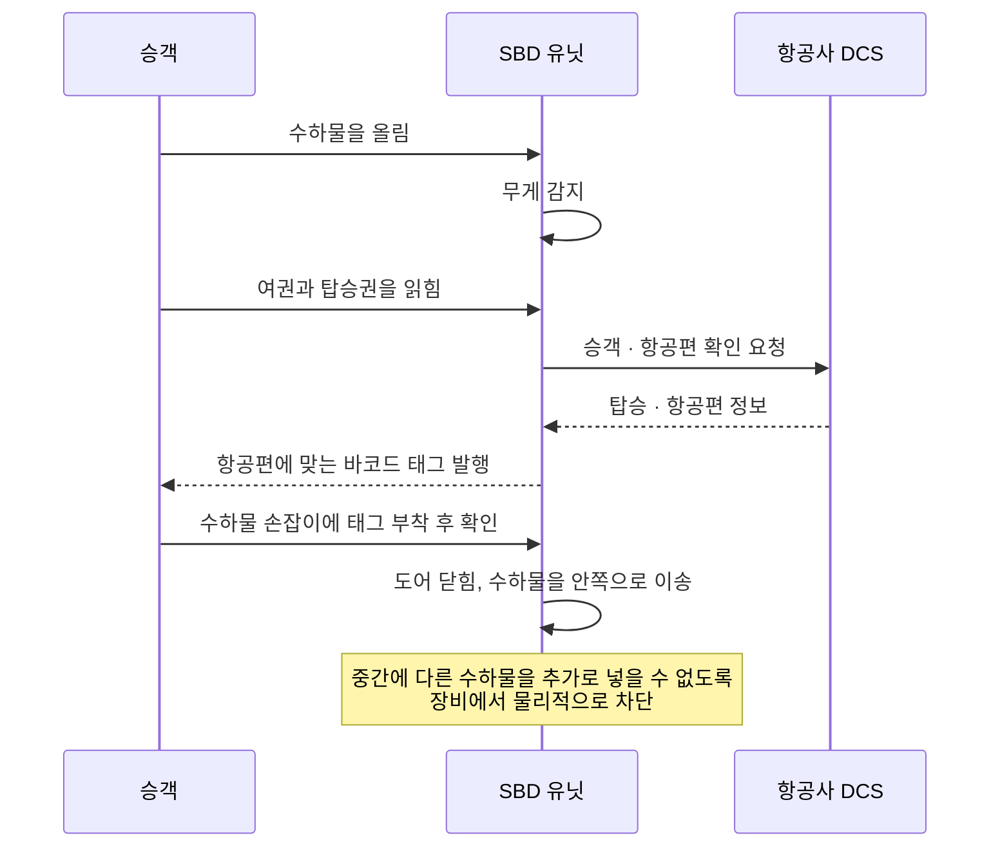

# 김포공항 국제선 SBD 구축

승객이 직접 수하물을 부치는 셀프 백 드롭(Self Bag Drop, SBD) 장비를 김포공항 국제선에 구축한 사업이다. 바즐시스템에서 사업 수행과 관리를 맡았던 프로젝트다. 항공사 시스템과의 연동 조율, 해외 제조사와의 기술 소통, 구축 후 운영을 맡으며 공항 시스템이 여러 주체 사이에서 어떻게 맞물려 돌아가는지를 가까이서 경험했다.

## 배경

공항 체크인 카운터에서 직원이 하던 수하물 위탁을 승객이 장비 앞에서 직접 처리하도록 하는 것이 SBD다. 한국공항공사가 김포공항 국제선에 이를 도입하는 사업을 발주했고, 바즐시스템이 주 수행사로 참여했다. 장비와 솔루션은 네덜란드 Scarabee사의 제품을 도입했다.

SBD는 장비만 설치한다고 끝나지 않는다. 승객의 여권과 탑승권 정보를 항공사의 출발 관리 시스템(DCS, Departure Control System)과 맞춰 보고, 그 항공편에 맞는 수하물 태그를 발행해야 한다. 그래서 장비 제조사, 공항공사, 항공사별 시스템 담당자가 모두 얽힌 통합 프로젝트가 된다.

## 해결하려던 문제

- 기존 시스템과 항공사별로 다른 DCS에 SBD 장비를 연동해야 함
- 해외 제조사의 장비와 소프트웨어 구조를 국내 수행팀과 발주처가 이해하고 협의해야 함
- 승객이 직접 쓰는 장비라 오작동이나 사용 오류를 장비 차원에서 막아야 함
- 개통 이후에도 현장에서 발생하는 장비 이슈를 계속 대응해야 함

## 목표

- 김포공항 국제선에 SBD를 설치하고 주요 항공사 DCS와 연동해 정상 운영
- 제조사, 수행사, 발주처, 항공사 사이의 기술 소통과 일정 조율을 원활히 진행
- 개통 후 장비를 안정적으로 운영하고 유지 관리

## 시스템 구성

김포공항 국제선에 SBD 유닛이 여러 대 설치됐다. 기억하는 규모는 십수 대다. 각 유닛은 승객의 여권과 탑승권을 읽는 리더, 수하물 무게 센서, 태그 프린터, 수하물을 안쪽으로 보내는 벨트와 도어로 구성된다.

## 비즈니스 플로우

승객이 SBD 유닛에서 수하물을 부치는 과정이다.

- 수하물 무게가 감지되면 여권과 탑승권을 읽히고, 이 정보로 DCS에서 탑승 여부와 항공편을 확인한다.
- 확인되면 해당 항공편으로 찾아갈 수 있는 바코드 태그가 발행되고, 승객이 직접 손잡이에 붙인 뒤 확인을 누른다.
- 확인하면 도어가 닫히고 수하물이 안쪽으로 이송되어 항공기로 향한다.
- 수하물을 추가로 넣거나 바꿔치기하는 일이 없도록 이송 중에는 장비에서 막아 둔다.

## 담당한 일

- **사업 수행**: PM을 맡은 과장님 아래에서 일정과 이슈를 관리하며 사업을 수행
- **항공사별 DCS 연동 조율**: 대한항공, 아시아나항공, 제주항공, JAL 등 연동 대상 항공사와 연동에 필요한 사항을 협의하고 일정 조율
- **기술 통역**: Scarabee 현지 엔지니어와의 협의를 통역하고, 그쪽 CTO가 시스템 구조와 프로그램 흐름, 코드 수준의 특징을 설명할 때도 통역해 국내 팀이 시스템을 이해할 수 있게 함
- **운영·유지관리**: 구축 후 설치된 장비의 운영과 현장 이슈 대응에 참여

## 트러블슈팅

개통 후 현장 운영에서 장비 쪽 문제가 있었다.

- **수하물이 벨트에 올라가지 않는 문제**: 수하물이 유닛의 벨트를 타고 안쪽으로 들어가야 하는데, 일부 유닛에서 올라가지 않았다. 기계 결함이 원인으로 의심됐다.
- **유닛 사이의 센서 문제**: 앞쪽 유닛이 수하물을 보내면, 뒤쪽에 이어진 유닛들이 광센서로 "짐이 오고 있으니 지금은 넘기면 안 되는 타이밍"임을 인지하고 기다려야 한다. 이 센서가 제대로 동작하지 않을 때 수하물이 안쪽에서 끼는 경우가 있었다.

두 문제 모두 소프트웨어만으로 풀 수 있는 성격이 아니라, 현장 장비와 제조사가 함께 다뤄야 하는 문제였다.

## 기술

- 셀프 백 드롭(SBD) 장비와 솔루션: Scarabee
- 항공사 출발 관리 시스템(DCS) 연동
- 여권·탑승권 리딩, 중량 센서, 광센서, 태그 프린터 등 장비 구성 요소

## 배운 점

이 프로젝트에서 얻은 경험은 이후 개발 일에도 이어졌다.

- 하나의 서비스가 장비, 제조사, 발주처, 여러 외부 시스템(항공사 DCS)과 맞물려 돌아가는 구조를 이해하게 됐다.
- 연동이 필요한 시스템마다 요구와 방식이 다르므로, 스펙과 일정을 명확히 하고 이슈를 놓치지 않는 것이 중요하다는 것을 배웠다.
- 해외 기술 담당자와 국내 팀 사이의 소통을 맡으며, 기술 내용을 정확히 옮기려면 시스템을 이해해야 한다는 점을 경험했다.
- 장애가 소프트웨어가 아니라 장비 센서와 기구에서 나는 경우도 있다는 것을 현장에서 직접 봤다.
