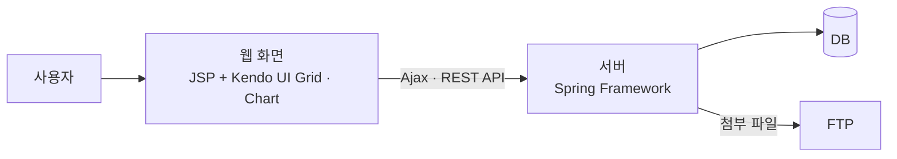
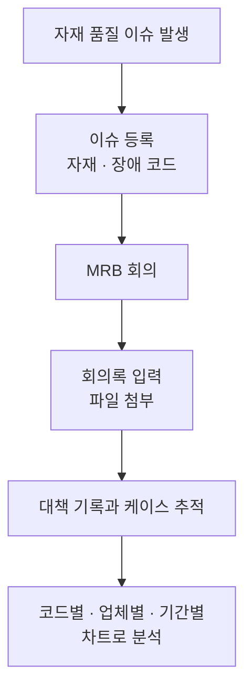
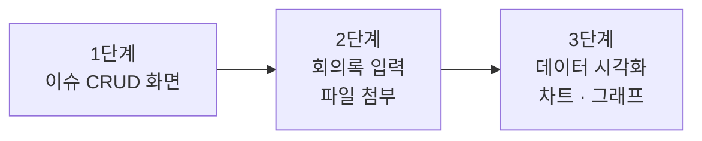

# MRB(자재) 품질이슈 관리 시스템

반도체 자재에 문제가 생겼을 때 열리는 MRB 회의의 이슈, 대책, 회의록을 케이스 단위로 기록하고 추적하며, 자재와 장애 코드별로 발생 추이를 차트로 볼 수 있게 만든 시스템. 품질팀과 협의하며 요구사항 분석부터 화면, 서버 개발까지 혼자 맡아 3단계로 구축했다.

## 배경

MRB는 Material Review Board의 약자로, 자재에 문제가 생겼을 때 관련 담당자가 모여 원인과 대책을 논의하는 회의다. 회의가 열릴 때마다 회의록과 대책이 남는데, 같은 자재나 같은 유형의 문제가 다시 생겼을 때 이전에 어떻게 처리했는지 찾아보려면 그 기록이 케이스 단위로 모여 있어야 한다.

기존에는 이 기록이 엑셀과 메일 등에 흩어져 수기로 관리되고 있었다. 이슈 하나를 추적하려면 여러 곳을 뒤져야 했고, 자재나 업체별로 어떤 문제가 얼마나 반복되는지 한눈에 보기 어려웠다.

## 해결하려던 문제

- MRB 회의 내용과 대책이 엑셀과 메일에 흩어져 있어 케이스를 추적하기 어려움
- 회의록에 딸린 첨부 파일이 따로 관리되어 이슈와 연결해 찾기 어려움
- 어떤 자재와 장애가 자주 반복되는지, 업체별로 차이가 있는지 데이터로 확인할 수단이 없음

## 목표

- 이슈 등록부터 회의록, 대책, 첨부 파일까지 한 케이스로 모아 추적할 수 있게 한다
- 자재와 장애를 코드로 정리해 코드별, 업체별, 기간별로 분석할 수 있게 한다
- 현업이 직접 입력하고 조회하는 화면으로 수기 관리를 대체한다

## 구성

구조는 단순하게 유지했다. 사용자가 웹 화면에서 입력하고 조회하며, 서버는 데이터를 저장하고 차트용 데이터를 제공한다. 첨부 파일은 FTP를 통해 관리한다.

## 업무 흐름

- 자재와 장애를 코드로 정리해, 코드가 같은 이슈끼리 모아서 볼 수 있게 했다.
- 회의가 끝나면 회의록과 대책을 입력하고 필요한 파일을 첨부한다.
- 쌓인 데이터는 코드별, 업체별로, 그리고 일·주·월 단위로 차트와 그래프에서 확인할 수 있다.

## 개발 과정

이 시스템은 처음부터 끝까지 혼자 맡았고, 세 단계로 나눠 진행했다.

1. **이슈 CRUD 화면**: 이슈를 등록하고 조회, 수정, 삭제하는 기본 화면
2. **회의록 입력과 파일 첨부**: MRB 회의 내용과 대책을 입력하고 파일을 붙이는 화면
3. **데이터 시각화**: 자재·장애 코드별, 업체별로, 일·주·월 단위의 추이를 차트와 그래프로 제공

## 담당한 일

- 품질팀과 협의해 요구사항을 정리하고 화면으로 옮김
- 이슈 등록·조회·수정·삭제와 회의록 입력, 파일 첨부 기능의 화면과 서버 개발
- 자재와 장애 코드를 담는 데이터 구조 설계
- Kendo UI Grid와 Chart로 코드별, 업체별, 기간별 시각화 구현
- Ajax 기반 REST API로 화면과 서버를 연동

## 기술

- Backend: Java, JSP, Spring Framework
- Frontend: JavaScript, Kendo UI (Grid, Chart)
- Data: Ajax, RESTful API, FTP(첨부 파일 관리)

## 결과

수기로 관리하던 MRB 이슈를 입력, 첨부, 추적, 분석까지 한 시스템에서 다룰 수 있게 만들었다. 이슈를 케이스 단위로 모아 이전 사례를 찾아볼 수 있게 됐고, 자재와 장애 코드, 업체, 기간별 추이를 차트로 확인할 수 있게 됐다.
