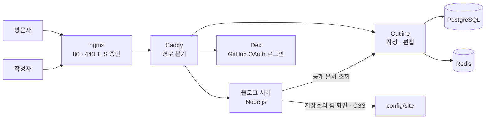
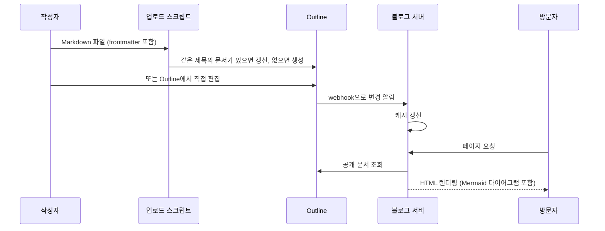
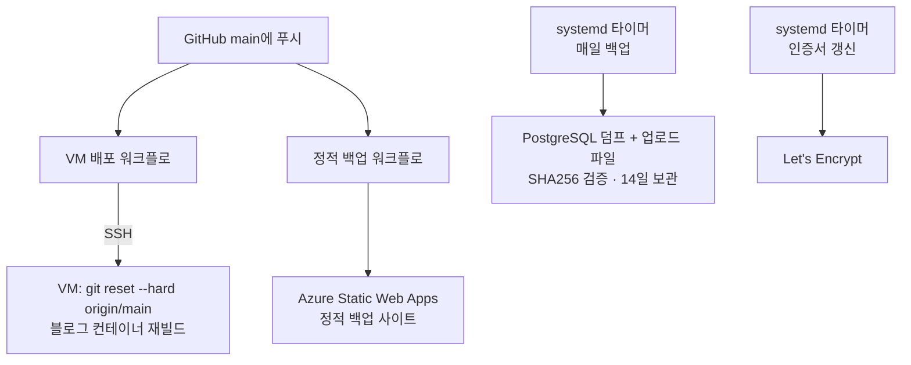

# Neverland

지금 보고 있는 이 사이트다. 글쓰기는 편한 도구에서 하고, 공개 화면은 별도의 포트폴리오로 보이게 만든 개인 아카이브.

## 배경

작업 결과만 나열하는 포트폴리오와 시간순으로 흘러가는 블로그를 따로 운영하면 어느 쪽도 오래 가지 못한다. 실제로 어떤 문제를 풀었고 왜 그렇게 판단했는지가 프로젝트 소개와 이어지는 한 곳이 필요했다. 글을 쓰는 환경은 가볍고 편해야 하고, 공개되는 화면은 읽는 사람 입장에서 정돈돼 있어야 한다.

## 해결하려던 문제

- 글쓰기는 편해야 하지만 공개 화면은 개인 사이트다운 인상을 가져야 한다
- 작업 기록과 프로젝트 소개가 서로 분리되지 않아야 한다
- 글이 쌓여도 태그, 연도, 검색으로 다시 찾을 수 있어야 한다
- 외부(회사나 다른 PC)에서도 글을 고칠 수 있어야 한다
- 새 서버나 유료 도메인 없이, 이미 가진 인프라로 운영해야 한다
- 서버가 사라져도 글은 남아야 한다

## 목표

- 문서를 쓰는 곳(Outline)과 보여주는 곳(블로그)을 분리하되, 수정이 바로 반영되게 한다
- 프로젝트 소개에 다이어그램(Mermaid)과 표를 쓸 수 있게 한다
- 사이트 코드를 푸시하면 서버에 자동 배포되게 한다
- 추가 비용 0원, 백업과 복구 절차까지 갖춘다

## 아키텍처

- **Outline**: 오픈소스 위키. 비공개 작성·편집 화면으로 쓴다. 글과 프로젝트는 하나의 컬렉션(Portfolio)에 두고, 문서 맨 위의 frontmatter(제목, 종류, 슬러그, 요약, 태그, 기간 등)로 구분한다.
- **블로그 서버**: Node.js 서버 하나. Outline API로 공개 대상 문서를 가져와 목록, 상세, 검색, RSS, 사이트맵으로 렌더링한다. 마크다운 변환기, Mermaid 렌더링, 프로젝트 목록 API도 여기 들어 있다.
- **Dex**: Outline 로그인을 GitHub OAuth로 연결한다. 방문자는 로그인 없이 공개 화면만 보고, 작성자는 `Write` 링크로 들어간다.
- **Caddy**: 하나의 주소 아래에서 블로그, Outline, Dex로 경로를 나눠 보낸다.
- **nginx**: 같은 서버에 있는 다른 서비스가 80/443을 쓰고 있어서, 그 nginx가 TLS를 종단하고 Neverland 경로를 Caddy로 넘기는 구성으로 편입했다.
- **홈 화면**: 정적 HTML과 CSS는 저장소(`config/site`)에 두고, 프로젝트 카드와 최근 글은 블로그의 공개 API를 불러와 채운다.

## 콘텐츠 흐름

글은 Markdown 파일을 업로드 스크립트로 올리거나 Outline에서 직접 고친다. 두 경로 모두 같은 문서를 대상으로 하고, 문서 제목을 키로 "있으면 갱신, 없으면 생성"한다. 수정하면 webhook이 블로그 캐시를 바로 갱신해 공개 화면에 반영된다.

## 배포와 운영

- **자동 배포**: 사이트 코드(홈 화면, CSS, 블로그 서버)를 main에 푸시하면 GitHub Actions가 서버에 SSH로 접속해 최신 코드를 받고 블로그 컨테이너를 다시 빌드한다. 글은 Outline에 올리면 끝이라 배포가 필요 없다.
- **정적 백업**: 같은 푸시로 저장소의 Markdown이 정적 사이트로 빌드되어 Azure Static Web Apps 무료 플랜에도 올라간다. 메인 서버가 내려가도 글을 볼 수 있다.
- **백업**: 매일 PostgreSQL 덤프와 Outline 업로드 파일을 묶어 해시로 무결성을 검증하고 14일 보관한다. 복구 절차도 문서로 남겼다.
- **비용**: 이미 쓰고 있던 Azure VM을 재사용하고, 도메인은 무료 `sslip.io`, 인증서는 Let's Encrypt라 추가 비용이 없다.

## 디자인

세 번 다듬었다.

1. **초기**: 에디토리얼 스타일의 홈. 사이트 이름 "Neverland"를 Peter Pan에서 따와서(영어 이름이 Peter였다), 숲색과 골드 팔레트로 바꿨다.
2. **카피 정리**: 꾸민 문구를 걷어냈다. 히어로는 "WORK · NOTES · EXPERIMENTS" 한 줄로 두고 부제와 선언문을 없앴다.
3. **개편**: 홈의 프로젝트 카드와 기록 목록을 하드코딩에서 API로 바꿨다. 폰트를 Instrument Serif, Noto Serif KR, Pretendard로 정리하고, 카드 그리드와 호버 효과, 모바일 내비를 새로 만들었다.

## 담당한 일

기획, 설계, 구축, 운영을 혼자 했다.

- 콘텐츠 구조 설계: frontmatter 규칙, 프로젝트와 글과 페이지 타입, 기간 기준 정렬
- Outline, Dex, Caddy, PostgreSQL, Redis를 묶은 Docker Compose 구성
- 블로그 서버: Outline 연동, 목록·상세·검색·RSS·사이트맵, 공개 API, 마크다운 렌더러
- 업로드 스크립트: 문서 생성·갱신, 컬렉션 지정
- 공유 서버의 nginx에 편입하는 구성과 인증서 자동 갱신
- GitHub Actions: VM 자동 배포, 정적 백업 배포
- 백업, 검증, 복구 절차
- 홈 화면 디자인과 프론트엔드

## 기술 선택 이유

- **Outline**: 직접 CMS를 만들기보다 이미 완성도 높은 문서 편집기(Markdown, 이미지, 협업)를 쓰는 편이 글쓰기에 집중하기 좋다. API가 있어 스크립트로도 다룰 수 있다.
- **별도의 Node 블로그 서버**: Outline 화면을 그대로 공개하지 않고, 공개할 문서만 골라 원하는 디자인으로 보여주려고 분리했다. 의존성이 거의 없는 작은 서버라 유지 부담이 적다.
- **Caddy**: 경로 분기 설정이 간단하다.
- **Mermaid**: 프로젝트 문서의 설계도를 이미지 파일이 아니라 텍스트로 관리해, 수정과 버전 관리가 쉽다.
- **정적 백업 + VM의 이중 구성**: 평소에는 동적 서버로 서비스하고, 서버 문제가 생겨도 글을 볼 수 있는 저비용 안전망을 둔다.
- **기존 VM 재사용**: 새 리소스를 만들지 않아 비용이 0이고 관리 대상도 늘지 않는다.

## 트러블슈팅

**1. 이미 점유된 80/443**

새로 올리려는 서버에는 다른 서비스의 nginx가 80과 443을 쓰고 있었다. 포트를 바꾸거나 서버를 따로 만들지 않고, 그 nginx가 Neverland 경로를 읽어 내부의 Caddy로 넘기도록 설정 파일 하나를 포함(include)시키는 방식으로 편입했다. 기존 서비스를 건드리지 않고 도메인과 인증서만 추가할 수 있었다.

**2. 마크다운 표가 깨져 보이는 문제**

블로그의 자체 마크다운 렌더러가 표를 지원하지 않아서, 프로젝트 문서의 표가 `|` 문자 그대로 출력됐다. 렌더러에 표 지원을 추가하고, 표가 긴 경우 가로로 스크롤되게 스타일을 정리했다.

**3. 프로젝트가 게시일 순으로만 정렬되는 문제**

프로젝트 목록이 문서를 올린 날짜로 보여서, 실제 진행 시기와 맞지 않았다. 정렬은 이미 문서의 기간(period) 기준이었지만 화면에는 게시일이 표시되고 있었다. 목록에는 진행 기간을 표시하도록 바꿨다.

**4. 홈 화면의 하드코딩**

프로젝트 카드를 HTML에 직접 적어 두니 프로젝트를 올릴 때마다 홈을 따로 고쳐야 했고, 실제 문서와 어긋났다. 블로그 서버가 이미 제공하던 공개 API를 홈이 불러오게 하고, `featured` 표시가 있는 프로젝트가 기간순으로 자동으로 나타나게 했다.

## 기술

- Node.js (블로그 서버, 빌드·업로드 스크립트)
- Outline, PostgreSQL, Redis, Dex
- Docker Compose, Caddy, nginx
- GitHub Actions, Azure Static Web Apps (정적 백업)
- Markdown, Mermaid
- systemd 타이머 (백업, 인증서 갱신)

## 현재 상태

회사 프로젝트와 개인 프로젝트 문서 10건 이상이 이 사이트에 올라와 있고, 사이트 코드는 main에 푸시하면 자동 배포된다. 앞으로는 짧은 개인 도메인, 소셜 공유 이미지 개선, 글 작성 템플릿을 추가할 예정이다.
