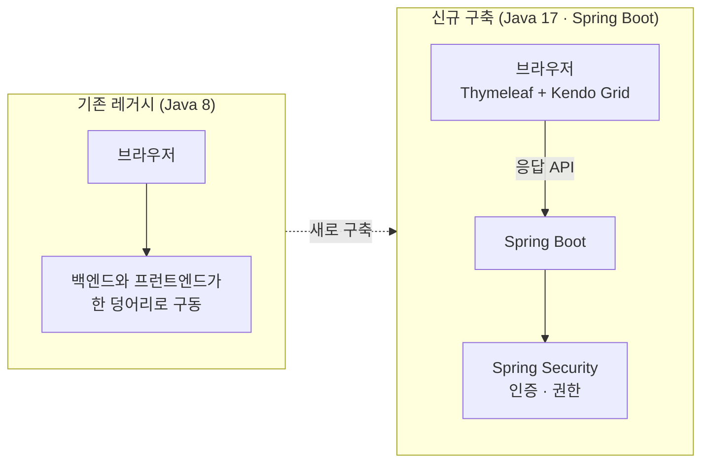
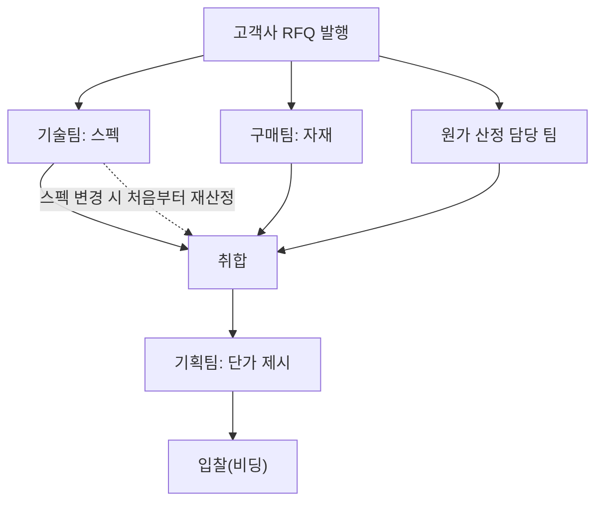

# RFQ 전산화 — Java 17 · Spring Boot 기반 신규 구축

견적 요청(RFQ)에 대한 원가 산정을 엑셀에서 시스템으로 옮기는 프로젝트의 초기 구축을 맡았다. 기존 레거시를 이어 쓰지 않고 Java 17과 Spring Boot로 기반을 새로 만들었고, 이직이 결정되어 초기 프레임워크 구축 단계까지 진행했다. PM은 팀장님이 맡았고, 팀장님과 둘이서 진행하면서 코드는 직접 작성했다.

## 배경

RFQ(Request for Quotation)는 고객사가 발행하는 견적 요청이다. 요청이 오면 원가를 확인하고 적절한 금액으로 입찰(비딩)을 넣어야 한다. 이 과정이 엑셀로만 관리되고 있었다.

원가 산정에는 여러 팀이 관여한다. 스펙은 기술팀이, 자재는 구매팀이, 원가는 해당 팀이 각각 산정하고, 이를 모두 취합해 기획팀이 단가를 제시한다. 문제는 중간에 어느 한 팀이 값을 바꾸면 연쇄적으로 다시 계산해야 한다는 점이다. 예를 들어 기술팀이 스펙을 바꾸면 처음부터 다시 시작해야 했다. 이 변경과 재산정을 관리하는 시스템이 필요했다.

## 해결하려던 문제

**업무 쪽**

- 스펙, 자재, 원가가 팀별 엑셀로 흩어져 있어 취합이 번거롭고 오류 가능성이 큼
- 한 팀의 변경이 다른 팀의 산정에 반영되지 않거나 반영하려면 처음부터 다시 해야 함

**기술 쪽 (기존 레거시)**

- Java 8 기반으로, 백엔드와 프런트엔드가 한 덩어리로 같이 구동되어 API만으로 동작하지 않는 비효율적인 구조
- 프로젝트 구조가 일관되지 않아 유지보수가 매우 비효율적
- 배포 과정이 비효율적

## 목표

- 레거시를 이어 쓰지 않고, RFQ 전산화를 올릴 수 있는 기반을 Java 17과 Spring Boot로 새로 구축한다
- 응답 API를 정리해 화면과 서버가 API로 분리되어 동작하게 한다
- 보안(인증·권한) 구조를 처음부터 갖춘다
- 이미 라이선스를 구입한 Kendo Grid를 새 구조에서도 쓸 수 있게 한다

## 구성

- **Spring Boot 기반 신규 프로젝트**: 레거시의 구조를 이어받지 않고 일관된 구조로 새로 만들었다.
- **응답 API 설계**: 사내에서 SigneticsReport라는 이름으로 응답 방식 등의 틀을 만들어 쓰고 있었다. 이 틀을 새 구조에 맞게 반영했다.
- **Spring Security**: 인증과 권한 관리 구조를 구축했다.
- **Kendo Grid + Thymeleaf**: Kendo Grid는 이미 구매한 라이선스가 있어서 새 구조에서도 쓰기로 했다. 원래 JSP 환경에서 동작하던 컴포넌트라 Thymeleaf에서는 처음에 제대로 동작하지 않았는데, 설정을 조정해 동작하도록 만들었다.

## 업무 흐름 (전산화 대상)

이 흐름에서 스펙 변경처럼 중간에 값이 바뀔 때의 재산정을 관리하는 것이 시스템의 목적이었다.

## 담당한 일

- 기존 레거시를 이어 쓰지 않고 Java 17과 Spring Boot로 신규 구축
- 프로젝트 구조와 응답 API 설계, 사내 응답 틀(SigneticsReport) 반영
- Spring Security 기반 인증·권한 구조 구축
- Thymeleaf와 Kendo UI(Grid, Form), jQuery 기반의 입력·조회 화면 개발
- 배포 과정이 비효율적이어서 CI/CD를 구축할 계획이었고, 이를 위해 회사에 GitLab 도입을 제안
- PM(팀장님)과 일정과 요구사항을 협의하고, 코드는 직접 작성

## 기술

- Java 17, Spring Boot, Spring Security
- Thymeleaf, jQuery, Kendo UI (Grid, Form)
- GitLab (도입 제안)

## 진행 범위

초기 프레임워크 구축 단계까지 진행했다.

- Spring Boot 기반 프로젝트 환경 구축(보안 구조와 API 설계 포함)
- Kendo UI 기반 데이터 입력·조회 기능
- 인증과 세션, 권한 관리의 보강은 진행 중이었다
- CI/CD 구축은 계획 단계였다

이직이 결정되어 이후 단계까지 이어가지는 못했고, 초기 구축을 마친 상태로 인수인계했다.

## 배운 점

기능을 얹기 전에 기반의 구조(API 분리, 인증, 응답 형식, 배포)를 먼저 바로잡는 일이 이후 유지보수 비용을 좌우한다는 것을 체감했다. 이미 구매한 라이선스와 기존 사내 틀 같은 제약 안에서 새 구조를 맞추는 일도 설계의 일부라는 것을 배웠다.
