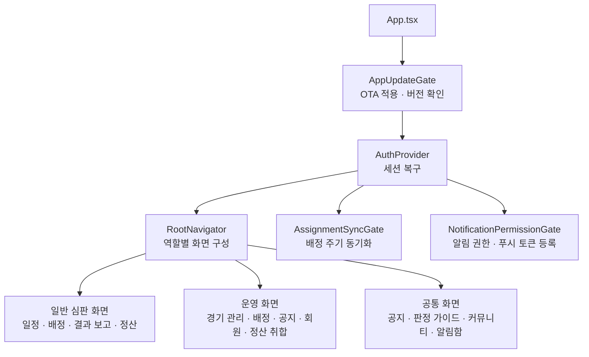
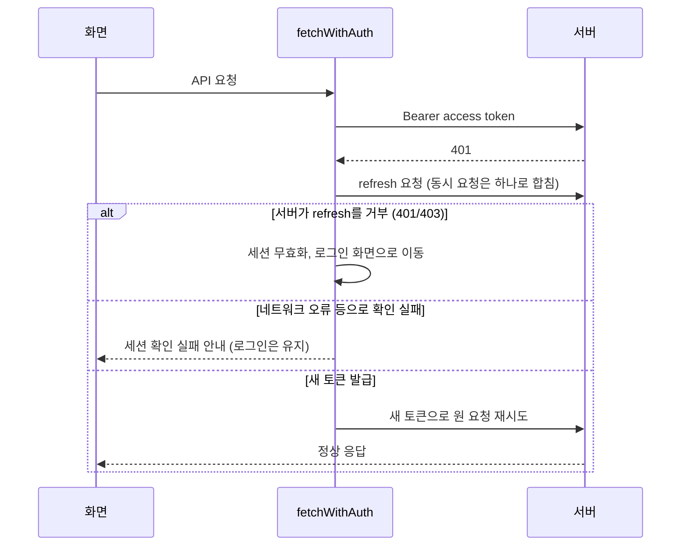
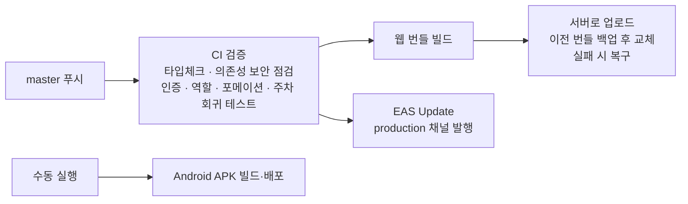

# Umpire Mobile

[Umpire 심판 배정·정산 플랫폼](/projects/umpire-platform)의 클라이언트 앱이다. 서비스 전체의 업무 흐름과 백엔드는 해당 문서에서 다루고, 여기서는 **앱을 어떻게 설계하고 배포했는지**에 집중한다.

## 배경

사용자는 주말마다 경기에 투입되는 심판과 이를 운영하는 국장, 차장, 총무다. 대부분 업무 중이거나 경기장에서 휴대폰으로 확인하기 때문에 모바일이 기본 채널이어야 하고, 같은 사람이 한 계정으로 일반 심판 화면과 운영 화면을 모두 써야 한다. 앱 스토어 심사를 기다리지 않고 수정 사항을 빠르게 전달할 수 있어야 한다는 점도 운영상 중요했다.

## 해결하려던 문제

- 일반 심판, 신입, 휴직, 국장, 차장, 총무, 시스템 관리자까지 역할마다 필요한 메뉴와 가능한 동작이 다름
- 모바일 네트워크는 불안정한데, 토큰 만료와 네트워크 오류를 구분하지 못하면 멀쩡한 사용자가 로그아웃됨
- 푸시 알림이 안 오는 사용자가 있어도 어디서 막혔는지 알 수 없음
- 앱 업데이트를 매번 APK로 배포하면 사용자가 설치하지 않은 구버전이 오래 남음
- Android 앱과 웹을 따로 만들 여력이 없음

## 목표

- 하나의 코드베이스로 Android와 웹을 모두 제공한다
- 역할에 따라 메뉴와 화면이 달라지되, 서버 권한과 같은 기준을 따른다
- 로그인 세션은 가능한 한 끊기지 않게 유지하고, 정말 만료됐을 때만 로그아웃한다
- 푸시 등록의 모든 단계를 진단할 수 있게 한다
- JavaScript 변경은 즉시 배포하고, 네이티브 변경이 필요할 때만 APK를 배포한다

## 앱 구조

- **스택**: Expo 54, React Native 0.81, React 19, TypeScript, React Navigation. 같은 코드로 Android 앱과 웹을 빌드한다.
- **화면**: 로그인·가입(카카오 가입 포함), 홈, 가능 일정 등록, 내 배정, 경기 결과 보고, 월 정산 확인과 이력, 공지(목록·상세·작성), 국장용 경기·배정·후보 선택·회원 관리, 판정 가이드(KBO 규칙 검색과 상세), 자유게시판, 야구 토론, 긴급 연락처, 알림함, 버그 신고 등 30개 이상.
- **야구 도메인 화면**: 야구 토론은 주자 위치와 볼·스트라이크·아웃을 눌러 입력하는 상황판 컴포넌트를 쓰고, 판정 가이드의 규칙 상세에는 포메이션 위치와 공의 이동을 단계별로 재생하는 SVG 애니메이션 플레이어(react-native-svg)를 넣었다.

### 역할별 화면

역할은 앱 쪽에서 헬퍼 함수로 모아 판정한다. 운영진 여부, 대관 경기 생성 권한, 확정 배정 수정 권한처럼 기능마다 허용 역할이 다르고, 서버의 권한 검사와 같은 기준이 되도록 회귀 테스트로 고정했다. 같은 계정이 로그인하면 역할에 맞춰 하단 탭과 사이드 메뉴가 달라진다. 일반 심판은 자신의 배정과 정산을 중심으로 보고, 운영 역할은 배정 후보 선택, 공지, 회원 관리로 바로 이동한다.

### 배정 동기화

배정은 서버 데이터가 원본이고 푸시는 변경을 알리는 보조 수단이다. 푸시를 못 받아도 앱이 열려 있으면 최신 상태를 보게 하려고, 이번 주와 다음 주 배정을 30초 간격(과도한 호출 방지)으로 가져오고 앱이 포그라운드로 돌아올 때도 즉시 동기화한다.

## 인증과 세션

- **만료와 네트워크 오류를 구분**: refresh를 서버가 거부하면 진짜 만료라서 로그아웃하지만, 요청 자체가 실패한 경우에는 "네트워크 문제로 확인에 실패했다"고만 알리고 세션은 유지한다. 불안정한 망에서 사용자가 이유 없이 로그아웃되지 않게 하는 것이 목적이다.
- **동시 요청 합치기**: 여러 화면이 동시에 401을 받아도 refresh는 한 번만 실행하고 결과를 공유한다. 서버는 refresh 토큰을 회전시키기 때문에 동시에 여러 번 보내면 재사용 탐지에 걸릴 수 있다.
- **보안 저장소**: 토큰은 기기의 보안 저장소(SecureStore)에 저장한다. 웹은 SecureStore가 없어 브라우저 저장소를 쓴다.

## 푸시 알림 등록

푸시 알림이 안 오는 문제는 원인이 알림 권한, 안드로이드 채널, 프로젝트 ID, 토큰 발급, 서버 저장 중 어디든 될 수 있어서 한 군데 로그만으로는 알 수 없다.

- 로그인, 세션 복구, 앱이 포그라운드로 돌아올 때, 토큰이 바뀔 때마다 등록을 시도한다
- 단계별 결과를 로컬과 서버에 진단 정보로 남겨, 권한 거부인지 토큰 발급 실패인지 서버 저장 실패인지 구분한다. 토큰과 프로젝트 ID는 마스킹해서 기록한다
- 진단 기록이나 로컬 캐시 저장이 실패해도 실제 등록 흐름을 막지 않도록 주 흐름과 분리했다
- 웹은 Web Push(VAPID)로 같은 방식으로 등록한다

## 배포

- **JavaScript와 에셋 변경**: EAS Update 운영 채널로 발행하면 앱이 다음 실행 때 가져온다. 앱 스토어 심사나 재설치가 필요 없다.
- **네이티브 변경**(권한, SDK, 매니페스트): 새 APK를 빌드해 배포한다. 앱 시작 시 업데이트 게이트가 먼저 OTA를 적용하고, 그다음 서버에 버전을 물어봐 필수 업데이트가 필요하면 APK 다운로드를 안내한다. 앱이 포그라운드로 돌아올 때도 다시 확인한다.
- **웹 번들**: 빌드한 번들을 서버에 올리고, 이전 번들을 백업해 둔 뒤 교체한다. 교체가 실패하면 백업으로 되돌린다. APK 다운로드 파일은 교체 과정에서 보존한다.
- **CI**: 타입체크와 의존성 보안 점검, 인증·역할·포메이션 파서·주차 표시 회귀 테스트를 통과해야 배포 단계로 넘어간다.

## 담당한 일

기획, 설계, 개발, 배포를 혼자 맡았다.

- 역할별 탐색 구조와 화면 설계, 30개 이상 화면 구현
- 인증 클라이언트: 토큰 갱신, 동시 요청 합치기, 만료와 네트워크 오류 구분, 보안 저장소 적용
- 푸시 등록과 진단 흐름, 배정 동기화
- 야구 상황판, 포메이션 애니메이션 플레이어 같은 도메인 컴포넌트
- 웹·Android 빌드, EAS Update, APK 배포 파이프라인
- Android 에뮬레이터에서 역할별 계정으로 전수 점검하고 발견한 문제 수정

## 트러블슈팅

**1. 일정 저장만 로그인 세션 만료로 처리되던 문제**

Android에서 일정 등록을 누르면 로그인 화면으로 돌아갔다. 같은 세션에서 푸시 토큰 저장은 성공했고, 서버 예외 매핑상 일정 마감이나 서비스 타입 오류는 401이 될 수 없었다. 요청 단계 문제로 판단해 일정 저장을 PUT에서 POST로 바꾸고(서버에는 같은 로직을 호출하는 POST 경로 추가), 인증 헤더 병합을 React Native Android에서 안정적인 일반 객체 방식으로 바꿨다. 로그, 판단, 검증 결과를 문서로 남겼다.

**2. 푸시 등록 경쟁 상태**

로그인 직후 여러 컴포넌트가 같은 토큰 등록을 동시에 요청해 성공과 401 응답이 섞였다. 인증 API 내부의 중복 호출을 제거하고 access 토큰마다 등록 요청을 하나로 합쳤으며, 재시도는 최초 등록이 실패했을 때만 하도록 바꿨다. 수정 후 "등록 시작 1회, 서버 저장 200 1회, 성공 1회"로 정리됐다.

**3. 전수 점검에서 발견한 사용자 문구와 빌드 문제**

로그인 만료 안내에 ISO 타임스탬프가 그대로 노출되고, 운영 화면에 "데모 상태"라는 부정확한 문구가 남아 있었다. 문구를 정리하고, Expo 기본 진입점이 설치 방식에 따라 `App.tsx`를 못 찾을 수 있어 `index.js`를 명시했다. 수정한 APK로 권한 허용·거부 시나리오와 서버 저장까지 다시 확인했다.

## 기술

- React Native / Expo 54 / TypeScript
- React Navigation, react-native-svg
- Expo Notifications / Expo SecureStore / EAS Update
- GitHub Actions (CI, 웹 번들 배포, APK 빌드)
- Spring Boot API 연동

## 현재 상태

로그인, 가능 일정, 배정, 공지, 결과 보고, 정산, 푸시, 판정 가이드, 역할별 운영 화면이 연결되어 있고, 앱 버전 5.0.x로 실제 사용자에게 운영 중이다.
