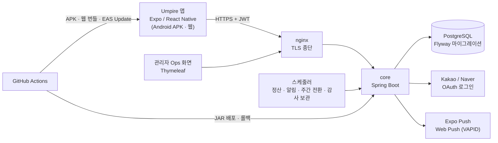
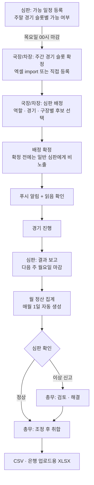
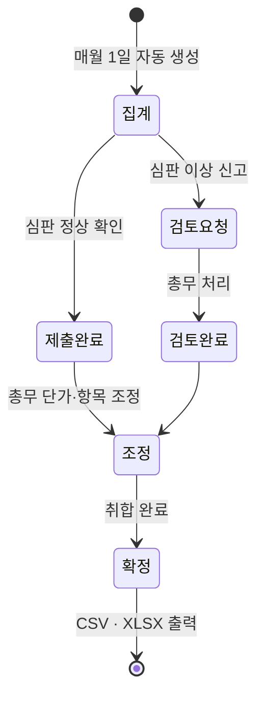
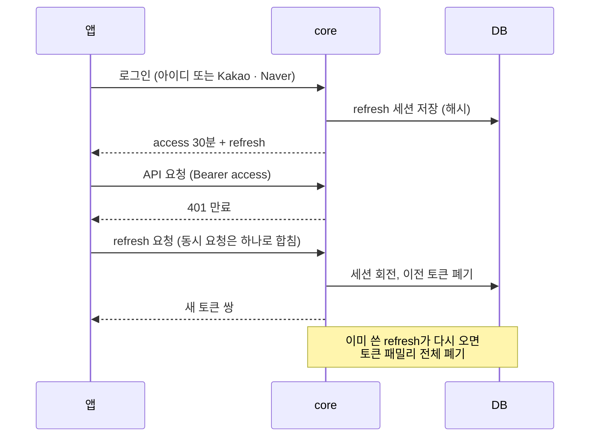

# Umpire — 심판 배정·정산 플랫폼

주말 경기에 투입되는 야구 심판들의 업무를 한 흐름으로 이은 서비스. 심판은 앱으로 가능 일정을 내고 배정을 확인하고 결과를 보고하며, 국장·차장·총무는 같은 앱과 관리 화면에서 배정, 공지, 회원, 정산을 처리한다. 스프링 부트 백엔드(core)와 React Native 앱(umpire-mobile)을 모두 직접 만들었고, 지금도 실제 조직이 사용하는 운영 서비스다.

## 배경

심판 배정 업무는 한 주에 여러 단계가 이어진다. 심판에게 가능한 날짜를 받고, 경기 일정에 맞춰 심판을 배정하고, 배정 결과를 알리고 읽었는지 확인하고, 경기가 끝나면 결과를 보고받고, 한 달이 지나면 경기 수와 역할에 따라 심판비를 계산해 확인받는다. 이 과정이 메신저와 엑셀에 흩어져 있으면 운영자는 누가 가능 일정을 냈는지, 누가 배정을 읽었는지, 어떤 경기의 보고가 빠졌는지를 일일이 확인해야 한다. 월 정산은 계산 규칙이 여러 겹이라 실수가 나기 쉽고 이의가 생기면 추적하기도 어렵다.

## 해결하려던 문제

- 가능 일정과 배정, 공지가 여러 채널에 흩어져 있어 진행 상태를 한눈에 볼 수 없음
- 배정 공지를 누가 읽었는지, 결과 보고를 누가 안 냈는지 사람이 직접 확인해야 함
- 월 정산이 역할별 단가, 야간수당, 상조회비, 보고·일정 미제출 공제까지 겹쳐서 수작업 계산과 이의 대응이 어려움
- 국장, 차장, 총무, 일반 심판, 수습, 휴직 등 역할마다 볼 수 있는 화면과 할 수 있는 일이 다름
- 알림이 가야 할 사람에게 실제로 가는지 확인할 방법이 없음
- 비용 없이 소수 인원이 쓰는 서비스를 직접 배포하고 운영해야 함

## 목표

- 가능 일정 → 배정 → 공지/읽음 → 결과 보고 → 월 정산을 모바일 앱 하나의 흐름으로 연결한다
- 역할별로 필요한 기능만 보이고, 서버에서도 같은 권한이 지켜진다
- 푸시 알림으로 배정 변경과 공지를 전달하고, 실패하면 추적과 재시도가 된다
- 정산은 계산 근거를 남기고, 심판이 확인하거나 이상을 신고하고 총무가 조정해 취합하는 절차를 시스템으로 만든다
- 인증, 사용자, 역할, 알림을 공통 플랫폼(core)으로 분리해 다른 서비스도 재사용할 수 있게 한다

## 아키텍처

- **core (백엔드)**: Spring Boot 3, Spring Security(JWT), JPA, Flyway, PostgreSQL. 공통 플랫폼(`com.empire.core`: 인증, 사용자와 역할, 설정, 알림, 감사)과 심판 도메인(`com.empire.service.umpire`: 공지, 가능 일정, 경기 슬롯, 배정, 결과 보고, 회원, 커뮤니티, 판정 가이드, 정산)을 같은 프로젝트에서 패키지로 나눴다.
- **앱**: Expo / React Native / TypeScript. 일반 심판, 국장, 총무가 같은 앱에서 역할별 메뉴를 본다. 웹과 Android를 같은 코드로 빌드한다.
- **관리자 화면**: 공지 작성, 정산 취합, 로그 조회처럼 PC가 편한 작업은 서버가 렌더링하는 Thymeleaf 화면으로 제공한다.
- **인증은 공통 플랫폼으로 분리**: 로그인, 토큰 갱신, 소셜 연동, 사용자 역할은 core가 맡고, 다른 개인 프로젝트(Front Office 야구 게임, RealMan)도 서비스 타입으로 구분해 같은 인증을 쓴다.

### 단일 JAR로 시작한 이유

공통 플랫폼과 심판 도메인을 처음부터 별도 서비스로 쪼갤 수도 있었지만, 혼자 운영하는 서비스에서 서비스 사이 계약과 배포를 따로 관리하는 비용이 더 크다고 판단했다. 대신 패키지 경계(`core` ↔ `service.umpire`)를 지키고 의존 방향을 서비스 → core로 유지해, 필요해지면 분리할 수 있게 열어 두었다. 현재 구현은 아직 양방향 참조가 일부 남아 있어 분리하려면 데이터 소유권, 이벤트 계약, 트랜잭션 경계를 먼저 정해야 한다는 것도 문서로 정리해 두었다.

## 비즈니스 플로우

한 주의 업무는 목요일 마감을 기준으로 이어진다.

배정이 확정된 뒤에도 경기 취소와 복구를 처리한다. 경기를 취소하면 연결된 배정이 같이 정리되고 알림이 가며, 복구하면 그때 정리된 배정이 되살아난다. 경기가 시작됐거나 결과 보고가 제출된 경기는 취소할 수 없게 막았다.

## 정산 시스템

월 정산은 이 서비스에서 가장 규칙이 많은 부분이다. 확정 배정과 결과 보고, 가능 일정 제출 기록을 월 단위로 모아 심판별 금액을 계산한다.

- **역할별 단가**: 주심과 루심, 1심 단독 경기는 단가가 다르고, 한 경기에서 주심과 루심을 모두 맡으면 1심 1건으로 계산한다. 대관 경기는 월 정산에서 제외하고 별도 정산한다.
- **가산·공제**: 야간경기 수당, 상조회비, 결과 보고 미제출 공제, 가능 일정 미제출 공제. 두 공제 금액은 관리자가 설정 화면에서 바꿀 수 있다.
- **제외 대상**: 휴직 심판은 회비와 공제 대상에서 빠지고, 운영진은 보고 미제출 공제에서 제외한다.
- **절차**: 매월 1일 09시에 직전 월 정산이 자동 생성되고 알림이 가며, 심판이 확인(정상) 또는 이상 신고를 하면 총무가 조정과 검토를 거쳐 취합을 완료한다. 확인하지 않은 사람에게는 정해진 날짜에 독촉 알림이 간다.
- **산출물**: 참고용 CSV와 은행 업로드용 XLSX(Apache POI). 실제 송금은 시스템 밖에서 이뤄진다. 이 시스템은 지급 자체가 아니라 계산 근거와 확인 절차를 책임진다.

코드 구조는 계산을 전담하는 서비스가 월별 context를 만들고, 심판별 누적기가 경기와 가산·공제를 쌓은 뒤 결과를 아이템으로 변환한다. 이미 확인된 기록은 복제해 보존한다.

## 인증과 권한

- **토큰**: access 30분, refresh 세션은 기기별로 관리하며 절대 90일, 유휴 30일. refresh 토큰은 DB에 해시로만 저장하고 회전할 때마다 이전 것을 폐기하며, 이미 사용한 토큰이 다시 오면 탈취로 보고 그 패밀리 전체를 폐기한다. 앱은 401을 받으면 refresh를 한 번만 요청하고 원래 요청을 재시도한다.
- **역할**: 일반 사용자, 수습, 휴직, 국장, 차장, 총무, 시스템 관리자 등 9개 역할과 서비스 타입(UMPIRE, REALMAN, FRONTOFFICE 등)이 겹쳐 권한을 결정한다. 컨트롤러의 `@PreAuthorize`와 서비스 안의 접근 검증을 함께 쓰고, 앱의 메뉴 노출은 서버 권한과 같은 기준을 따르게 맞추는 중이다.
- **소셜 로그인**: Kakao와 Naver를 지원한다. 개발용 앱을 따로 만들어 로컬 테스트가 운영 앱 설정에 영향을 주지 않게 분리했다.
- **정산 PIN**: 정산 관련 PIN은 BCrypt로 해시해 저장한다.

## 푸시 알림

배정, 공지, 정산 독촉처럼 사람이 움직여야 하는 일이 많아서 알림이 서비스의 핵심 기능이다.

- 모바일은 Expo Push, 웹은 VAPID Web Push로 보낸다
- 예약 푸시(리마인더)를 스케줄러가 1분 단위로 확인해 발송한다
- 발송 이력을 남기고, 실패하면 재시도하며, 채널별 이력을 하나로 통합해 본다
- 푸시 등록이 실패하면 어느 단계에서 실패했는지 진단할 수 있다. 알림 권한, 안드로이드 채널, 프로젝트 ID, 토큰 발급, 서버 저장 단계를 각각 기록한다

## 판정 가이드와 커뮤니티

심판 업무에 필요한 부가 기능도 함께 제공한다.

- **판정 가이드**: 야구 규칙 전체를 색인하고 하위 조항까지 검색할 수 있다. PostgreSQL trigram 검색을 사용하고 리그별 로컬룰 화면을 따로 두었다.
- **자유게시판과 야구 토론**: 게시글과 댓글, 읽음 처리. 야구 토론은 주자 위치와 볼·스트라이크·아웃 같은 경기 상황 값을 함께 저장해 판정 상황을 구체적으로 토론할 수 있다.

## 배포와 운영

- **백엔드**: GitHub Actions가 테스트 후 Azure VM에 JAR를 배포한다. 버튼 한 번으로 이전 JAR로 롤백하는 워크플로가 있고, 운영 푸시 상태를 매일 새벽 점검하는 감사 워크플로도 돌린다.
- **앱**: 네이티브 변경은 새 APK로, JavaScript와 에셋 변경은 EAS Update 운영 채널로 배포한다. 앱이 시작할 때 업데이트 게이트가 버전을 확인한다. 웹 번들은 서버에서 정적으로 제공한다.
- **DB**: Flyway 마이그레이션 60개 이상. 운영 DB 스키마는 Hibernate가 `validate`만 하고 변경은 모두 마이그레이션으로만 한다.
- **스케줄러**: 정산 생성과 독촉(매일 09시), 주간 배정·일정 전환(월요일 06시), 예약 푸시와 재시도(매분), 감사 로그 보관(매일 00시 10분)

## 담당한 일

기획, 설계, 개발, 배포, 운영을 혼자 맡았다.

- 업무 흐름 분석과 도메인 설계: 가능 일정, 경기 슬롯, 배정, 결과 보고, 정산 사이의 규칙
- 백엔드: 인증과 권한, 심판 도메인 API(92개 이상 엔드포인트), 정산 계산, 푸시, 스케줄러, 관리자 화면
- 모바일 앱: 역할별 화면, 세션 관리와 토큰 갱신, 푸시 등록, 업데이트 게이트
- 인프라와 CI/CD: 백엔드 배포와 롤백, 앱 APK·웹·OTA 배포
- 보안 점검과 개선, 운영 중 장애 대응

## 트러블슈팅

**1. 정산 재계산이 확정된 금액을 덮어쓰던 문제**

정산을 다시 집계하면 이미 심판이 확인했거나 검토 중인 기록의 금액이 조용히 바뀌고, 총무가 손으로 조정한 금액이 재계산 때 사라졌다. 경기 취소와 복구는 정산에 반영되지도 않았다.

- **조치**: 재계산 로직을 다시 설계했다. 이미 제출·검토 상태에 들어간 기록은 복제해 보존하고, 총무의 수동 조정 금액과 사유를 별도 컬럼에 저장해 재계산해도 유지되게 했다. 경기 취소와 복구는 해당 배정만 다시 계산하는 부분 재계산으로 정산에 반영했다.
- **함께 정리한 정책**: 대관 경기는 월 정산에서 제외하고, 휴직 심판은 회비·공제에서 제외하며, 가능 일정 미제출 공제 대상 주는 로스터 전체 기준으로 하기로 정했다. 일정 저장 마감(목요일)과 정산상 미제출 기준(수요일)이 다른 것은 총무와 국장이 검토할 하루를 확보하려는 의도된 두 단계 마감이라는 점도 확인하고 문서로 남겼다.

**2. 리버스 프록시 뒤의 OAuth 콜백 주소**

관리자 소셜 로그인에서 콜백 주소가 `http://호스트:80/...`로 잘못 만들어졌다. nginx가 TLS를 종단하고 내부로는 HTTP로 넘기는데 앱이 요청의 scheme과 port를 그대로 썼기 때문이다. 프록시 헤더를 반영해 절대 주소를 만들도록 고쳤고, 콜백 경로가 인증 전 단계에서 막히던 보안 설정 누락도 함께 찾아 고쳤다.

**3. 일정 저장만 로그인 세션 만료로 처리되던 문제**

Android에서 일정 등록을 누르면 로그인 화면으로 돌아갔다. 같은 세션에서 푸시 토큰 저장 같은 다른 API는 성공했고, 서버 예외 매핑상 일정 마감이나 서비스 타입 오류는 401이 될 수 없는 경우였다. 요청 단계 문제로 판단해 일정 저장을 PUT에서 POST로 바꾸고(서버에는 같은 저장 로직을 호출하는 POST 경로를 추가), 인증 헤더 병합 방식을 React Native Android에서 안정적인 일반 객체 방식으로 바꿔 해결했다. 증상, 로그, 판단, 검증 결과를 문서로 남겼다.

**4. 푸시 등록 경쟁 상태**

로그인 직후 여러 컴포넌트가 같은 푸시 토큰 등록을 동시에 요청해 성공과 401 응답이 섞였다. 인증 API 내부의 중복 호출을 제거하고, access 토큰마다 등록 요청을 하나로 합치고, 재시도는 최초 등록이 실패했을 때만 하도록 바꿨다. 수정 후에는 등록 시작 1회, 서버 저장 200 1회, 성공 1회로 정리된 것을 확인했다.

**5. 탈퇴 후 재가입한 사용자의 인증이 500으로 실패하던 문제**

요청마다 실행되는 인증 조회가 삭제 여부를 걸러내지 않고 있었다. 아이디가 전역 유일하던 시절에는 안전했지만, 서비스 타입별로 아이디 범위를 나눈 뒤로는 "탈퇴한 옛 계정"과 "같은 아이디로 재가입한 새 계정"이 동시에 존재할 수 있다. 이 경우 조회가 두 행을 반환해 예외가 나고, 해당 사용자의 모든 인증 요청이 500으로 막혔다.

- **조치**: 삭제되지 않은 사용자만 조회하는 쿼리로 교체하고, 필터 없는 위험한 버전은 삭제했다. 탈퇴 이력과 재가입 행이 공존하는 정확한 시나리오를 통합 테스트로 고정했다.

## 기술 선택 이유

- **Spring Boot + JPA + Flyway**: 정산처럼 데이터 정합성이 중요한 도메인에서 스키마를 마이그레이션 파일로만 바꾸고 Hibernate는 검증만 하게 해 운영 DB와 코드가 어긋나지 않게 했다.
- **PostgreSQL**: 관계형 데이터 외에도 판정 가이드의 trigram 검색까지 한 DB로 해결했다.
- **React Native + Expo**: 소수의 사용자를 위해 iOS와 Android, 웹을 따로 만들 수 없었다. 한 코드베이스와 EAS Update로 앱 스토어 심사 없이 JavaScript 변경을 배포할 수 있다.
- **Thymeleaf 관리자 화면**: PC에서 하는 공지 작성, 정산 취합, 로그 조회 같은 작업은 별도 프런트엔드 프로젝트 없이 서버 렌더링으로 빠르게 제공했다.
- **Expo Push + Web Push**: 두 채널로 모바일과 웹을 모두 무료로 커버한다. 카카오 알림톡이나 네이버 푸시는 기술적·비용적으로 맞지 않아 검토 후 보류했다.
- **JWT + refresh 회전**: 모바일 앱에서 세션을 길게 유지하면서도 탈취에 대응할 수 있도록 refresh 토큰 회전과 재사용 탐지를 적용했다.

## 기술

- Backend: Java 17, Spring Boot 3.5, Spring Security, Spring Data JPA, Flyway, Thymeleaf, Apache POI
- Database: PostgreSQL
- Mobile: React Native (Expo 54), TypeScript, React Navigation, Expo Notifications, EAS Update
- Auth: JWT, Kakao · Naver OAuth
- Push: Expo Push, Web Push (VAPID)
- Test: JUnit 5, Mockito, Testcontainers
- Infra: Docker, nginx, Azure VM, GitHub Actions

## 현재 상태

로그인과 회원 승인, 가능 일정, 배정, 공지, 결과 보고, 월 정산, 푸시, 판정 가이드, 역할별 운영 화면이 모두 연결되어 실제 조직에서 운영되고 있다. 운영 중 나온 보안·정산 정합성 개선 항목을 우선순위로 정리하며 하나씩 닫아가고 있고, 실제 은행 송금 연동과 지급 결과 추적은 의도적으로 범위에서 제외했다.
