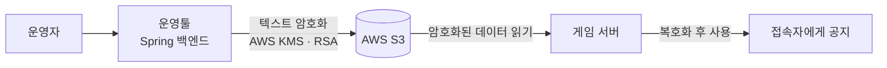

# 운영툴에서 게임 서버로 텍스트를 안전하게 전달하기 — S3와 암호화

게임 운영툴([열혈강호 W 운영툴](/projects/yeolhyeolgangho-admin-tool))을 만들던 시기에 맡았던 기능 하나에 대한 기록이다. 개발 기간은 한 달 정도로 작은 기능이었지만, AWS SDK를 직접 읽으며 암호화를 설계해 본 일이라 배운 게 많았다.

## 배경

운영자가 운영툴에서 인게임 공지 같은 텍스트를 입력하면, 이 텍스트가 게임 서버로 전달되어 접속한 모든 유저에게 보여야 한다. 접속자가 천 명 안팎인 서비스에서 일부가 엉뚱한 공지를 보거나 잘못된 텍스트가 노출되면 안 된다.

## 문제

게임 서버는 매우 민감한 서버다. 게임이 열어 둔 통로를 제외하면 외부에서 접속할 수 있는 방법이 모두 막혀 있다. 그래서 운영툴에서 게임 서버로 데이터를 보내려면 정해진 경로를 거쳐야 했다.

문제는 그 경로에서 데이터가 평문이면 중간에서 가로채(하이재킹) 다른 내용으로 바꿔 보낼 수 있다는 점이었다. 공지처럼 모든 접속자에게 보이는 텍스트가 변조되면 영향이 크다. 그래서 전달하는 데이터를 암호화하기로 했다.

## 구조

운영툴이 텍스트를 암호화해서 S3에 올리고, 게임 서버가 그것을 읽어 복호화해서 사용하는 구조다.

- 암호화에는 AWS KMS와 RSA를 사용했고, 읽는 쪽에서는 대칭키로 복호화했다.
- 운영툴의 Spring 백엔드가 텍스트를 암호화한 뒤 S3에 업로드하는 기능을 개발했다.
- 외부에서 게임 서버로 직접 들어갈 수 없으므로, 중간 저장소인 S3를 거치되 저장된 내용이 평문이 아니게 했다.

## 어떻게 만들었나

AWS가 제공하는 SDK 문서와 예제를 보면서, 암호화와 업로드를 코드에 어떻게 반영할지 먼저 정리하고 설계한 뒤 구현했다.

## 어려웠던 점

개발 경력이 얼마 되지 않았던 때라 SDK 문서를 읽고 코드에 적용하는 것부터 쉽지 않았다. 가장 어려웠던 건 암호화한 데이터를 복호화했을 때 원래 값과 맞지 않는 경우가 있었다는 점이다. 암호화 자체는 성공하는데 읽는 쪽에서 맞지 않으니, 어느 단계에서 어긋나는지 하나씩 확인하며 맞춰 갔다. 이 과정에서 시행착오가 많았다.

## 배운 점

- 암호화는 "암호화가 된다"보다 "복호화해서 원래 값이 나온다"까지 확인해야 끝난다. 양쪽을 같은 기준으로 맞추는 일이 핵심이다.
- 정해진 경로로 보낸다고 해서 평문이 안전한 것은 아니다. 변조되면 영향이 큰 데이터는 경로를 믿지 않고 데이터 자체를 보호해야 한다.
- 외부 서비스의 SDK는 예제만 따라 하지 말고 동작 원리를 이해하고 써야 문제가 생겼을 때 원인을 찾을 수 있다.
